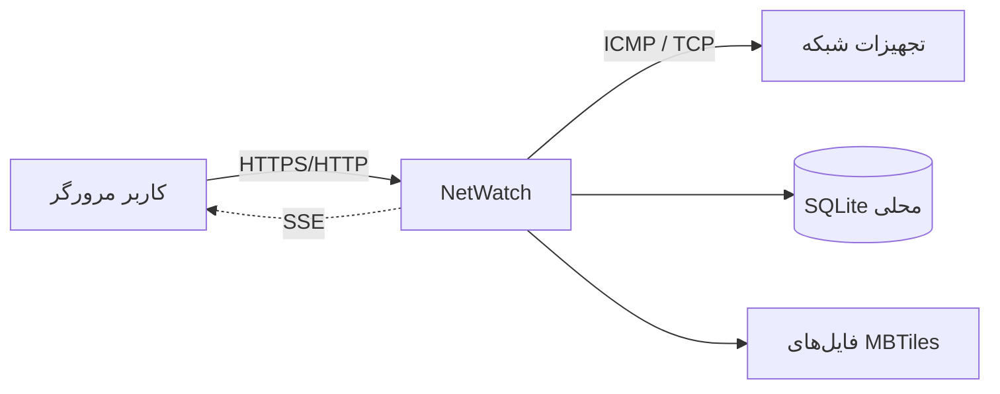

# معرفی NetWatch و قابلیت‌ها

این سند توضیح می‌دهد NetWatch چیست، چه مسئله‌ای را حل می‌کند، چه قابلیت‌هایی
واقعاً در نسخهٔ `1.2.0` دارد و کجا مرزهای آن است. اگر فقط یک سند را می‌خوانید،
همین سند و سپس [نصب](03-installation.md) را بخوانید.

---

## ۱. NetWatch در یک نگاه

**NetWatch** یک سامانهٔ تحت وب و **کاملاً آفلاین** برای پایش تجهیزات شبکه است.
سرور به‌صورت دوره‌ای برای هر تجهیز Ping (ICMP یا TCP) می‌فرستد، نتیجه را ذخیره
می‌کند، وضعیت را از «در دسترس» به «دارای اختلال» یا «قطع» تغییر می‌دهد، قطعی و
هشدار می‌سازد و گزارش‌های تحلیلی ارائه می‌دهد.

ویژگی‌های تعیین‌کننده:

- **بدون اینترنت در زمان بهره‌برداری:** همهٔ داده‌ها و نقشه‌ها محلی‌اند.
- **یک فرآیند، یک فایل داده:** Node.js + SQLite داخلی (`node:sqlite`)، بدون
  سرور دیتابیس جدا.
- **رابط فارسی و RTL:** React + Vite + Tailwind، با تقویم شمسی/میلادی.
- **کنترل دسترسی واقعی:** سه نقش و مجوزهای ریزدانه روی APIها.
- **سند عملیاتی:** قطعی، تعمیرات، هشدار، حسابرسی و پشتیبان نسخه‌دار.

---

## ۲. برای چه کسانی مناسب است؟

| نقش | استفادهٔ اصلی |
| --- | --- |
| **مدیر شبکه / اپراتور** | دیدن وضعیت لحظه‌ای، رسیدگی به هشدار، ثبت تعمیرات، بررسی دستی |
| **مدیر سیستم** | نصب، پیکربندی، TLS، پشتیبان، Retention، کنترل دسترسی و پایش سلامت |
| **توسعه‌دهنده** | توسعهٔ API/رابط، افزودن Migration، آزمون و انتشار |
| **مدیر/بازبین** | گزارش دسترس‌پذیری، خروجی Excel، گزارش حسابرسی |

NetWatch برای **شبکهٔ داخلی یک سازمان** طراحی شده است؛ نه برای ارائهٔ عمومی روی
اینترنت. پیش‌فرض شنود فقط `127.0.0.1` است و برای انتشار در شبکه باید صریحاً
`HOST` و لایهٔ TLS/فایروال تنظیم شود.

---

## ۳. قابلیت‌های موجود

### ۳.۱. پایش و وضعیت

| قابلیت | وضعیت | توضیح |
| --- | --- | --- |
| ICMP Ping با ابزار سیستمی | موجود | حالت `icmp`؛ نیازمند `ping` و در لینوکس `CAP_NET_RAW` |
| TCP Ping | موجود | حالت `tcp` با پورت قابل تنظیم (پیش‌فرض ۸۰) |
| حالت خودکار | موجود | `auto`: ICMP و در صورت نبود مجوز، TCP |
| شبیه‌سازی برای دمو | موجود با محدودیت | فقط با انتخاب صریح `simulate`؛ داده با `mode=simulate` برچسب می‌خورد |
| بازهٔ اختصاصی هر تجهیز | موجود | `ping_interval` تجهیز بر تنظیم عمومی مقدم است |
| آستانهٔ تأخیر/افت اختصاصی | موجود | مقادیر خالی یعنی استفاده از تنظیم عمومی |
| بررسی دستی و زنده | موجود | `POST /api/devices/:id/ping` و `GET /api/devices/:id/probe` |
| نقشهٔ آفلاین و MBTiles | موجود | کاشی‌ها از فایل محلی سرو می‌شوند |
| علامت‌های نقشه | موجود | نوع، نام، مختصات و ورود/خروج Excel |

### ۳.۲. هشدار و عملیات

| قابلیت | وضعیت | توضیح |
| --- | --- | --- |
| هشدار قطعی/تأخیر/افت/بازگشت | موجود | موتور در گذار وضعیت هشدار می‌سازد |
| Cooldown و تأخیر هشدار | موجود | `alert_cooldown`، `alert_delay` و `duration_sec` قاعده |
| بازهٔ سکوت | موجود | `suppression_enabled` و بازهٔ `HH:MM` |
| تأیید/رفع/حذف هشدار | موجود | تکی و گروهی |
| پنجرهٔ تعمیرات | موجود | سراسری یا مخصوص تجهیز؛ وضعیت `maintenance` |
| سابقهٔ تعمیرات | موجود | ثبت دستی علت، اقدام، هزینه، تکنسین و مدت |
| ساخت خودکار سابقهٔ تعمیرات | **وجود ندارد** | موتور فقط قطعی/هشدار/بازگشت می‌سازد؛ سابقهٔ تعمیرات با کاربر ثبت می‌شود |
| اعلان بیرونی (ایمیل/SMS/Webhook) | **وجود ندارد** | فقط Toast در رابط کاربری |

### ۳.۳. گزارش و داده

| قابلیت | وضعیت | توضیح |
| --- | --- | --- |
| داشبورد KPI و روند | موجود | امتیاز سلامت، توزیع وضعیت، روند ۷ روزه |
| گزارش بازه‌ای | موجود | `24h`/`7d`/`30d`/`90d` یا `from`/`to` |
| خروجی CSV/XLSX | موجود | تجهیزات، گزارش، علامت‌ها و مختصات |
| ورود گروهی Excel/CSV | موجود | پیش‌نمایش، اعتبارسنجی و ثبت اتمیک |
| آمار روزانه | موجود | `daily_stats` مبنای گزارش بلندمدت |
| Retention قابل‌تنظیم | موجود | با Dry-Run، توقف و Legal Hold |
| پشتیبان نسخه‌دار | موجود | `manifest.json` + SHA-256 + `integrity_check` |
| بازیابی با تأیید | موجود | Dry-Run، نسخهٔ ایمنی و جای‌گذاری اتمیک |
| رمزنگاری پشتیبان | **وجود ندارد** | پشتیبان باید روی رسانهٔ محافظت‌شده نگه‌داری شود |

### ۳.۴. امنیت و مدیریت

| قابلیت | وضعیت | توضیح |
| --- | --- | --- |
| ورود با نام کاربری/رمز | موجود | کوکی HttpOnly، نشست ۱۲ساعته و Idle ۶۰دقیقه |
| RBAC سه‌نقشی | موجود | `admin`/`operator`/`viewer` |
| مدیریت کاربران | موجود | ساخت، تغییر نقش، غیرفعال‌سازی، بازکردن قفل |
| قفل حساب | موجود | ۵ شکست متوالی، قفل ۱۵دقیقه‌ای |
| CSRF و Same-Origin | موجود | برای همهٔ درخواست‌های تغییردهنده |
| محدودیت شبکهٔ APIهای مدیریتی | موجود (اختیاری) | `NETWATCH_ADMIN_ALLOWED_CIDRS` |
| محدودهٔ مجاز Probe | موجود | پیش‌فرض شبکه‌های خصوصی؛ Link-Local/Metadata مسدود |
| Audit Log | موجود | تغییرات و خواندن‌های حساس |
| MFA/SSO/LDAP | **وجود ندارد** | فقط رمز محلی |
| رمزنگاری داده در سکون | **وجود ندارد** | به فایل‌سیستم/دیسک رمزنگاری‌شدهٔ میزبان تکیه کنید |
| اجرای چندنمونه‌ای افقی | **وجود ندارد** | SQLite محلی و قفل رهبری برای یک نمونه طراحی شده‌اند |

---

## ۴. صفحات رابط کاربری

| مسیر | صفحه | کار اصلی |
| --- | --- | --- |
| `/dashboard` | داشبورد | KPI، وضعیت لحظه‌ای، روند، تجهیزات دارای اختلال |
| `/devices` | تجهیزات | فهرست، فیلتر، CRUD، Import/Export، Ping دستی |
| `/devices/:id` | جزئیات تجهیز | نمودار RTT/افت، قطعی‌ها، نمونه‌ها، تعمیرات |
| `/map` | نقشهٔ شبکه | Markerها، لایه‌های MBTiles، علامت‌ها |
| `/alerts` | هشدارها | فیلتر، تأیید/رفع، قوانین، سکوت |
| `/maintenance` | تعمیرات | سوابق، پنجره‌ها، تحلیل علت/اقدام |
| `/reports` | گزارش‌ها | بازه، دسترس‌پذیری، MTTR، خروجی |
| `/app-health` | سلامت برنامه | CPU/RAM/Event Loop، DB، SSE، صف، پشتیبان |
| `/settings` | تنظیمات | عمومی، موتور، هشدار، Retention، کاربران، Audit |

مسیر `/` به `/dashboard` هدایت می‌شود. مسیر `/health` در SPA به `/app-health`
می‌رود، اما **`/api/health` و `/health` در سرور، Endpointهای JSON پایش هستند** و
نباید با صفحهٔ HTML اشتباه گرفته شوند.

---

## ۵. نسخه و سازگاری

| مورد | مقدار |
| --- | --- |
| نسخهٔ برنامه | `1.2.0` (از `package.json`) |
| ساختار داده | `SCHEMA_VERSION = 5` |
| Node.js | `>= 22.12.0` |
| ارتقا از 1.1.0 | بدون Migration جدید |
| ارتقا از 1.0.0 | Migrationهای ۲ تا ۵ |
| بازیابی پشتیبان قدیمی‌تر | مجاز؛ Migration در اولین راه‌اندازی اجرا می‌شود |
| بازیابی پشتیبان جدیدتر | رد می‌شود (`schemaVersion` بالاتر) |

---

## ۶. محدودیت‌های طراحی

1. **SQLite تک‌نویسنده:** مناسب یک گرهٔ سرور است؛ چند نمونهٔ افقی پشت Load
   Balancer پشتیبانی نمی‌شود.
2. **بدون Agent:** پایش از سمت سرور انجام می‌شود؛ اگر مسیر شبکه/فایروال بسته
   باشد، تجهیز «قطع» دیده می‌شود حتی اگر خودش سالم باشد.
3. **Probe فعال محدود است:** فقط مقاصد CIDR مجاز؛ برای شبکه‌های بزرگ باید
   محدوده را آگاهانه تنظیم کرد.
4. **حافظهٔ نمونه‌های خام:** با بازهٔ کوتاه و تجهیزات زیاد، حجم داده سریع رشد
   می‌کند؛ Retention و بازهٔ پایش را متناسب تنظیم کنید.
5. **پشتیبان همگام:** ساخت/بازیابی پشتیبان روی حلقهٔ رویداد اجرا می‌شود و برای
   فایل‌های بزرگ می‌تواند چند ثانیه سرویس را کند کند.
6. **بدون رمزنگاری داخلی:** امنیت فایل داده و پشتیبان به میزبان و مجوزهای
   فایل‌سیستم وابسته است.
7. **آزمون مرورگر محدود:** CI فقط Chromium را اجرا می‌کند؛ Safari/Firefox
   بازبینی دستی می‌خواهند.

جزئیات کامل محدودیت‌ها و ریسک‌های باقی‌مانده در
[مستند ریسک‌های فاز ۲](../phase2-remaining-risks.md) و
[ریسک‌های فاز ۳](../phase3-remaining-risks.md) آمده است.

---

## ۷. چه چیزی در این نسخه عمداً ساده نگه داشته شده است؟

- **بدون صف پیام یا Redis:** صف کارهای سنگین در حافظه و با Worker Thread است.
- **بدون ORM:** SQL آماده و کنترل‌شده با `node:sqlite`.
- **بدون سرویس ابری:** نقشه، فونت، Excel و همهٔ دارایی‌ها محلی‌اند.
- **بدون حساب چندمستأجری:** یک سازمان، یک پایگاه‌داده.
- **بدون وابستگی بومی برای دیتابیس:** `node:sqlite` بخشی از Node است.

---

## مطالب مرتبط

- [واژه‌نامه](00-glossary.md)
- [معماری](02-architecture.md)
- [نصب و راه‌اندازی](03-installation.md)
- [پیکربندی](04-configuration.md)
- [API](06-api.md)
- [محدودیت‌های امنیتی](08-security.md)
- [موتور پایش](09-engine.md)
