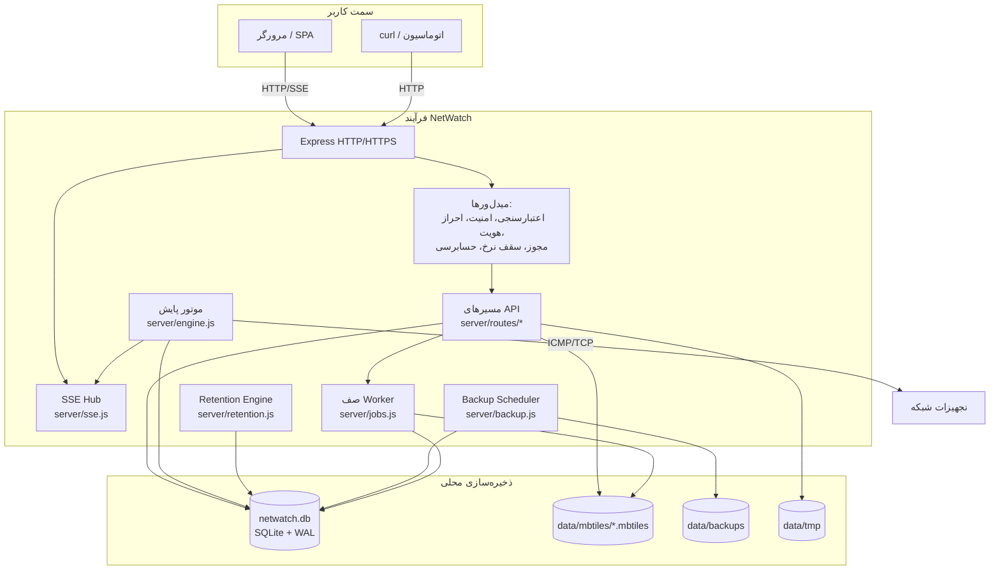
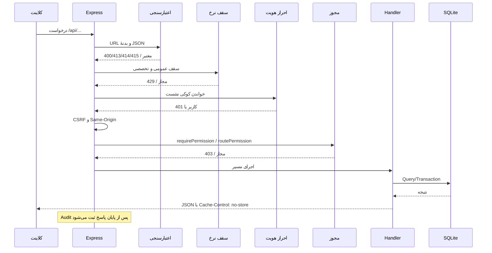
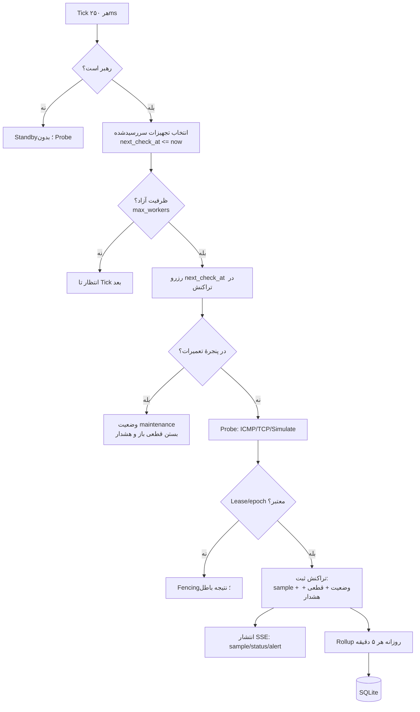
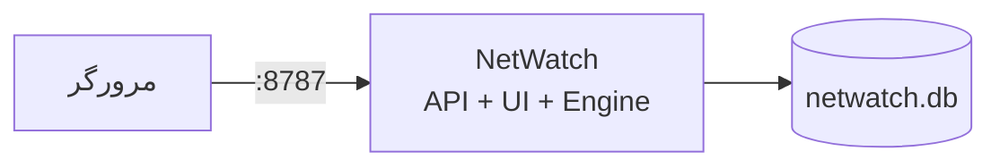
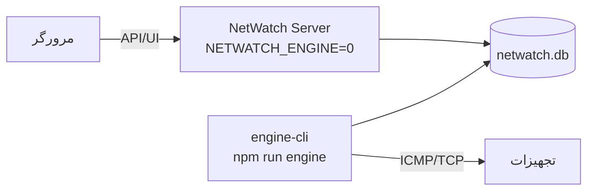
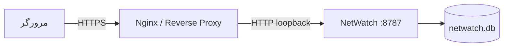
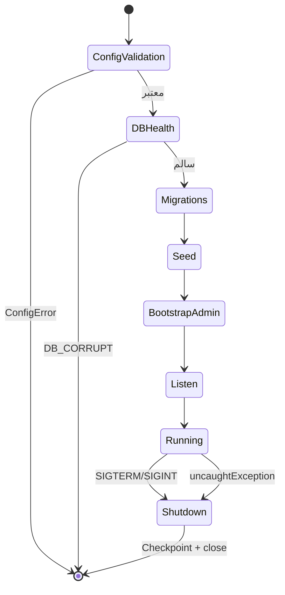

# معماری NetWatch

این سند ساختار داخلی، اجزای اصلی، ترتیب پردازش درخواست، جریان داده و مدل‌های
استقرار را توضیح می‌دهد. هدف این است که توسعه‌دهنده بتواند محل هر رفتار را در کد
پیدا کند و مدیر سیستم بداند چه فرآیندهایی روی سرور اجرا می‌شوند.

---

## ۱. نمای کلی سیستم

NetWatch یک **فرآیند Node.js** است که چهار نقش را هم‌زمان انجام می‌دهد:

1. سرور HTTP/HTTPS و API؛
2. سروکنندهٔ رابط کاربری ساخته‌شده (SPA)؛
3. میزبان کانال زندهٔ SSE؛
4. میزبان موتور پایش (قابل خاموش‌کردن یا انتقال به `engine-cli`).



---

## ۲. اجزای اصلی و مسئولیت‌ها

| جزء | فایل | مسئولیت |
| --- | --- | --- |
| نقطهٔ ورود | `server/index.js` | ساخت اپ Express، ترتیب میدل‌ورها، سلامت، SSE، سرو SPA، خاموشی مرتب |
| پیکربندی | `server/config.js` | خواندن و اعتبارسنجی env، مسیرها، TLS، سقف‌ها، خطای `ConfigError` |
| پایگاه‌داده | `server/db.js` | اتصال `node:sqlite`، PRAGMAها، Schema، Migration، تنظیمات، Seed |
| لایهٔ دسترسی | `server/store.js` | Query و سریال‌سازی تجهیزات، فیلترها، تگ‌ها |
| موتور | `server/engine.js` | زمان‌بندی، Probe، گذار وضعیت، قطعی، هشدار، Rollup، سلامت |
| Ping | `server/ping.js` | ICMP با `ping` سیستمی، TCP، تشخیص دسترسی ICMP |
| قفل رهبری | `server/leader.js` | Lease در `engine_lock`، Fencing Token |
| API تجهیزات | `server/routes/devices.js` | CRUD، Import/Export، نقشه، سری، Probe |
| API داشبورد/گزارش | `server/routes/dashboard.js`, `server/routes/reports.js` | KPI، روند، گزارش و خروجی |
| API عملیات | `server/routes/ops.js` | هشدار، قانون، تعمیرات، رویدادها، موتور، تنظیمات |
| API موجودی/نقشه | `server/routes/inventory.js`, `server/routes/markers.js` | گروه، تگ، لایه، کاشی، علامت |
| API سیستم | `server/routes/system.js` | سلامت DB، Retention، پشتیبان/بازیابی |
| احراز هویت | `server/auth.js` | Login، Session، CSRF، کاربران، قفل حساب |
| مجوزها | `server/permissions.js` | نقش‌ها، مجوزها و میدل‌ورهای گارد |
| امنیت شبکه | `server/net-policy.js`, `server/network-access.js`, `server/probe-guard.js` | CIDR، مقصد Probe، محدودیت API مدیریتی |
| سقف نرخ | `server/rate-limit.js` | سطل‌های IP/حساب، هدرها و آمار |
| حسابرسی | `server/audit.js` | ثبت تغییرات و خواندن‌های حساس |
| SSE | `server/sse.js` | اتصال‌ها، Heartbeat، فیلتر دستگاه، Backpressure |
| کارهای سنگین | `server/jobs.js`, `server/workers/impexp-worker.js` | Excel/CSV/MBTiles در Worker |
| Retention | `server/retention.js` | سیاست، قفل، Dry-Run، حذف Batchی |
| پشتیبان | `server/backup.js` | ساخت، Manifest، Verify، Restore، Scheduler |
| سنجه‌ها | `server/metrics.js` | CPU/RAM/Event Loop/API/Query |
| لاگ | `server/logger.mjs` | JSON یک‌خطی، Redaction، سطح لاگ |
| رابط کاربری | `web/src/**` | SPA، صفحات، کامپوننت‌ها، دریافت داده و SSE |

---

## ۳. ترتیب پردازش یک درخواست API

ترتیب میدل‌ورها در `server/index.js` امنیت و رفتار را تعیین می‌کند:



ترتیب واقعی (از بالا به پایین):

1. `express.json({ limit: '2mb', strict: true })`
2. `validateRequestUrl` و `validateJsonBody` روی `/api`
3. اندازه‌گیری تأخیر API (به‌جز `/api/events`)
4. `sameOriginOnly` برای متدهای تغییردهنده
5. هدرهای امنیتی سراسری
6. لاگ درخواست‌های خطادار/کند
7. سقف نرخ عمومی
8. `attachUser` → `auditMutations` → `requireAuth` → `csrfGuard`
9. گارد شبکهٔ مدیریتی
10. سقف‌های Probe/Import/Admin (پس از احراز هویت)
11. `authRouter` و روترهای دامنه
12. `Cache-Control: no-store` برای API
13. هندلر خطای مرکزی

نکته: `auditMutations` **پیش از** گارد مجوز نصب می‌شود تا درخواست‌های ردشده هم
ثبت شوند.

---

## ۴. جریان دادهٔ موتور پایش



### قواعد کلیدی جریان

- **جدول `devices` خودش صف است:** `next_check_at` زمان سررسید را نگه می‌دارد؛
  صف حافظهٔ نامحدود وجود ندارد.
- **ظرفیت:** در هر Tick حداکثر `max_workers - inflight` بررسی جدید شروع می‌شود.
- **زمان‌بندی:** مبنای `next_check_at` زمان سررسید قبلی است، نه لحظهٔ اجرا؛ پس
  بازهٔ واقعی به‌مرور کوتاه نمی‌شود.
- **اتمی‌بودن:** نتیجهٔ هر بررسی (نمونه، وضعیت، قطعی، هشدار) در یک تراکنش ثبت
  می‌شود؛ شکست میانی همه را برمی‌گرداند.
- **Fencing:** اگر رهبری در میانهٔ Probe عوض شود، نتیجه دور ریخته می‌شود.

---

## ۵. مدل‌های استقرار

### ۵.۱. تک‌فرآیندی (پیش‌فرض)



مناسب نصب‌های کوچک و متوسط؛ ساده‌ترین گزینه و پیش‌فرض مستندات.

### ۵.۲. سرور + موتور مستقل



- سرور با `NETWATCH_ENGINE=0` بالا می‌آید.
- موتور با `npm run engine` (یا `engine-cli --once` در Cron) اجرا می‌شود.
- فقط یکی از این دو در هر لحظه رهبر است؛ دیگری Standby می‌ماند.
- هر دو به **همان** `NETWATCH_DATA_DIR` نیاز دارند.

### ۵.۳. پشت پروکسی معکوس با TLS



- `HOST=127.0.0.1` و `NETWATCH_TRUST_PROXY=loopback`.
- پروکسی باید `X-Forwarded-For`، `X-Forwarded-Proto` و `Host` را بفرستد.
- `proxy_buffering off` برای SSE الزامی است.
- نمونهٔ آماده: `deploy/nginx.conf.example`.

### ۵.۴. TLS مستقیم بدون اینترنت

`npm run tls:setup` یک CA محلی و گواهی سرور می‌سازد؛ سپس:

```bash
NETWATCH_TLS_DIR=data/tls npm start
```

جزئیات در [نصب و راه‌اندازی](03-installation.md) آمده است.

---

## ۶. ساختار پوشه‌ها

```text
server/
  index.js              نقطهٔ ورود و میدل‌ورها
  config.js             پیکربندی مرکزی و اعتبارسنجی
  db.js                 SQLite، Schema، Migration، تنظیمات
  engine.js             موتور پایش
  engine-cli.js         اجرای مستقل موتور
  ping.js               ICMP/TCP
  leader.js             قفل رهبری و Fencing
  store.js              دسترسی دادهٔ تجهیزات
  auth.js               ورود، نشست، CSRF، کاربران
  permissions.js        RBAC
  routes/               مسیرهای API
  scripts/              ابزارهای CLI (DB، Release، TLS، QA)
  tests/                unit / integration / e2e / heavy
  workers/              Worker پردازش فایل
web/
  src/                  React SPA
  tests/                آزمون واحد و Playwright
  dist/                 خروجی Build (تولید)
deploy/
  netwatch.service      واحد systemd سخت‌سازی‌شده
  nginx.conf.example    پروکسی معکوس و TLS
docs/
  fa/                   همین مستندات فارسی
data/                   دادهٔ محلی (در git نیست)
  netwatch.db
  netwatch.db-wal
  netwatch.db-shm
  backups/
  mbtiles/
  tmp/
  tls/
```

---

## ۷. اصول طراحی

1. **آفلاین‌بودن:** هیچ فراخوانی اینترنتی در زمان اجرا وجود ندارد.
2. **منبع واحد پیکربندی:** `server/config.js` همهٔ کلیدهای حیاتی را می‌خواند و
   مقدار نامعتبر را با `ConfigError` متوقف می‌کند.
3. **Fail-fast:** پایگاه‌دادهٔ خراب، TLS ناقص یا CIDR نامعتبر باعث توقف
   راه‌اندازی می‌شود؛ نه ادامهٔ بی‌صدا.
4. **دفاع در عمق:** RBAC + CSRF + Same-Origin + سقف نرخ + محدودیت شبکه +
   Audit + هدرهای امنیتی.
5. **دادهٔ سندمحور:** دوام `synchronous=FULL` و WAL؛ خاموشی مرتب با Checkpoint.
6. **مقیاس‌پذیری عمودی:** بهینه‌سازی Query، ایندکس و Batch؛ بدون ادعای HA.
7. **قابلیت مشاهده:** `/api/status`، `/api/system/health`،
   `/api/system/app-health`، `engine_log` و لاگ JSON.

---

## ۸. چرخهٔ حیات فرآیند



- `SIGTERM`/`SIGINT` باعث تخلیهٔ بررسی‌های در جریان، بستن SSE، توقف زمان‌بندها،
  Checkpoint و بستن DB می‌شود.
- `uncaughtException`/`unhandledRejection` ثبت و سپس خاموشی مرتب با کد ۱.
- `EADDRINUSE` با پیام روشن و کد ۱ پایان می‌یابد.
- `SIGKILL` مسیر خاموشی مرتب را دور می‌زند؛ WAL در راه‌اندازی بعدی بازیابی
  می‌شود، اما برای عملیات عادی استفاده نکنید.

---

## ۹. محدودیت‌های معماری

| محدودیت | اثر | راهکار فعلی |
| --- | --- | --- |
| SQLite تک‌نویسنده | گذردهی نوشتن محدود به یک رشته | Batch، WAL، ایندکس، Worker برای فایل |
| پشتیبان/بازیابی همگام | توقف کوتاه حلقهٔ رویداد | زمان‌بندی در ساعت کم‌بار |
| SSE در حافظه | چند نمونه پشت LB پشتیبانی نمی‌شود | یک نمونه یا Sticky Session |
| نقشهٔ محلی | حجم MBTiles روی دیسک | سقف ۱GB پیش‌فرض برای هر فایل |
| بدون Agent | وابستگی به مسیر شبکهٔ سرور | تنظیم فایروال/مسیر و Probe CIDR |

---

## مطالب مرتبط

- [معرفی](01-introduction.md)
- [پایگاه‌داده](05-database.md)
- [موتور پایش](09-engine.md)
- [امنیت](08-security.md)
- [عملیات](10-operations.md)
- [نصب](03-installation.md)
