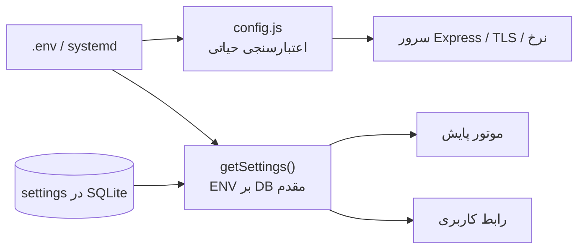

# پیکربندی NetWatch

هدف این سند: شناخت دو لایهٔ تنظیمات (متغیر محیطی و تنظیمات درون‌برنامه‌ای)، مقادیر
پیش‌فرض واقعی و نحوهٔ تغییر امن آن‌ها. پیش از این سند
[نصب](03-installation.md) را انجام دهید.

---

## ۱. دو لایهٔ تنظیمات

| لایه | محل | مناسب برای | اعمال |
| --- | --- | --- | --- |
| محیطی (ENV) | `.env` یا `EnvironmentFile` | پورت، مسیر داده، TLS، امنیت، سقف منابع | با ری‌استارت |
| تنظیمات برنامه | جدول `settings` در SQLite | بازهٔ پایش، آستانه‌ها، Retention، پشتیبان، نقشه | فوری یا چرخهٔ بعدی |

**اولویت:** متغیرهای محیطیِ فهرست‌شده در `ENV_SETTINGS` بر مقدار ذخیره‌شده در
پایگاه‌داده مقدم‌اند. بنابراین اگر `NETWATCH_PING_INTERVAL=60` بدهید و از UI هم
مقدار ۳۰ را ذخیره کنید، مقدار مؤثر ۶۰ می‌ماند. برای برگشت به کنترل UI، متغیر را
حذف و سرویس را ری‌استارت کنید.



### اعتبارسنجی و خطاهای حیاتی

`config.js` پیش از بالا آمدن سرور اجرا می‌شود. خطاهای زیر **راه‌اندازی را متوقف**
می‌کنند (نه فقط هشدار):

- `HOST` نامعتبر؛ `PORT` خارج از ۱..۶۵۵۳۵؛
- CIDR نامعتبر در `NETWATCH_ADMIN_ALLOWED_CIDRS` یا `NETWATCH_PROBE_ALLOWED_CIDRS`؛
- تنظیم ناقص TLS (تنها یکی از CERT/KEY)؛
- `NETWATCH_HEADERS_TIMEOUT_MS >= NETWATCH_REQUEST_TIMEOUT_MS`؛
- `NETWATCH_ENGINE_MODE` خارج از `auto|icmp|tcp|simulate`.

هشدارها (بدون توقف) شامل انتشار روی شبکه بدون TLS، نبود محدودیت CIDR مدیریتی و
خاموش‌بودن HSTS است. این هشدارها در لاگ راه‌اندازی دیده می‌شوند.

---

## ۲. پیکربندی شبکه

| متغیر | پیش‌فرض | بازه/مقادیر | توضیح |
| --- | --- | --- | --- |
| `HOST` | `127.0.0.1` | IP یا نام میزبان | برای دسترسی شبکه `0.0.0.0` |
| `PORT` | `8787` (توسعه: `3000`) | ۱..۶۵۵۳۵ | پورت HTTPS در حالت TLS |
| `NETWATCH_HTTP_PORT` | `0` (خاموش) | ۰..۶۵۵۳۵ | شنوندهٔ HTTP برای ریدایرکت ۳۰۸ به HTTPS |
| `NETWATCH_TRUST_PROXY` | خالی | `loopback`، عدد ۱..۱۰، فهرست IP/CIDR | فقط پشت پروکسی معکوس |
| `NETWATCH_ADMIN_ALLOWED_CIDRS` | خالی (بدون محدودیت) | CIDR جداشده با ویرگول | محدودیت شبکه‌ای APIهای مدیریتی |

نمونهٔ تولیدی پشت Nginx:

```ini
HOST=127.0.0.1
PORT=8787
NETWATCH_TRUST_PROXY=loopback
NETWATCH_ADMIN_ALLOWED_CIDRS=10.10.0.0/16,192.168.20.0/24
```

> `NETWATCH_TRUST_PROXY` را فقط وقتی تنظیم کنید که واقعاً پروکسی دارید. مقدار
> بازِ آن اجازه می‌دهد کلاینت `X-Forwarded-For` جعل کند و سقف نرخ/حسابرسی را
> دور بزند.

---

## ۳. مسیرهای داده

| متغیر | پیش‌فرض | توضیح |
| --- | --- | --- |
| `NETWATCH_DATA_DIR` | `<project>/data` | ریشهٔ دادهٔ پایدار |
| `NETWATCH_DB` | `<DATA_DIR>/netwatch.db` | مسیر فایل SQLite |
| `NETWATCH_BACKUP_DIR` | `<DATA_DIR>/backups` | مقصد پشتیبان‌ها |
| `NETWATCH_SEED_DEMO` | `1` | در نصب واقعی `0` بدهید |

ساختار پیش‌فرض:

```text
data/
├── netwatch.db            # پایگاه‌داده + WAL/SHM
├── initial-admin-password.txt  # فقط تا نخستین ورود مدیر
├── backups/               # پشتیبان‌های زمان‌بندی‌شده
├── mbtiles/               # فایل‌های نقشهٔ آفلاین
└── tls/                   # گواهی‌های محلی (با tls:setup)
```

---

## ۴. HTTPS

| متغیر | پیش‌فرض | توضیح |
| --- | --- | --- |
| `NETWATCH_TLS_DIR` | خالی | پوشهٔ شامل `server.crt` و `server.key` (و `ca.crt`) |
| `NETWATCH_TLS_CERT` | — | مسیر صریح گواهی؛ باید همراه KEY باشد |
| `NETWATCH_TLS_KEY` | — | مسیر صریح کلید |
| `NETWATCH_TLS_CA` | — | زنجیرهٔ میانی (اختیاری) |
| `NETWATCH_HSTS` | `1` | هدر HSTS با `max-age=15552000` |
| `NETWATCH_HTTP_PORT` | `0` | ریدایرکت HTTP→HTTPS |

```bash
NETWATCH_TLS_DIR=data/tls npm start
```

با فعال‌بودن TLS، کوکی نشست `Secure` می‌شود و HSTS ارسال می‌گردد. جزئیات ساخت
گواهی در [نصب §۵](03-installation.md#۵-https-بدون-اینترنت).

---

## ۵. امنیت، ورود و نشست

| متغیر | پیش‌فرض | بازه | اثر |
| --- | --- | --- | --- |
| `NETWATCH_ADMIN_USER` | `admin` | ۳..۳۲ نویسه | فقط نخستین اجرا |
| `NETWATCH_ADMIN_PASSWORD` | تصادفی | سیاست رمز | فقط نخستین اجرا |
| `NETWATCH_PASSWORD_MIN_LENGTH` | `12` | ۸..۱۲۸ | حداقل طول رمز تازه |
| `NETWATCH_PASSWORD_REQUIRE_COMPLEXITY` | `1` | ۰/۱ | سه دسته از چهار دسته یا عبارت ≥۲۰ نویسه |
| `NETWATCH_LOGIN_MAX_FAILURES` | `5` | ۳..۱۰۰ | شکست پیوسته تا قفل |
| `NETWATCH_LOGIN_LOCKOUT_MINUTES` | `15` | ۱..۱۴۴۰ | مدت قفل حساب |
| `NETWATCH_SESSION_HOURS` | `12` | ۱..۷۲۰ | عمر مطلق نشست |
| `NETWATCH_SESSION_IDLE_MINUTES` | `60` | ۱..۷۲۰ | بی‌فعالیتی تا انقضا |

- قفل حساب در پایگاه‌داده ذخیره می‌شود و با ری‌استارت پاک نمی‌شود.
- اگر Idle Timeout از عمر مطلق بیشتر باشد، به عمر مطلق محدود و هشدار داده
  می‌شود.
- سیاست رمز بر **رمز جدید** اعمال می‌شود؛ رمز ضعیف موجود تا تغییر بعدی معتبر
  می‌ماند.

### سقف نرخ

| متغیر | پیش‌فرض | دامنه | کاربرد |
| --- | --- | --- | --- |
| `NETWATCH_RATE_LIMIT_WINDOW_MS` | `60000` | ۱ثانیه..۱ساعت | پنجرهٔ همهٔ محدودکننده‌ها |
| `NETWATCH_RATE_LIMIT_MAX` | `600` | ≥۱ | کل API بر IP |
| `NETWATCH_EXPENSIVE_RATE_LIMIT_MAX` | `60` | ≥۱ | مسیرهای سنگین (گزارش/خروجی) |
| `NETWATCH_LOGIN_RATE_LIMIT_MAX` | `10` | ≥۱ | ورود بر IP و نام کاربری |
| `NETWATCH_ADMIN_RATE_LIMIT_MAX` | `120` | ≥۱ | APIهای مدیریتی |
| `NETWATCH_IMPORT_RATE_LIMIT_MAX` | `20` | ≥۱ | آپلود/ورود گروهی |
| `NETWATCH_PROBE_RATE_LIMIT_MAX` | `60` | ≥۱ | Probe/اسکن |
| `NETWATCH_RATE_LIMIT_MAX_KEYS` | `10000` | ۱۰۰..۱میلیون | سقف کلید حافظه |

> محدودکننده‌ها درون‌حافظه‌ای‌اند و بین چند نمونهٔ هم‌زمان مشترک نیستند.
> سقف تعداد کلید از رشد بی‌مرز حافظه جلوگیری می‌کند.

### مهلت‌های HTTP

| متغیر | پیش‌فرض | بازه |
| --- | --- | --- |
| `NETWATCH_REQUEST_TIMEOUT_MS` | `120000` | ۵ثانیه..۱۰دقیقه |
| `NETWATCH_HEADERS_TIMEOUT_MS` | `30000` | ۱..۱۲۰ثانیه |
| `NETWATCH_KEEPALIVE_TIMEOUT_MS` | `5000` | ۰٫۵..۱۲۰ثانیه |

---

## ۶. سقف منابع و آپلود

| متغیر | پیش‌فرض | بازه | توضیح |
| --- | --- | --- | --- |
| `NETWATCH_MAX_IMPORT_BYTES` | `10485760` (۱۰MiB) | ۶۴KiB..۱۰۰MiB | سقف فایل CSV/XLSX |
| `NETWATCH_MAX_IMPORT_ROWS` | `50000` | — | سقف ردیف ورود گروهی |
| `NETWATCH_MAX_XLSX_UNCOMPRESSED_BYTES` | `67108864` (۶۴MiB) | ۱MiB..۵۱۲MiB | ضد ZIP Bomb |
| `NETWATCH_MAX_XLSX_ENTRIES` | `5000` | ۱۰..۱۰۰۰۰۰ | سقف اعضای آرشیو |
| `NETWATCH_MAX_XLSX_RATIO` | `200` | ۱۰..۱۰۰۰۰ | نسبت فشرده‌سازی مجاز |
| `NETWATCH_JOB_CONCURRENCY` | `2` | ۱..۸ | Worker هم‌زمان Excel/MBTiles |
| `NETWATCH_JOB_QUEUE_MAX` | `24` | ۱..۵۰۰ | صف؛ سرریز = ۵۰۳ |
| `NETWATCH_JOB_TIMEOUT_MS` | `180000` | ۵ثانیه..۱۰دقیقه | مهلت هر Job |
| `NETWATCH_MAP_MAX` | `25000` | ۱۰۰۰..۵۰۰۰۰ | حداکثر Marker در پاسخ نقشه |
| `NETWATCH_SSE_MAX` | `200` | ≥۱ | حداکثر اتصال زندهٔ هم‌زمان |
| `NETWATCH_SSE_MAX_BUFFER` | `1048576` | ≥۱۰۲۴ | بافر هر اتصال |
| `NETWATCH_SSE_HEARTBEAT_MS` | `25000` | ≥۱۰۰۰ | فاصلهٔ ضربان |

> **تناقض شناخته‌شده:** `config.js` برای `NETWATCH_SSE_MAX` پیش‌فرض ۳۲ و
> اعتبارسنجی دارد، اما `createSseHub()` بدون آرگومان ساخته می‌شود و مقدار مؤثر
> را مستقیم از `process.env.NETWATCH_SSE_MAX || 200` می‌خواند. مقدار مؤثر همان
> **۲۰۰** است؛ `NETWATCH_SSE_MAX=32` دستی کار می‌کند. جزئیات در
> [Changelog](17-changelog.md).

### ۶.۱. لاگ و کلیدهای کنترلی

| متغیر | پیش‌فرض | مقدار مجاز | توضیح |
| --- | --- | --- | --- |
| `NETWATCH_LOG_LEVEL` | `info` | `debug`/`info`/`warn`/`error` | حداقل سطح ثبت در `server/logger.mjs` |
| `NETWATCH_LOG_STREAM` | (خالی) | `stderr` | همهٔ لاگ‌ها به stderr می‌روند (مناسب Cron/JSON) |
| `NETWATCH_ALLOW_RESET` | (خاموش) | `1` | اجازهٔ بازنشانی دادهٔ نمایشی از API؛ پیش‌فرض **غیرفعال** |

`POST /api/settings/reset-demo` بدون `NETWATCH_ALLOW_RESET=1` با `403` رد
می‌شود. معادل خط فرمان (`npm run seed:reset`) این محدودیت را ندارد و باید
آگاهانه اجرا شود.

---

## ۷. موتور پایش

| متغیر | معادل در settings | پیش‌فرض | بازه |
| --- | --- | --- | --- |
| `NETWATCH_ENGINE` | — | `1` (روشن) | `0` = خاموش در همین فرآیند |
| `NETWATCH_ENGINE_MODE` | `engine_mode` | `auto` | `auto/icmp/tcp/simulate` |
| `NETWATCH_PING_INTERVAL` | `ping_interval` | `30` ثانیه | ۵..۸۶۴۰۰ |
| `NETWATCH_TIMEOUT_MS` | `timeout_ms` | `1200` | ۱۰۰..۳۰۰۰۰ |
| `NETWATCH_RETRIES` | `retries` | `1` | ۰..۵ |
| `NETWATCH_PACKET_COUNT` | `packet_count` | `3` | ۱..۱۰ |
| `NETWATCH_MAX_WORKERS` | `max_workers` | `128` | ۱..۵۱۲ |
| `NETWATCH_TCP_PORT` | `tcp_port` | `80` | ۱..۶۵۵۳۵ |
| `NETWATCH_RETENTION_DAYS` | `retention_days` | `90` | ۱..۳۶۵۰ |
| `NETWATCH_ENGINE_LOCK_TTL_MS` | — | `15000` | ۱ثانیه..۱۰دقیقه |
| `NETWATCH_LOCK_RETRY_MS` | — | `2000` | ۰٫۱..۶۰ثانیه |
| `NETWATCH_SHUTDOWN_TIMEOUT_MS` | — | `5000` | ۰٫۱..۱۲۰ثانیه |
| `NETWATCH_STOP_DRAIN_MS` | — | `0` | ۰..۱۲۰ثانیه |

نکته‌ها:

- `auto` ابتدا ICMP را امتحان می‌کند و در صورت نبود مجوز به TCP می‌رود؛
  شبیه‌سازی هرگز خودکار انتخاب نمی‌شود.
- مقدار نامعتبر عددی در این متغیرها باعث **خطای راه‌اندازی نمی‌شود**؛ فقط در
  لاگ رد می‌شود و مقدار پایگاه‌داده می‌ماند. `NETWATCH_ENGINE_MODE` استثناست و
  در `config.js` خطای حیاتی می‌دهد.
- `NETWATCH_STOP_DRAIN_MS=0` یعنی توقف عادی فوری است و عملیات نیمه‌کاره
  باطل می‌شوند؛ برای خاموشی بدون از دست رفتن نتیجه، مقدار مثبت بدهید.

### محدودهٔ Probe

| متغیر | پیش‌فرض | توضیح |
| --- | --- | --- |
| `NETWATCH_PROBE_ALLOWED_CIDRS` | شبکه‌های خصوصی + loopback | فهرست CIDR مجاز |
| `NETWATCH_PROBE_ALLOW_LINK_LOCAL` | `0` | اجازهٔ 169.254/16 و fe80::/10 |
| `NETWATCH_PROBE_ALLOW_METADATA` | `0` | اجازهٔ 169.254.169.254 (خطرناک) |
| `NETWATCH_PROBE_ALLOW_TRANSITION` | `0` | اجازهٔ 6to4/Teredo |

---

## ۸. تنظیمات درون‌برنامه‌ای مهم

این مقادیر در **تنظیمات ← عمومی/پایش/نگهداری/پشتیبان** یا با
`PATCH /api/settings` تغییر می‌کنند. منبع: `DEFAULT_SETTINGS` در `server/db.js`.

### پایش و هشدار

| کلید | پیش‌فرض | بازه | معنا |
| --- | --- | --- | --- |
| `site_name` | `مرکز پایش شبکه` | ≤۸۰ نویسه | نام نمایشی |
| `engine_enabled` | `true` | bool | اجرای موتور |
| `engine_mode` | `auto` | enum | روش بررسی |
| `ping_interval` | `30` | ۵..۸۶۴۰۰ | ثانیه بین دو بررسی |
| `timeout_ms` | `1200` | ۱۰۰..۳۰۰۰۰ | مهلت هر تلاش |
| `retries` | `1` | ۰..۵ | تلاش مجدد |
| `packet_count` | `3` | ۱..۱۰ | بسته در هر بررسی |
| `max_workers` | `128` | ۱..۵۱۲ | هم‌زمانی |
| `latency_threshold` | `150` | ۰..۶۰۰۰۰ | آستانهٔ هشدار تأخیر (ms) |
| `loss_threshold` | `10` | ۰..۱۰۰ | آستانهٔ افت بسته (٪) |
| `failures_for_offline` | `3` | ۱..۵۰ | شکست متوالی تا Offline |
| `successes_for_online` | `2` | ۱..۵۰ | موفقیت متوالی تا Online |
| `alerting_enabled` | `true` | bool | تولید هشدار |
| `alert_cooldown` | `600` | ۰..۶۰۴۸۰۰ | فاصلهٔ ضدتکرار (ثانیه) |
| `alert_delay` | `0` | ۰..۸۶۴۰۰ | تأخیر پیش از هشدار |
| `suppression_enabled` | `false` | bool | پنجرهٔ سکوت |
| `suppression_start` / `suppression_end` | `23:00` / `06:00` | `HH:MM` | بازهٔ سکوت |
| `notify_browser` | `true` | bool | اعلان مرورگر |
| `tcp_port` | `80` | ۱..۶۵۵۳۵ | پورت TCP پیش‌فرض |
| `chart_default_range` | `1h` | `15m..90d` | بازهٔ پیش‌فرض نمودار |
| `calendar` | `jalali` | `jalali/gregorian` | تقویم نمایش |
| `timezone_offset_minutes` | `210` | -۷۲۰..۸۴۰ | اختلاف با UTC |

### نقشه و چیدمان

| کلید | پیش‌فرض | توضیح |
| --- | --- | --- |
| `map_default_center` | `[35.6892, 51.389]` | مرکز تهران |
| `map_default_zoom` | `6` | ۰..۲۲ |
| `map_show_labels` | `true` | برچسب Markerها |
| `device_detail_widgets` | `[]` | چیدمان ویجت‌های جزئیات |
| `dashboard_widgets` | `[]` | چیدمان داشبورد (حداکثر ۴۰) |
| `probe_allowed_cidrs` | خصوصی‌ها | محدودهٔ اسکن |

### نگهداری داده و پشتیبان

| کلید | پیش‌فرض | بازه | توضیح |
| --- | --- | --- | --- |
| `retention_enabled` | `true` | bool | اجرای خودکار سیاست |
| `retention_run_time` | `03:00` | `HH:MM` | زمان روزانه |
| `retention_interval_minutes` | `1440` | ۱۵..۱۰۰۸۰ | حداقل فاصله |
| `retention_batch_size` | `5000` | ۱۰۰..۵۰۰۰۰ | رکورد در هر تراکنش |
| `retention_max_rows_per_run` | `100000` | ۱۰۰۰..۵M | سقف هر اجرا |
| `samples_retention_days` | `90` | ۱..۳۶۵۰ | نمونه‌های خام |
| `daily_stats_retention_days` | `365` | ۳۶۵..۳۶۵۰۰ | آمار روزانه |
| `outages_retention_days` | `365` | ۳۶۵..۳۶۵۰۰ | قطعی‌ها |
| `alerts_retention_days` | `180` | ۳۰..۳۶۵۰ | هشدارها |
| `engine_log_retention_days` | `30` | ۷..۳۶۵۰ | لاگ موتور |
| `audit_retention_days` | `365` | ۳۶۵..۳۶۵۰۰ | حسابرسی |
| `retention_legal_hold` | `false` | bool | توقف کل حذف |
| `retention_prune_backups` | `false` | bool | حذف پشتیبان در Retention |
| `backup_enabled` | `true` | bool | پشتیبان خودکار |
| `backup_interval_hours` | `24` | ۱..۱۶۸ | فاصلهٔ پشتیبان |
| `backup_daily_keep` | `7` | ۱..۶۰ | نسخهٔ روزانه |
| `backup_weekly_keep` | `4` | ۰..۵۲ | نسخهٔ هفتگی |
| `backup_prune_enabled` | `true` | bool | هرس خودکار |
| `checkpoint_interval_minutes` | `15` | ۱..۱۴۴۰ | checkpoint WAL |
| `retention_days` | `90` | ۱..۳۶۵۰ | کلید قدیمی سازگاری |

> `retention_days` فقط برای سازگاری نگه داشته شده است؛ سیاست رسمی با
> `samples_retention_days` و کلیدهای مشابه اداره می‌شود. برای جزئیات به
> [نگهداری داده](12-retention.md) بروید.

---

## ۹. اولویت، اعتبارسنجی و اعمال

### ترتیب مؤثر

1. مقدار پیش‌فرض `DEFAULT_SETTINGS`؛
2. مقدار ذخیره‌شده در جدول `settings`؛
3. متغیرهای `ENV_SETTINGS` (پایان بخش ۷) که بر هر دو مقدم‌اند.

### چه چیزی فوری اعمال می‌شود؟

| تغییر | اعمال |
| --- | --- |
| بازه/آستانه/حالت موتور | چرخهٔ بعدی موتور؛ نیازی به ری‌استارت نیست |
| Retention و پشتیبان | زمان‌بند درون‌برنامه‌ای |
| پورت، HOST، TLS، مسیر داده | **ری‌استارت** |
| رمز/نشست/CIDR مدیریتی | ری‌استارت برای ENV؛ تغییر رمز از UI فوری |
| سقف نرخ | ری‌استارت (در ساخت محدودکننده خوانده می‌شود) |
| `NETWATCH_JOB_*`، `NETWATCH_MAP_MAX` | ری‌استارت |

### نمونهٔ اعتبارسنجی

```bash
# مقدار نامعتبر باید با پیام دقیق و کد خروج غیرصفر متوقف شود
HOST='بدون فاصله' npm start
# ConfigError: پیکربندی نامعتبر است ...

echo $?    # غیرصفر
```

```bash
# بررسی پیکربندی بدون بالا آمدن کامل (اگر اسکریپت مستقل ندارید)
node -e "import('./server/config.js').then(m=>console.log(JSON.stringify(m.configSummary(m.config),null,2)))"
```

> خروجی `configSummary` فقط مقادیر غیرحساس را نشان می‌دهد؛ رمز و کلید در آن
> وجود ندارد.

### الگوی فایل محیطی

```ini
# /etc/netwatch/netwatch.env  (chmod 600)
HOST=127.0.0.1
PORT=8787
NETWATCH_DATA_DIR=/var/lib/netwatch
NETWATCH_SEED_DEMO=0
NETWATCH_TRUST_PROXY=loopback
NETWATCH_ADMIN_ALLOWED_CIDRS=10.10.0.0/16
NETWATCH_ENGINE_MODE=auto
NETWATCH_PING_INTERVAL=30
NETWATCH_MAX_WORKERS=128
```

پس از هر تغییر:

```bash
sudo systemctl restart netwatch
sudo systemctl status netwatch --no-pager
journalctl -u netwatch -n 40 --no-pager
```

---

## ۱۰. مطالب مرتبط

- [نصب](03-installation.md)
- [معماری و جریان داده](02-architecture.md)
- [امنیت](08-security.md)
- [موتور پایش](09-engine.md)
- [نگهداری داده](12-retention.md)
- [پشتیبان‌گیری](11-backup-restore.md)
- [Changelog و تناقض‌ها](17-changelog.md)
