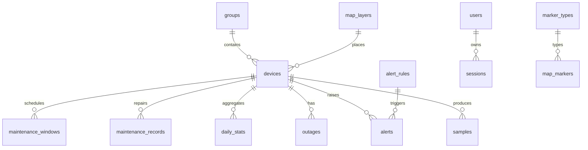

# پایگاه‌داده و مدل داده

این سند ساختار داده، Migrationها، یکپارچگی و کارایی پایگاه‌داده را توضیح می‌دهد.
NetWatch از **SQLite داخلی Node.js** (`node:sqlite`) روی یک فایل محلی استفاده
می‌کند؛ هیچ سرور دیتابیس یا اتصال شبکه‌ای لازم نیست.

| مورد | مقدار واقعی |
| --- | --- |
| فایل پیش‌فرض | `<NETWATCH_DATA_DIR>/netwatch.db` → `data/netwatch.db` |
| نسخهٔ ساختار | `SCHEMA_VERSION = 5` در `server/db.js` |
| Journal | `WAL` |
| `synchronous` | `FULL` (قابل تغییر با `NETWATCH_SQLITE_SYNC`) |
| `foreign_keys` | `ON` |
| `busy_timeout` | `NETWATCH_BUSY_TIMEOUT_MS` (پیش‌فرض `5000`) |
| تعداد جدول | **۲۵** جدول پایه |
| Migration | `schema_migrations` + `PRAGMA user_version` |
| زمان | epoch میلی‌ثانیه، UTC |

---

## ۱. اصول طراحی

- **یک فایل + WAL**: پشتیبان‌گیری و بازیابی ساده است، اما کپیٔ فایل در حال
  اجرا بدون `db:backup` می‌تواند ناسازگار باشد.
- **کلید خارجی فعال**: رکورد یتیم ساخته نمی‌شود؛ حذف گروه/تجهیز با
  `ON DELETE CASCADE` یا `SET NULL` سیاست مشخص دارد.
- **زمان عددی UTC**: مقایسه و مرتب‌سازی مستقل از منطقهٔ زمانی است. «روز»
  تجمیعی با `timezone_offset_minutes` به نیمه‌شب محلی تبدیل می‌شود.
- **بولی به‌صورت `0/1`**: SQLite نوع BOOLEAN ندارد.
- **Migration تراکنشی**: هر گام اتمیک است و پیش از آن پشتیبان فایلی ساخته
  می‌شود.

---

## ۲. جدول‌ها

### تجهیزات و پایش

| جدول | نقش | نکته |
| --- | --- | --- |
| `devices` | تجهیز و آخرین وضعیت | `next_check_at` صف بررسی؛ ایندکس `idx_devices_due` |
| `samples` | نتیجهٔ هر Probe | یکتایی `(device_id, started_at)`؛ ایندکس `(device_id, ts)` |
| `outages` | بازهٔ قطعی | `open`, `started_at`, `ended_at`, `duration_sec` |
| `alerts` | هشدار | وضعیت `active/acknowledged/resolved/suppressed` |
| `alert_rules` | قانون هشدار | `metric`, `threshold`, `duration_sec`, `cooldown_sec` |
| `daily_stats` | تجمیع روزانه | مبنای گزارش بلندمدت پس از هرس نمونه‌ها |
| `maintenance_records` | سوابق تعمیر | متصل به تجهیز و در صورت وجود `outage_id` |
| `maintenance_windows` | پنجرهٔ تعمیر برنامه‌ریزی‌شده | سرکوب هشدار در بازه |

### سازمان‌دهی، نقشه و عملیات

| جدول | نقش |
| --- | --- |
| `groups` | گروه‌بندی تجهیزات |
| `tags`, `device_tags` | برچسب چندبه‌چند |
| `map_layers`, `map_markers`, `marker_types` | لایه‌ها و نشانگرهای نقشه |
| `settings` | تنظیمات کلید/مقدار JSON |
| `audit_log` | حسابرسی تغییرات و رویدادهای امنیتی |
| `engine_log` | لاگ موتور پایش |

### زیرساخت اجرا

| جدول | نقش |
| --- | --- |
| `users`, `sessions` | حساب‌ها و نشست‌ها (فقط هش توکن) |
| `engine_lock`, `engine_meta` | رهبری موتور و Fencing Token (`epoch`) |
| `retention_runs`, `retention_state` | تاریخچه و قفل اجرای Retention |
| `runtime_state` | وضعیت کوچک زمان اجرا |
| `schema_migrations` | تاریخچهٔ Migration |

فایل‌های MBTiles **بیرون** از پایگاه‌داده و در `<DATA_DIR>/mbtiles` نگه داشته
می‌شوند.

---

## ۳. روابط اصلی



---

## ۴. Migrationها

| نسخه | نام | محتوا |
| --- | --- | --- |
| ۱ | `baseline` | ساختار پایه |
| ۲ | `resilience` | `next_check_at`، زمان‌بندی نمونه، `engine_lock.epoch`، `engine_meta` |
| ۳ | `retention-policy` | `retention_runs`، `retention_state`، `runtime_state` |
| ۴ | `auth-security` | قفل حساب و زمان تغییر رمز، ایندکس نشست |
| ۵ | `performance-indexes` | ایندکس‌های هشدار، قطعی و آمار روزانه |

قواعد:

1. هر گام داخل تراکنش اجرا می‌شود و `user_version` و `schema_migrations` را در
   همان تراکنش می‌نویسد.
2. گام‌ها idempotent‌اند؛ اجرای دوباره روی ساختار کامل بی‌خطر است.
3. پیش از مهاجرت یک پایگاه‌دادهٔ موجود، فایل
   `netwatch.db.pre-migration-v<old>-<timestamp>` ساخته می‌شود. اگر پشتیبان
   ساخته نشود، مهاجرت انجام نمی‌شود.
4. شکست گام ⇒ Rollback و توقف با `MIGRATION_FAILED`.

### افزودن Migration

1. `SCHEMA_VERSION` را یک واحد بالا ببرید.
2. گام را idempotent بنویسید (`hasColumn`/`IF NOT EXISTS`).
3. گام را به `MIGRATIONS` اضافه کنید.
4. `server/tests/unit/db-migration.test.mjs` و
   `server/tests/integration/upgrade-and-install.test.mjs` را اجرا کنید.

جزئیات ستون‌به‌ستون در [docs/database-schema.md](../database-schema.md) است، اما
توجه کنید که آن سند نسخهٔ Schema را **۳** اعلام می‌کند و نسبت به کد فعلی (۵)
قدیمی است.

---

## ۵. یکپارچگی و بازیابی

```bash
npm run db:doctor              # بررسی کامل
npm run db:doctor -- --json    # گزارش ماشین‌خوان
NETWATCH_DB_CHECK=quick|full|warn|off npm start
```

| حالت | رفتار |
| --- | --- |
| `quick` (پیش‌فرض) | `PRAGMA quick_check`؛ خطا ⇒ توقف راه‌اندازی |
| `full` | `integrity_check` کامل (کندتر) |
| `warn` | فقط هشدار؛ برای بازیابی روی همان سرور |
| `off` | بدون بررسی (توصیه نمی‌شود) |

`db:doctor` این موارد را بررسی می‌کند:

- `quick_check`/`integrity_check`؛
- نقض کلید خارجی (`foreign_key_check`)؛
- وجود جدول‌های الزامی و ایندکس‌ها؛
- نسخهٔ Schema و Journal Mode؛
- پلن پرس‌وجوهای کلیدی (در صورت پشتیبانی).

خرابی هرگز بی‌صدا نادیده گرفته نمی‌شود؛ سرویس بالا نمی‌آید و پیام بازیابی از
پشتیبان ثبت می‌شود.

---

## ۶. کارایی

- `ANALYZE` و `PRAGMA optimize` دوره‌ای اجرا می‌شوند.
- گزارش‌های بلندمدت از `daily_stats` خوانده می‌شوند؛ لبه‌های ناقص از `samples`
  پر می‌شوند.
- حذف نمونه‌ها Batch‌ای است تا قفل نوشتن طولانی نشود.
- برای تعداد زیاد تجهیز، `max_workers × ping_interval` را متناسب کنید؛ شاخص
  `backlog` در `/api/engine/status` هشدار می‌دهد.
- ایندکس‌های نسخهٔ ۵ برای فیلترهای پرتکرار هشدار/قطعی/آمار اضافه شده‌اند.

---

## ۷. بایدها و نبایدها

| کار | درست | نادرست |
| --- | --- | --- |
| پشتیبان | `npm run db:backup` | کپی `netwatch.db` در حال نوشتن |
| بازیابی | `npm run db:restore` و توقف سرویس | جایگزینی فایل زیر سرویس روشن |
| پاک‌سازی | Retention با Preview | `DELETE` دستی روی جدول‌ها |
| تغییر ساختار | Migration نسخه‌بندی‌شده | `ALTER TABLE` دستی |
| فایل WAL | مدیریت توسط SQLite | حذف `-wal`/`-shm` برای رفع خطا |

---

## ۸. مطالب مرتبط

- [پشتیبان‌گیری و بازیابی](11-backup-restore.md)
- [نگهداری داده](12-retention.md)
- [API](06-api.md)
- [عیب‌یابی](13-troubleshooting.md)
- [ارتقا](15-upgrade-release.md)
