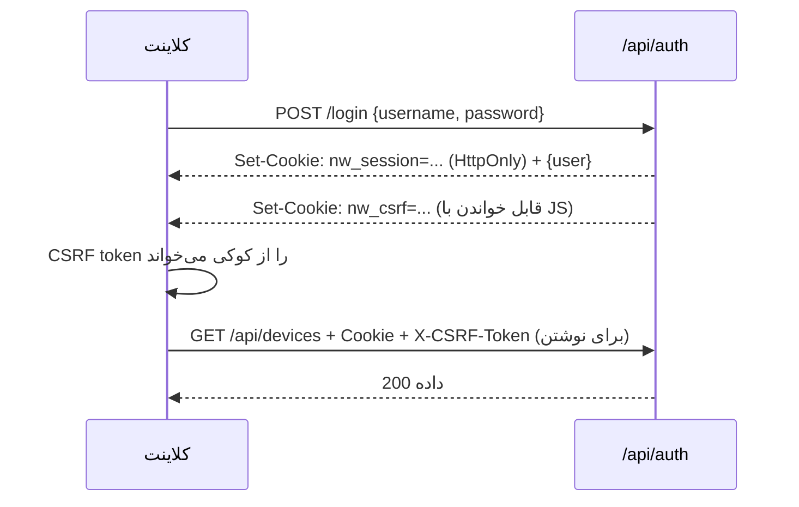

# API NetWatch

این سند قرارداد کامل HTTP API نسخهٔ **۱.۲.۰** را توضیح می‌دهد: احراز هویت، قالب
خطا، مجوز هر مسیر، پارامترها و نمونهٔ پاسخ. هدف این است که یک توسعه‌دهنده بتواند
بدون خواندن کد، کلاینت یا اسکریپت اتوماسیون بسازد.

> این سند از روی کد `server/index.js`، `server/auth.js` و `server/routes/*.js`
> استخراج شده است. مسیرهایی که در کد وجود ندارند در این سند هم نیستند.

---

## ۱. مفاهیم پایه

| مورد | مقدار |
| --- | --- |
| پیشوند مسیرها | `/api` |
| قالب بدنه | JSON (`Content-Type: application/json`)، سقف `2mb` |
| زمان‌ها | epoch milliseconds (عدد) |
| احراز هویت | کوکی نشست HttpOnly + هدر `X-CSRF-Token` برای درخواست‌های تغییردهنده |
| قالب خطا | `{ "error": "پیام فارسی" }` (و در برخی مسیرها فیلدهای کمکی) |
| نسخه‌بندی مسیر | ندارد؛ نسخهٔ برنامه در `package.json` تعیین می‌شود |

### جریان احراز هویت



توکن CSRF فقط برای متدهای تغییردهنده (`POST/PUT/PATCH/DELETE`) لازم است؛ درخواست
`GET` تنها به کوکی نشست نیاز دارد.

---

## ۲. نقش‌ها و مجوزها

سه نقش وجود دارد (`server/permissions.js`). نام‌های `administrator`،
`Administrator` و `admin` همه به نقش `admin` نرمال می‌شوند.

| مجوز | admin | operator | viewer |
| --- | :---: | :---: | :---: |
| `dashboard:read`, `devices:read`, `reports:read` | ✅ | ✅ | ✅ |
| `alerts:read`, `maintenance:read`, `inventory:read` | ✅ | ✅ | ✅ |
| `markers:read`, `settings:read`, `engine:read`, `ops:read` | ✅ | ✅ | ✅ |
| `devices:write`, `alerts:write`, `maintenance:write` | ✅ | ✅ | ❌ |
| `inventory:write`, `markers:write`, `ops:write` | ✅ | ✅ | ❌ |
| `engine:control`, `probe:run`, `system:health` | ✅ | ✅ | ❌ |
| `settings:write`, `users:manage`, `audit:read`, `demo:reset` | ✅ | ❌ | ❌ |

مجوزهای واقعی هر کاربر در پاسخ `GET /api/auth/me` در فیلد `user.permissions`
برگردانده می‌شود؛ کلاینت باید همان را مبنا بگیرد، نه حدس از نام نقش.

---

## ۳. قالب خطا و کدهای وضعیت

| کد | معنی در NetWatch | نمونه پیام |
| --- | --- | --- |
| `400` | ورودی نامعتبر (اعتبارسنجی سرور) | «نام کاربری و رمز عبور الزامی است.» |
| `401` | نشست معتبر نیست | «نشست معتبری وجود ندارد.» |
| `403` | مجوز کافی نیست / Origin غیرمجاز / محدودیت شبکهٔ مدیر | «این عملیات فقط برای Administrator مجاز است.» |
| `404` | مسیر یا رکورد یافت نشد | «مسیر یافت نشد» |
| `409` | تعارض (مثلاً نام تکراری) | پیام وابسته به منبع |
| `413` | بدنهٔ بزرگ‌تر از سقف | خطای Express |
| `429` | سقف نرخ درخواست | پیام سقف نرخ |
| `503` | پایگاه‌داده/سرویس ناسالم | «فایل پایگاه‌داده آسیب دیده است…» |

**نمونهٔ پاسخ خطا:**

```json
{ "error": "برای این عملیات مجوز ندارید." }
```

> نکته: پیام‌های خطا فارسی و برای انسان هستند؛ برای منطق برنامه از کد وضعیت
> استفاده کنید، نه از متن پیام.

---

## ۴. احراز هویت و کاربران

| متد | مسیر | مجوز | کار |
| --- | --- | --- | --- |
| POST | `/api/auth/login` | عمومی (با محدودیت نرخ) | ورود و ساخت نشست |
| POST | `/api/auth/logout` | نشست | بستن نشست جاری |
| POST | `/api/auth/logout-all` | نشست | باطل‌کردن همهٔ نشست‌های کاربر |
| GET | `/api/auth/me` | نشست | کاربر جاری + مجوزها |
| GET | `/api/auth/users` | `users:manage` | فهرست کاربران |
| POST | `/api/auth/users` | `users:manage` | ساخت کاربر |
| PUT | `/api/auth/users/:id` | `users:manage` | ویرایش کاربر/نقش/رمز |
| POST | `/api/auth/users/:id/unlock` | `users:manage` | بازکردن قفل حساب |
| DELETE | `/api/auth/users/:id` | `users:manage` | حذف کاربر |

### ورود

```bash
curl -i -c cookies.txt -X POST http://localhost:8787/api/auth/login \
  -H 'Content-Type: application/json' \
  -d '{"username":"admin","password":"<رمز>"}'
```

```json
{
  "user": {
    "id": 1,
    "username": "admin",
    "role": "admin",
    "roleLabel": "Administrator",
    "disabled": 0,
    "last_login_at": 1761000000000
  }
}
```

ویژگی‌های امنیتی این مسیر: اجرای Argon2id حتی برای نام کاربری ناموجود (ضد
Timing Attack)، شمارش شکست و قفل موقت حساب، ابطال نشست قبلی پیش از ورود
(ضد Session Fixation) و حذف فایل رمز بوت‌استرپ پس از نخستین ورود مدیر.

### کاربر جاری

```bash
curl -b cookies.txt http://localhost:8787/api/auth/me
```

```json
{
  "user": {
    "id": 1,
    "username": "admin",
    "role": "admin",
    "roleLabel": "Administrator",
    "permissions": ["dashboard:read", "devices:read", "…"]
  }
}
```

### ساخت کاربر

```bash
curl -b cookies.txt -X POST http://localhost:8787/api/auth/users \
  -H 'Content-Type: application/json' -H "X-CSRF-Token: $CSRF" \
  -d '{"username":"ops1","password":"<رمز قوی>","role":"operator"}'
```

قواعد رمز در `server/password-policy.js` اعمال می‌شود؛ رمز ضعیف با `400` رد
می‌شود. نقش نامعتبر با `400` رد می‌شود و نقش ناشناخته در پایگاه‌داده هنگام ورود
باعث `403` می‌شود.

---

## ۵. سلامت و وضعیت

| متد | مسیر | مجوز | توضیح |
| --- | --- | --- | --- |
| GET | `/health` | عمومی | Liveness بدون احراز هویت |
| GET | `/api/health` | عمومی | همان پاسخ، برای پروب‌های داخلی |
| GET | `/api/system/health` | `system:health` | جزئیات کامل اجزا |
| GET | `/api/system/app-health` | `system:health` | سلامت منابع خود برنامه + تاریخچهٔ کوتاه |
| GET | `/api/status` | نشست | وضعیت تجمیعی سرور/موتور/تجهیزات |
| GET | `/api/events` | `dashboard:read` | جریان SSE |

```bash
curl http://localhost:8787/api/health
```

```json
{ "ok": true, "status": "ok", "ts": 1761000000000 }
```

پاسخ `/api/health` **فقط** همین سه فیلد است؛ اگر مستند قدیمی‌تری فیلدهای بیشتری
نشان می‌دهد، کد مبنا است.

**نمونهٔ `/api/status` (خلاصه‌شده):**

```json
{
  "server": { "ok": true, "ts": 1761000000000, "uptime": 4231 },
  "engine": { "running": true, "leader": true, "healthy": true, "interval": 30, "pendingAlerts": 0 },
  "devices": { "total": 42, "up": 39, "down": 2, "inactive": 1, "monitoring": 41 },
  "app": { "ok": true },
  "generatedAt": 1761000000000
}
```

`engine.stale` وقتی `true` می‌شود که آخرین چرخه بیش از سه بازهٔ بررسی به‌علاوهٔ
۵ ثانیه کهنه باشد. پاسخ با `Cache-Control: no-store` ارسال می‌شود.

### SSE

```bash
curl -N -b cookies.txt http://localhost:8787/api/events
```

قالب فریم‌ها استاندارد `text/event-stream` است:

```
event: device
data: {"id":12,"status":"online","rttMs":8.4}

event: alert
data: {"id":91,"severity":"critical","title":"قطع ارتباط"}
```

| رویداد | معنی |
| --- | --- |
| `device` | تغییر وضعیت/RTT یک تجهیز |
| `alert` | هشدار جدید یا تغییر وضعیت هشدار |
| `engine` | تغییر وضعیت موتور |
| `ping` | نگه‌داشتن اتصال |

---

## ۶. تجهیزات

مسیرها با `routePermission({read:'devices:read', write:'devices:write'})` محافظت
می‌شوند؛ یعنی `GET` به مجوز خواندن و بقیهٔ متدها به مجوز نوشتن نیاز دارند.

| متد | مسیر | کار |
| --- | --- | --- |
| GET | `/api/devices` | فهرست صفحه‌بندی‌شده با فیلتر |
| GET | `/api/devices/meta` | فهرست گروه‌ها، تگ‌ها، انواع، مکان‌ها، لایه‌ها و تنظیمات |
| POST | `/api/devices` | ایجاد تجهیز |
| GET | `/api/devices/:id` | جزئیات |
| PUT / PATCH | `/api/devices/:id` | جایگزینی/ویرایش جزئی |
| DELETE | `/api/devices/:id` | حذف |
| POST | `/api/devices/:id/ping` | Probe فوری (`probe:run`) |
| GET | `/api/devices/:id/probe` | Probe موقت بدون ذخیره (`probe:run`) |
| GET | `/api/devices/:id/series?range=1h` | سری زمانی |
| GET | `/api/devices/:id/outages` | قطعی‌ها |
| GET | `/api/devices/:id/availability` | دسترس‌پذیری |
| GET | `/api/devices/:id/samples` | نمونه‌های خام |
| GET | `/api/devices/:id/health` | خلاصهٔ سلامت تجهیز |
| GET | `/api/devices/:id/maintenance` | سوابق تعمیرات تجهیز |
| GET | `/api/devices/export` | خروجی XLSX/CSV |
| GET | `/api/devices/template` | فایل قالب ورودی |
| POST | `/api/devices/import/preview` | پیش‌نمایش ورود فایل |
| POST | `/api/devices/import/commit` | اعمال ورود فایل |
| GET | `/api/devices/export/geo` | خروجی موقعیت جغرافیایی |
| POST | `/api/devices/import/geo` | ورود موقعیت جغرافیایی |
| POST | `/api/devices/bulk` | عملیات گروهی (فعال/غیرفعال/حذف/گروه و…) |
| POST | `/api/devices/positions` | ذخیرهٔ مختصات چند تجهیز |
| GET | `/api/devices/sparklines` | دادهٔ فشردهٔ نمودار فهرست |
| GET | `/api/devices/map` | تجهیزات برای نقشه |

### پارامترهای فهرست

`server/store.js` → `parseListQuery`:

| پارامتر | پیش‌فرض | توضیح |
| --- | --- | --- |
| `page` | `1` | شمارهٔ صفحه |
| `pageSize` | `24` | حداکثر `500` |
| `search` | خالی | جست‌وجو در نام، IP، hostname، مکان، سازنده، مدل و شناسه |
| `group` | خالی | شناسه یا نام گروه |
| `tag` | خالی | شناسه یا نام تگ |
| `status` | خالی | `online`/`warning`/`offline`/`maintenance`/`unknown`/`high_latency` |
| `type`, `priority`, `location` | خالی | فیلتر مستقیم |
| `enabled` | خالی | `0` یا `1` |
| `geo` | خالی | فقط تجهیزات دارای مختصات |
| `sort` | `name` | کلید مرتب‌سازی مجاز در `DEVICE_SORTS` |
| `order` | `asc` | `asc` یا `desc` |

### نمونهٔ ایجاد تجهیز

```bash
curl -b cookies.txt -X POST http://localhost:8787/api/devices \
  -H 'Content-Type: application/json' -H "X-CSRF-Token: $CSRF" \
  -d '{
    "name": "Core-SW-01",
    "ip": "10.0.0.2",
    "group_id": 1,
    "priority": "critical",
    "latency_threshold": 80,
    "loss_threshold": 5
  }'
```

```json
{
  "id": 17,
  "name": "Core-SW-01",
  "ip": "10.0.0.2",
  "status": "unknown",
  "enabled": 1,
  "monitoring_enabled": 1
}
```

اعتبارسنجی در `sanitizeDeviceInput` انجام می‌شود: نام الزامی، IP/hostname معتبر،
مقادیر عددی در بازهٔ مجاز و جلوگیری از ورودی ناخواسته.

### سری زمانی

```bash
curl -b cookies.txt 'http://localhost:8787/api/devices/17/series?range=24h'
```

بازه‌های مجاز و اندازهٔ سبد:

| `range` | بازه | سبد |
| --- | --- | --- |
| `15m`, `1h` | ۱۵ دقیقه / ۱ ساعت | ۱ دقیقه |
| `6h` | ۶ ساعت | ۵ دقیقه |
| `24h` | ۲۴ ساعت | ۱۵ دقیقه |
| `7d` | ۷ روز | ۱ ساعت |
| `30d` | ۳۰ روز | ۶ ساعت |
| `90d` | ۹۰ روز | ۱ روز |

```json
{
  "range": "24h",
  "bucketMs": 900000,
  "bucketLabel": "۱۵ دقیقه",
  "from": 1760913600000,
  "to": 1761000000000,
  "points": [
    { "t": 1760913600000, "rtt": 9.2, "minRtt": 8.1, "maxRtt": 12.4,
      "loss": 0, "availability": 100, "samples": 15, "ok": 15, "down": 0, "status": "online" }
  ]
}
```

---

## ۷. داشبورد و گزارش‌ها

| متد | مسیر | مجوز | کار |
| --- | --- | --- | --- |
| GET | `/api/dashboard/summary` | `dashboard:read` | کارت‌های خلاصهٔ داشبورد |
| GET | `/api/reports/summary` | `reports:read` | گزارش تجمیعی بازه |
| GET | `/api/reports/export` | `reports:read` | خروجی گزارش |

### پارامترهای گزارش

| پارامتر | پیش‌فرض | توضیح |
| --- | --- | --- |
| `range` | `7d` | `24h`، `7d`، `30d`، `90d` |
| `from`, `to` | محاسبه از `range` | epoch ms؛ اگر `from > to` جابه‌جا می‌شود |
| `group`, `tag`, `ids`, `device` | خالی | فیلتر |
| `nocache` | — | `1` کش ۸ ثانیه‌ای را دور می‌زند |

```bash
curl -b cookies.txt 'http://localhost:8787/api/reports/summary?range=30d&group=1'
```

```json
{
  "range": { "from": 1758408000000, "to": 1761000000000, "offsetMin": 210 },
  "totals": { "devices": 42, "checks": 120960, "failed": 210, "availability": 99.83 },
  "devices": [ { "id": 17, "name": "Core-SW-01", "availability": 99.9, "avgRtt": 9.4 } ]
}
```

> نمونهٔ بالا شکل کلی پاسخ است؛ مجموعهٔ دقیق کلیدها به بازه و فیلتر بستگی دارد.
> گزارش خلاصه حداکثر ۸ ثانیه کش می‌شود تا چند اپراتور هم‌زمان، اسکن سنگین را
> تکرار نکنند.

---

## ۸. عملیات (هشدار، تعمیرات، موتور، تنظیمات)

مسیرهای این گروه روی `/api` سوار می‌شوند و با
`routePermission({read:'ops:read', write:'ops:write'})` محافظت می‌شوند؛ مسیرهای
حساس مجوز اختصاصی دارند.

### هشدارها

| متد | مسیر | مجوز | کار |
| --- | --- | --- | --- |
| GET | `/api/alerts` | `ops:read` | فهرست با فیلتر `status`، `severity`، بازه و صفحه‌بندی |
| POST | `/api/alerts/:id/ack` | `ops:write` | تأیید دریافت |
| POST | `/api/alerts/:id/resolve` | `ops:write` | حل‌شده |
| POST | `/api/alerts/bulk` | `ops:write` | عملیات گروهی |
| DELETE | `/api/alerts/:id` | `ops:write` | حذف |

### قوانین هشدار

| متد | مسیر | کار |
| --- | --- | --- |
| GET/POST | `/api/alert-rules` | فهرست/ایجاد |
| PUT/DELETE | `/api/alert-rules/:id` | ویرایش/حذف |

```json
{
  "id": 3,
  "name": "قطع بیش از ۲ دقیقه",
  "metric": "offline",
  "threshold": 120,
  "comparator": ">",
  "duration_sec": 120,
  "cooldown_sec": 600,
  "severity": "critical",
  "scope_group_id": null,
  "silent": 0,
  "enabled": 1
}
```

موتور در این نسخه از `metric`، `duration_sec`، `cooldown_sec`، `scope_group_id`،
`silent` و `enabled` استفاده می‌کند. `threshold`/`comparator`/`severity` ذخیره
می‌شوند اما آستانهٔ واقعی از تنظیمات و فیلدهای تجهیز خوانده می‌شود؛ جزئیات در
[موتور پایش](09-engine.md).

### تعمیرات و پنجره‌ها

| متد | مسیر | کار |
| --- | --- | --- |
| GET/POST | `/api/maintenance` | فهرست/ثبت سابقهٔ تعمیر |
| PUT/DELETE | `/api/maintenance/:id` | ویرایش/حذف |
| GET/POST | `/api/maintenance-windows` | پنجرهٔ تعمیرات برنامه‌ریزی‌شده |
| PUT/DELETE | `/api/maintenance-windows/:id` | ویرایش/حذف |

در بازهٔ پنجرهٔ فعال، تجهیز وارد وضعیت `maintenance` می‌شود، Probe متوقف و هشدار
سرکوب می‌شود.

### رویدادها و موتور

| متد | مسیر | مجوز | کار |
| --- | --- | --- | --- |
| GET | `/api/events/flaps` | `ops:read` | تجهیزات با نوسان مکرر |
| GET | `/api/events/simultaneous` | `ops:read` | قطعی‌های هم‌زمان |
| GET | `/api/events/timeline` | `ops:read` | خط زمانی حوادث |
| GET | `/api/events/top-outage-devices` | `ops:read` | بیشترین قطعی |
| GET | `/api/engine/status` | `ops:read` | وضعیت موتور |
| POST | `/api/engine/control/:action` | `engine:control` | `start`/`stop`/`pause`/`resume` |
| POST | `/api/engine/check/:id` | `probe:run` | بررسی فوری یک تجهیز |
| POST | `/api/engine/check-all` | `probe:run` | بررسی همهٔ تجهیزات |
| GET | `/api/engine/log` | `system:health` | لاگ موتور |

```bash
curl -b cookies.txt -X POST http://localhost:8787/api/engine/control/pause \
  -H "X-CSRF-Token: $CSRF"
```

```json
{ "ok": true, "engine": { "running": true, "accepting": false } }
```

### تنظیمات

| متد | مسیر | مجوز | کار |
| --- | --- | --- | --- |
| GET | `/api/settings` | `settings:read` | خواندن تنظیمات مؤثر |
| PUT | `/api/settings` | `settings:write` | ذخیرهٔ تنظیمات |
| POST | `/api/settings/reset-demo` | `demo:reset` | بازنشانی دادهٔ نمایشی (نیازمند `confirm:"reset"` و `NETWATCH_ALLOW_RESET=1`) |

```bash
curl -b cookies.txt -X PUT http://localhost:8787/api/settings \
  -H 'Content-Type: application/json' -H "X-CSRF-Token: $CSRF" \
  -d '{"ping_interval":60,"alert_cooldown":900}'
```

مقداری که با متغیر محیطی قفل شده باشد، از طریق API قابل تغییر نیست و در پاسخ
`GET /api/settings` به‌عنوان مقدار مؤثر دیده می‌شود. فهرست کامل کلیدها در
[پیکربندی](04-configuration.md#۸-تنظیمات-درونبرنامهای-مهم) آمده است.

---

## ۹. گروه‌ها، تگ‌ها و لایه‌های نقشه

مجوز: `inventory:read` / `inventory:write`.

| متد | مسیر | کار |
| --- | --- | --- |
| GET/POST | `/api/groups` | فهرست/ایجاد گروه |
| PUT/DELETE | `/api/groups/:id` | ویرایش/حذف (با `moveTo` برای انتقال تجهیزات) |
| GET/POST | `/api/tags` | فهرست/ایجاد تگ |
| PUT/DELETE | `/api/tags/:id` | ویرایش/حذف |
| POST | `/api/tags/:tagId/devices` | افزودن/حذف تجهیز از تگ |
| GET/POST | `/api/layers` | فهرست/ایجاد لایهٔ MBTiles |
| PUT/DELETE | `/api/layers/:id` | ویرایش/حذف لایه |
| POST | `/api/layers/upload` | آپلود فایل MBTiles (`multipart/form-data`) |
| GET | `/api/layers/:id/info` | متادیتای لایه |
| GET | `/api/tiles/:layerId/:z/:x/:y` | کاشی نقشه |
| GET | `/api/mbtiles/files` | فایل‌های MBTiles موجود |
| DELETE | `/api/mbtiles/files/:name` | حذف فایل MBTiles |

```bash
curl -b cookies.txt -X DELETE 'http://localhost:8787/api/groups/4?moveTo=1' \
  -H "X-CSRF-Token: $CSRF"
```

حذف گروه بدون `moveTo` تجهیزات را بی‌گروه می‌کند؛ با `moveTo` آن‌ها به گروه
مقصد منتقل می‌شوند. آپلود MBTiles با `upload.js` و بررسی مسیر امن انجام می‌شود.

---

## ۱۰. نشانه‌های نقشه (Markers)

مجوز: `markers:read` / `markers:write`.

| متد | مسیر | کار |
| --- | --- | --- |
| GET/POST | `/api/marker-types` | انواع نشانه |
| PUT/DELETE | `/api/marker-types/:id` | ویرایش/حذف نوع |
| GET | `/api/markers` | فهرست نشانه‌ها |
| POST | `/api/markers` | ایجاد نشانه |
| PUT/DELETE | `/api/markers/:id` | ویرایش/حذف |
| DELETE | `/api/markers/bulk` | حذف گروهی |
| GET | `/api/markers/export` | خروجی |
| GET | `/api/markers/template` | قالب ورود |
| POST | `/api/markers/import/preview` | پیش‌نمایش ورود |
| POST | `/api/markers/import` | اعمال ورود |

---

## ۱۱. حسابرسی

| متد | مسیر | مجوز |
| --- | --- | --- |
| GET | `/api/audit` | `audit:read` (فقط Administrator) |

پارامترها: `page`، `pageSize`، `action`، `username`، `success`، `from`، `to`.

```bash
curl -b cookies.txt 'http://localhost:8787/api/audit?page=1&pageSize=50&action=auth_login'
```

```json
{
  "items": [
    { "id": 812, "ts": 1760999990000, "username": "admin", "action": "auth_login",
      "target": null, "success": 1, "ip": "10.0.0.5" }
  ],
  "total": 812,
  "page": 1,
  "pageSize": 50
}
```

هر درخواست تغییردهنده (`POST/PUT/PATCH/DELETE`) به‌صورت خودکار در `audit_log`
ثبت می‌شود.

---

## ۱۲. پایگاه‌داده، Retention و پشتیبان‌گیری

| متد | مسیر | مجوز | کار |
| --- | --- | --- | --- |
| GET | `/api/system/db/health` | `system:health` | سلامت پایگاه‌داده (کش ۳۰ ثانیه) |
| POST | `/api/system/db/checkpoint` | Administrator | Checkpoint دستی WAL |
| GET | `/api/system/retention` | `system:health` | وضعیت و سیاست هرس |
| POST | `/api/system/retention/run` | Administrator | اجرای هرس |
| POST | `/api/system/retention/stop` | Administrator | درخواست توقف |
| GET | `/api/system/retention/runs` | `system:health` | تاریخچهٔ اجراها |
| GET | `/api/system/backups` | `system:health` | فهرست پشتیبان‌ها |
| POST | `/api/system/backups` | Administrator | ساخت پشتیبان |
| POST | `/api/system/backups/verify` | Administrator | اعتبارسنجی پشتیبان |
| POST | `/api/system/backups/prune` | Administrator | حذف پشتیبان‌های قدیمی |
| POST | `/api/system/backups/restore` | Administrator | بازیابی |
| GET | `/api/system/restore/status` | `system:health` | وضعیت بازیابی |

```bash
curl -b cookies.txt -X POST http://localhost:8787/api/system/backups \
  -H "X-CSRF-Token: $CSRF"
```

```json
{ "ok": true, "file": "netwatch-2026-10-20T09-00-00.db", "bytes": 8421376, "verified": true }
```

جزئیات رویه در [پشتیبان‌گیری](11-backup-restore.md) و [Retention](12-retention.md).

---

## ۱۳. نمونهٔ جریان کامل با `curl`

```bash
BASE=http://localhost:8787
curl -s -c cookies.txt -X POST "$BASE/api/auth/login" \
  -H 'Content-Type: application/json' \
  -d '{"username":"admin","password":"<رمز>"}' > /dev/null

CSRF=$(awk '/nw_csrf/ {print $7}' cookies.txt)

curl -s -b cookies.txt "$BASE/api/status" | head -c 400
curl -s -b cookies.txt "$BASE/api/devices?status=offline&pageSize=5"
curl -s -b cookies.txt -H "X-CSRF-Token: $CSRF" -X POST "$BASE/api/engine/check-all"
```

---

## ۱۴. محدودیت‌ها و نکات

- **بدون نسخه‌بندی مسیر:** تغییر شکننده در قرارداد، نیاز به هم‌زمان‌سازی کلاینت دارد.
- **بدون API Key:** همهٔ دسترسی‌ها مبتنی بر کوکی نشست و CSRF هستند؛ اتوماسیون
  باید جریان ورود را اجرا کند. توکن ماشین‌به‌ماشین **وجود ندارد** (پیشنهاد آینده).
- **Cursor ندارد:** صفحه‌بندی عددی است؛ در مجموعه‌های بزرگ و دادهٔ در حال تغییر،
  ممکن است رکوردی بین دو صفحه جابه‌جا شود.
- **Exportها** به‌صورت فایل جریانی برمی‌گردند و در حافظه ساخته نمی‌شوند.
- **سقف نرخ:** مسیرهای عمومی، ورود، Probe، Import و مسیرهای مدیریتی سقف جداگانه
  دارند؛ `429` را با احترام به `Retry-After` (در صورت وجود) دوباره امتحان کنید.

---

## مطالب مرتبط

- [امنیت و کنترل دسترسی](08-security.md)
- [موتور پایش](09-engine.md)
- [رابط کاربری](07-frontend.md)
- [پایگاه‌داده](05-database.md)
- [پیکربندی](04-configuration.md)
- [عیب‌یابی](13-troubleshooting.md)
