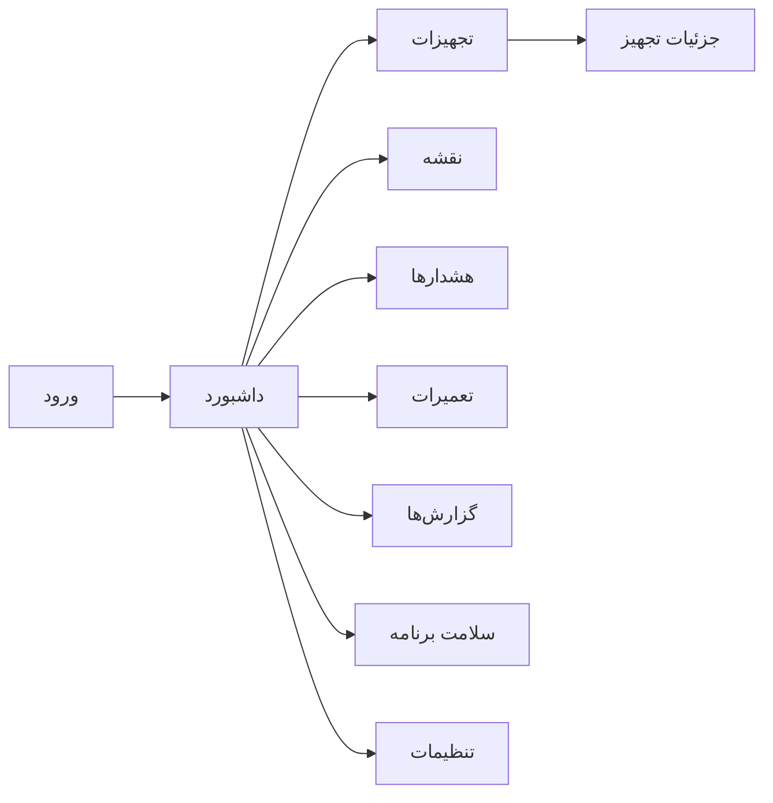
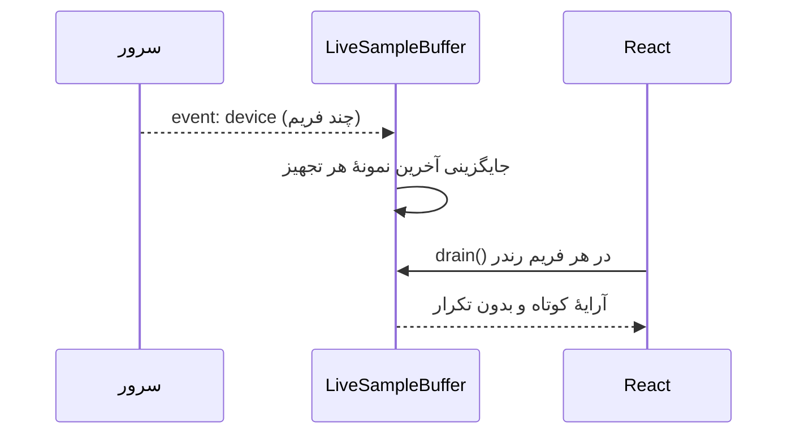

# رابط کاربری NetWatch

این سند ساختار فرانت‌اند را توضیح می‌دهد: ابزار ساخت، مسیرهای صفحه‌ها، لایهٔ
دریافت داده، اتصال زندهٔ SSE، مدیریت وضعیت و قواعدی که برای افزودن صفحهٔ تازه
لازم است. مخاطب آن توسعه‌دهندهٔ فرانت‌اند است.

| مورد | مقدار |
| --- | --- |
| کتابخانهٔ UI | React `19` + TypeScript |
| مسیریابی | `react-router-dom` نسخهٔ ۷ (سمت کلاینت) |
| استایل | Tailwind CSS نسخهٔ ۴ از طریق `@tailwindcss/vite` |
| نمودار | `recharts` |
| نقشه | `leaflet` (+ `maplibre-gl` برای لایهٔ برداری) |
| آیکن | `lucide-react` |
| فونت | `@fontsource/vazirmatn` |
| سرور توسعه | Vite روی `0.0.0.0:3000` |
| خروجی ساخت | `web/dist` |

---

## ۱. چیدمان پوشه‌ها

```
web/
├── index.html            ← قالب HTML؛ lang="fa" و dir="rtl"
├── vite.config.ts        ← root، پروکسی‌نشده، کد‌شکنی و allowedHosts
├── tailwind.config.js
├── tsconfig.json
├── tests/                ← آزمون‌های واحد منطق فرانت (node --test)
└── src/
    ├── main.tsx          ← نقطهٔ ورود React
    ├── App.tsx           ← مسیرها و قالب کلی
    ├── index.css         ← Tailwind و متغیرهای طراحی
    ├── components/       ← اجزای مشترک (Layout، نمودار، جدول، UI)
    ├── features/         ← فرم‌ها و دیالوگ‌های دامنه‌ای
    ├── lib/              ← api، auth، store، live-core، types، format
    └── pages/            ← صفحه‌های مسیر‌محور
```

---

## ۲. مسیرها و صفحه‌ها

`web/src/App.tsx`:

| مسیر | صفحه | نقش اصلی |
| --- | --- | --- |
| `/` | ریدایرکت به `/dashboard` | — |
| `/dashboard` | `Dashboard` | نمای کلی، کارت‌ها و نمودارهای زنده |
| `/devices` | `Devices` | فهرست تجهیزات با فیلتر، صفحه‌بندی و عملیات گروهی |
| `/devices/:id` | `DeviceDetail` | جزئیات، سری زمانی، قطعی‌ها، Probe دستی |
| `/map` | `MapPage` | نقشه، لایه‌های MBTiles و نشانه‌ها |
| `/alerts` | `Alerts` | هشدارها، تأیید/حل و قوانین |
| `/maintenance` | `Maintenance` | سوابق تعمیر و پنجره‌های برنامه‌ریزی‌شده |
| `/reports` | `Reports` | گزارش بازه‌ای و خروجی |
| `/app-health` | `AppHealth` | سلامت خود برنامه، پایگاه‌داده، پشتیبان و دیسک |
| `/health` | ریدایرکت به `/app-health` | سازگاری با لینک قدیمی |
| `/settings` | `Settings` | تنظیمات، کاربران و ابزارهای مدیریتی |
| `*` | ریدایرکت به `/dashboard` | — |

`Login` مسیر مستقل ندارد: در `web/src/main.tsx` کامپوننت `AuthGate` (از
`pages/Login`) کل `App` را در بر می‌گیرد و در صورت نبود نشست، فرم ورود را نشان
می‌دهد. ترتیب Provider‌ها در همین فایل است:
`Toast → Auth → AuthGate → App → Live → LivePing → ErrorBoundary`.

هر صفحه با `React.lazy` بارگذاری می‌شود؛ نمودار فقط با داشبورد/گزارش، نقشه فقط
با `/map` و صفحهٔ سلامت فقط با مراجعه به آن دانلود می‌شود.



---

## ۳. لایهٔ API

`web/src/lib/api.ts` تنها نقطهٔ تماس با سرور است:

| ویژگی | مقدار |
| --- | --- |
| پیشوند | `/api` (نسبی؛ همان Origin) |
| مهلت پیش‌فرض | `DEFAULT_TIMEOUT_MS = 15000` |
| مهلت آپلود/خروجی | `UPLOAD_TIMEOUT_MS = 120000` |
| CSRF | خواندن کوکی `nw_csrf` و ارسال در هدر `X-CSRF-Token` |
| خطا | کلاس `ApiError` با `status` و `code` (`HTTP`/`TIMEOUT`/`NETWORK`/`ABORTED`/`INVALID_RESPONSE`) |
| لغو | پشتیبانی `AbortSignal`؛ خطای لغو با `isAbortError` نادیده گرفته می‌شود |

```ts
import { api } from '@/lib/api';

const devices = await api.get('/devices', { status: 'offline', pageSize: 50 });
```

> هیچ درخواستی بدون مهلت رها نمی‌شود؛ این قاعده عمدی است تا شبکهٔ کند، رابط را
> در حالت «بارگذاری بی‌پایان» نگه ندارد.

### قواعد نمایش خطا

- `401` → بازگشت به فرم ورود و پاک‌کردن وضعیت محلی.
- `403` → پیام «مجوز ندارید» بدون تلاش دوباره.
- `429` → پیام سقف نرخ و غیرفعال‌کردن موقت دکمه.
- `TIMEOUT`/`NETWORK` → پیام قابل تلاش دوباره با دکمهٔ «تلاش مجدد».

---

## ۴. اتصال زنده (SSE)

`web/src/lib/live-core.ts` منطق خالص اتصال زنده را از React جدا می‌کند تا بدون
مرورگر هم آزمون‌پذیر باشد.

| مفهوم | رفتار |
| --- | --- |
| `LiveSampleBuffer` | برای هر تجهیز فقط **آخرین** نمونه نگه داشته می‌شود (Map با ترتیب LRU) |
| سقف بافر | پیش‌فرض `10000` تجهیز؛ فراتر از آن قدیمی‌ترین حذف می‌شود |
| `drain()` | نمونه‌های تازه را برمی‌گرداند و بافر را خالی می‌کند |
| منبع | `GET /api/events` با `EventSource` |

دلیل طراحی: فریم‌های SSE می‌توانند سریع‌تر از نرخ رندر برسند؛ اگر هر فریم در
آرایه جمع شود، بین دو Flush هزاران ردیف تکراری انباشته می‌شود. با «آخرین نمونه
به‌ازای هر تجهیز» حافظه هرگز بی‌مرز رشد نمی‌کند.



`web/src/components/LivePing.tsx` نشانگر وضعیت اتصال (متصل/قطع/تلاش دوباره) را
نمایش می‌دهد و `Freshness.tsx` کهنگی داده را نسبت به زمان فعلی نشان می‌دهد.

---

## ۵. مدیریت وضعیت

| ماژول | مسئولیت |
| --- | --- |
| `lib/auth.tsx` | کاربر جاری، مجوزها، ورود/خروج، محافظت از مسیرها |
| `lib/store.tsx` | وضعیت مشترک سراسری و به‌روزرسانی از SSE |
| `lib/params.ts` | خواندن/نوشتن فیلترها در Query String |
| `lib/format.ts` | قالب‌بندی فارسی عدد، زمان نسبی، مدت و درصد |
| `lib/types.ts` | تایپ‌های مشترک پاسخ API |
| `lib/async-gate.ts` | جلوگیری از پاسخ کهنهٔ درخواست‌های هم‌زمان |

قاعدهٔ عملی: دادهٔ «مالک سرور» را در کامپوننت تکرار نکنید؛ از `store` بخوانید تا
یک رویداد SSE همهٔ صفحه‌ها را هم‌زمان به‌روز کند.

---

## ۶. اجرا و ساخت

```bash
# نصب وابستگی‌ها (از ریشهٔ مخزن)
npm ci

# سرور توسعهٔ رابط (پورت ۳۰۰۰، با HMR)
npm run dev:web

# ساخت خروجی تولیدی در web/dist
npm run build

# بررسی نوع‌ها و لینت
npm run typecheck
npm run lint
```

فضای نام دسترسی به هاست‌های اضافی در Vite از متغیر
`__VITE_ADDITIONAL_SERVER_ALLOWED_HOSTS` (فهرست جداشده با کاما) خوانده می‌شود؛
برای پیش‌نمایش روی دامنهٔ دیگر همین را تنظیم کنید و **هرگز** `allowedHosts` را
باز (wildcard) نکنید.

> در حالت توسعه، ممکن است رابط روی پورت ۳۰۰۰ و API روی پورت دیگری اجرا شود.
> `API` با مسیر نسبی `/api` کار می‌کند؛ در این حالت یک پروکسی معکوس یا تنظیم
> پروکسی Vite لازم است. سرور تولیدی خودش `web/dist` را سرو می‌کند و این مشکل را
> ندارد.

---

## ۷. دسترس‌پذیری و RTL

- `index.html` با `lang="fa" dir="rtl"` و `viewport-fit=cover` تنظیم شده است.
- فونت Vazirmatn محلی بارگذاری می‌شود؛ هیچ درخواست فونت به اینترنت نمی‌رود
  (الزام محیط آفلاین).
- رنگ وضعیت‌ها فقط رنگ نیست: هر وضعیت آیکن و متن دارد تا برای کاربران با کوررنگی
  قابل تفکیک باشد.
- جدول‌های بزرگ با `VirtualList.tsx` رندر می‌شوند تا اسکرول در هزاران ردیف روان بماند.
- `ErrorBoundary.tsx` خطای رندر یک بخش را مهار می‌کند و کل برنامه را سفید نمی‌کند.

---

## ۸. افزودن صفحهٔ تازه

1. کامپوننت را در `web/src/pages/` بسازید.
2. مسیر را در `web/src/App.tsx` اضافه کنید (داخل همان `Routes`).
3. اگر به دادهٔ تازه نیاز است، تابع آن را در `web/src/lib/api.ts` اضافه کنید و
   تایپش را در `types.ts` تعریف کنید.
4. اگر صفحه باید در منو دیده شود، آیتم را در `components/Layout.tsx` اضافه کنید.
5. با مجوز مناسب محافظت کنید: صفحهٔ فقط‌خواندنی نباید برای Viewer دکمهٔ نوشتن
   نشان دهد؛ مبنای تصمیم، `user.permissions` از `/api/auth/me` است.
6. `npm run typecheck && npm run test:web` را اجرا کنید.

---

## ۹. محدودیت‌ها

- **بدون SSR:** برنامه یک SPA است؛ سرور فقط `index.html` را برای مسیرهای ناشناخته
  برمی‌گرداند و سئو/پیش‌رندر وجود ندارد.
- **بدون PWA/حالت آفلاین مرورگر:** اینترنت لازم نیست، اما قطع‌شدن سرور یعنی رابط
  دادهٔ تازه ندارد.
- **بدون i18n چندزبانه:** متن‌ها فارسی و در کد ثابت‌اند.
- **بدون Theme Switcher:** `color-scheme` روی روشن ثابت است.
- **آزمون مرورگری محدود:** مجموعهٔ Playwright (`npm run test:ui`) وجود دارد، اما
  همهٔ جریان‌ها در محیط بدون مرورگر اجرا نمی‌شوند؛ جزئیات در
  [آزمون‌ها](14-testing.md).

---

## مطالب مرتبط

- [API](06-api.md)
- [معماری](02-architecture.md)
- [امنیت و کنترل دسترسی](08-security.md)
- [راهنمای توسعه](16-development.md)
- [آزمون و تضمین کیفیت](14-testing.md)
