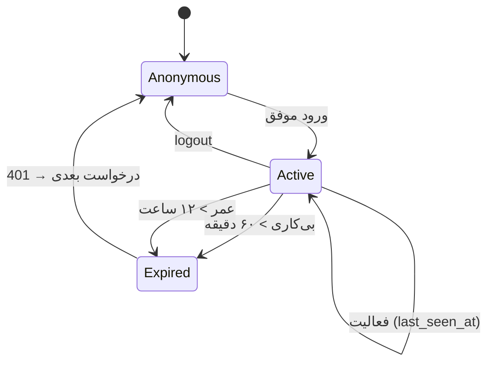

# امنیت و کنترل دسترسی

این سند مدل امنیتی NetWatch را توضیح می‌دهد: چه چیزی محافظت می‌شود، با چه
مکانیزمی، کدام پیش‌فرض‌ها امن هستند و کجا باید تصمیم آگاهانه گرفت. مخاطب آن
مدیر سیستم و توسعه‌دهنده است.

> NetWatch یک سامانهٔ **داخل شبکه** است و فرض طراحی آن «کاربران قابل‌اعتماد در
> شبکهٔ محلی» است؛ با این حال لایه‌های دفاعی زیر پیاده‌سازی شده‌اند تا یک حساب
> ضعیف یا یک کلاینت آلوده، کل سامانه را در معرض حمله نگذارد.

---

## ۱. مدل تهدید (خلاصه)

| دارایی | تهدید اصلی | کنترل موجود |
| --- | --- | --- |
| حساب‌ها | حدس رمز، پرکردن اعتبارنامه | Argon2id، قفل حساب، سقف نرخ ورود |
| نشست | دزدی کوکی، CSRF، Session Fixation | کوکی HttpOnly + SameSite، توکن CSRF، چرخش نشست |
| دادهٔ پایش | دسترسی غیرمجاز | RBAC در سطح هر مسیر |
| شبکهٔ داخلی | استفاده از سامانه به‌عنوان پلتفرم اسکن | سیاست مقصد Probe، مسدودسازی Metadata |
| فایل‌ها | Path Traversal و آپلود مخرب | `file-guard.js`، `upload.js`، محدودیت حجم |
| ردپا | پاک‌کردن سابقهٔ سوءاستفاده | `audit_log` برای همهٔ تغییرات |

---

## ۲. احراز هویت

### رمز عبور

| مورد | مقدار پیش‌فرض | تنظیم |
| --- | --- | --- |
| الگوریتم هش | Argon2id (`@node-rs/argon2`) | ثابت |
| حداقل طول | `12` | `NETWATCH_PASSWORD_MIN_LENGTH` (۸ تا ۱۲۸) |
| الزام ترکیب | حداقل سه دسته از چهار دسته، یا عبارت ≥۲۰ نویسه | `NETWATCH_PASSWORD_REQUIRE_COMPLEXITY` |
| ارتقای هش قدیمی | خودکار در نخستین ورود موفق | خودکار |

هنگام ورود، حتی اگر نام کاربری وجود نداشته باشد یک هش Argon2id روی یک هش ساختگی
اجرا می‌شود تا زمان پاسخ، وجود یا نبود کاربر را لو ندهد (ضد Timing Attack).

### قفل حساب

| مورد | پیش‌فرض | تنظیم |
| --- | --- | --- |
| آستانهٔ شکست | `5` | `NETWATCH_LOGIN_MAX_FAILURES` |
| مدت قفل | `15` دقیقه | `NETWATCH_LOGIN_LOCKOUT_MINUTES` |
| بازکردن دستی | `POST /api/auth/users/:id/unlock` | — |

شمارنده در پایگاه‌داده است، نه در حافظه؛ پس با ری‌استارت سرور صفر نمی‌شود.
تا وقتی قفل فعال است، **رمز صحیح هم پذیرفته نمی‌شود** — در غیر این صورت قفل
معنایی نداشت.

### نشست

| مورد | مقدار |
| --- | --- |
| نام کوکی نشست | `nw_session` (HttpOnly، SameSite=Strict) |
| کوکی CSRF | `nw_csrf` (قابل خواندن با JS، SameSite=Strict) |
| پرچم `Secure` | وقتی درخواست روی TLS باشد (`req.secure`) یا TLS در سرور فعال باشد |
| عمر مطلق | `12` ساعت (`NETWATCH_SESSION_HOURS`) |
| مهلت بی‌کاری | `60` دقیقه (`NETWATCH_SESSION_IDLE_MINUTES`) |
| ذخیره در پایگاه‌داده | هش توکن، نه توکن خام |
| ورود دوباره | نشست قبلی باطل و توکن تازه صادر می‌شود |



---

## ۳. مجوزها (RBAC)

سه نقش `admin`، `operator` و `viewer` وجود دارد و ۲۳ مجوز `<منبع>:<کنش>` تعریف
شده است. جدول کامل در [API](06-api.md#۲-نقشها-و-مجوزها) آمده است.

قاعده‌های پیاده‌سازی:

- بررسی نقش به‌تنهایی کافی نیست؛ هر مسیر مجوز مشخص خود را می‌خواهد. یک `viewer`
  حتی با `GET` به Probe (اسکن فعال) دسترسی ندارد.
- عملیات مخرب یا کل‌داده (`backups/*`، `db/checkpoint`، `retention/run`) علاوه بر
  `system:health`، بررسی `isAdmin` هم دارد.
- `audit:read`، `users:manage` و `demo:reset` فقط برای Administrator است.
- کلاینت باید مجوزها را از `GET /api/auth/me` بخواند و دکمه‌های غیرمجاز را نشان
  ندهد؛ اما **سرور** مرجع نهایی است و همان‌جا هم بررسی می‌کند.

---

## ۴. CSRF و Origin

| لایه | رفتار |
| --- | --- |
| `sameOriginOnly` | درخواست تغییردهنده با `Origin` غیرمجاز → `403` |
| `csrfGuard` | مقایسهٔ هدر `X-CSRF-Token` با کوکی `nw_csrf` |
| `SameSite=Strict` | کوکی‌ها در درخواست میان‌سایتی ارسال نمی‌شوند |

```json
{ "error": "درخواست از یک مبدأ نامعتبر ارسال شده است." }
```

پشت پروکسی معکوس، هدر `X-Forwarded-Host` تنها وقتی مبنای مقایسه قرار می‌گیرد که
`NETWATCH_TRUST_PROXY` تنظیم شده باشد. بدون آن، پروکسی باعث رد شدن درخواست‌های
تغییردهنده می‌شود؛ این رفتار عمدی و «امن‌تر» است.

---

## ۵. سقف نرخ

محدودکنندهٔ نرخ درون‌حافظه‌ای است و به Redis یا سرویس بیرونی نیاز ندارد.

| حوزه | پیش‌فرض (در هر پنجره) | تنظیم |
| --- | --- | --- |
| عمومی API | `600` | `NETWATCH_RATE_LIMIT_MAX` |
| پنجره | `60000` ms | `NETWATCH_RATE_LIMIT_WINDOW_MS` |
| ورود | `10` | `NETWATCH_LOGIN_RATE_LIMIT_MAX` |
| Probe | `60` | `NETWATCH_PROBE_RATE_LIMIT_MAX` |
| ورود/خروجی فایل | `20` | `NETWATCH_IMPORT_RATE_LIMIT_MAX` |
| مدیریتی | `120` | `NETWATCH_ADMIN_RATE_LIMIT_MAX` |
| سقف کلیدها | `10000` | `NETWATCH_RATE_LIMIT_MAX_KEYS` |

نکته‌های طراحی:

- Probe و Import و Admin هم بر اساس **IP** و هم بر اساس **شناسهٔ کاربر** شمارش
  می‌شوند؛ بنابراین چند کاربر پشت یک NAT، یک سهم مشترک ندارند.
- ورود با نام کاربری هم شمارش می‌شود تا حملهٔ توزیع‌شده روی یک حساب بی‌سقف نماند.
- تعداد کلیدها سقف دارد تا انبوه IP جعلی، حافظه را پر نکند.
- IP از `req.ip` خوانده می‌شود؛ `X-Forwarded-For` فقط با `trustProxy` معتبر است.

---

## ۶. سیاست شبکه برای Probe

Probe یک **اسکن فعال** است؛ اگر مقصدش آزاد باشد، سامانه به یک پلتفرم حمله در
شبکهٔ داخلی تبدیل می‌شود.

| مورد | پیش‌فرض |
| --- | --- |
| CIDR مجاز | `10.0.0.0/8`, `172.16.0.0/12`, `192.168.0.0/16`, `127.0.0.0/8`, `::1/128`, `fc00::/7` |
| Link-Local (`169.254.0.0/16`, `fe80::/10`) | مسدود |
| Cloud Metadata (`169.254.169.254`, …) | مسدود |
| 6to4/Teredo/NAT64 | مسدود |
| نام میزبان | DNS resolve می‌شود و **همهٔ** آدرس‌ها باید مجاز باشند |
| Zone ID (`fe80::1%eth0`) | پذیرفته نمی‌شود |

```bash
# بازکردن یک رنج تازه (آگاهانه)
NETWATCH_PROBE_ALLOWED_CIDRS="10.0.0.0/8,192.168.0.0/16,203.0.113.0/24"
```

> ⚠️ باز کردن `NETWATCH_PROBE_ALLOW_METADATA=1` می‌تواند به افشای اعتبارنامهٔ
> ابری منجر شود. فقط در آزمایشگاه و با علم به پیامد انجام دهید.

---

## ۷. هدرهای امنیتی

| هدر | مقدار |
| --- | --- |
| `X-Content-Type-Options` | `nosniff` |
| `X-Frame-Options` | `DENY` |
| `Referrer-Policy` | `no-referrer` |
| `Cross-Origin-Opener-Policy` | `same-origin` |
| `Permissions-Policy` | غیرفعال‌کردن دوربین، میکروفن، موقعیت، پرداخت، USB |
| `Strict-Transport-Security` | `max-age=15552000` (فقط با TLS و `NETWATCH_HSTS` فعال) |
| `Content-Security-Policy` | فقط در اجرای تولیدی؛ `default-src 'self'` و `object-src 'none'` |

CSP در حالت توسعه اعمال نمی‌شود چون Vite برای HMR به اسکریپت درون‌خطی و WebSocket
نیاز دارد. اگر CSP را تغییر می‌دهید، `worker-src blob:` را برای MapLibre نگه دارید.

---

## ۸. آپلود و فایل

| مورد | کنترل |
| --- | --- |
| حجم آپلود | محدودیت `multer` در `upload.js` |
| مسیر فایل | `file-guard.js` از خروج از پوشهٔ داده جلوگیری می‌کند |
| MBTiles | فقط در `<DATA_DIR>/mbtiles` و با بررسی نام |
| خروجی Export | جریانی، بدون نوشتن موقت در مسیر قابل حدس |
| دسترسی مستقیم | `web/dist` سرو می‌شود؛ پوشهٔ `data` هرگز سرو نمی‌شود |

نام فایل ورودی هرگز به‌عنوان مسیر مطلق استفاده نمی‌شود و `..` در نام رد می‌شود.

---

## ۹. حسابرسی

همهٔ درخواست‌های تغییردهنده به‌صورت خودکار در `audit_log` ثبت می‌شوند: کاربر،
IP، کنش، هدف، نتیجه و زمان. علاوه بر آن رخدادهای امنیتی در `engine_log` ثبت
می‌شوند: `auth_login_failed`، `auth_account_locked`، `auth_login`،
`auth_logout_all`، `auth_unknown_role` و رد Origin.

```bash
curl -b cookies.txt 'http://localhost:8787/api/audit?success=0&pageSize=20'
```

> هیچ مسیر API برای حذف یا ویرایش ردیف‌های `audit_log` وجود ندارد و تنها
> عملیات مجاز، خواندن است. تنها استثنا، هرس خودکار طبق
> `audit_retention_days` (حداقل ۳۶۵ روز) است که در [Retention](12-retention.md)
> توضیح داده شده است. در دسترسی مستقیم به فایل
> SQLite، مدیر سرور می‌تواند ردیف‌ها را تغییر دهد — این محدودیت در سطح مدل
> تهدید پذیرفته شده است.

---

## ۱۰. چک‌لیست سخت‌سازی نصب

- [ ] رمز پیش‌فرض/بوت‌استرپ را در نخستین ورود تغییر دهید (فایل رمز پس از اولین
      ورود مدیر حذف می‌شود).
- [ ] برای هر اپراتور حساب جدا بسازید؛ حساب مشترک، حسابرسی را بی‌اثر می‌کند.
- [ ] نقش `viewer` را برای نمایشگرهای اتاق کنترل استفاده کنید.
- [ ] TLS را فعال کنید (`npm run tls:setup`) و `NETWATCH_TRUST_PROXY` را فقط
      اگر پشت پروکسی هستید تنظیم کنید.
- [ ] `NETWATCH_ADMIN_ALLOWED_CIDRS` را برای محدودکردن مسیرهای مدیریتی به شبکهٔ
      مدیریت در نظر بگیرید.
- [ ] `NETWATCH_PROBE_ALLOWED_CIDRS` را به رنج واقعی شبکهٔ خود محدود کنید.
- [ ] پشتیبان‌گیری زمان‌بندی‌شده را فعال و **بازیابی** را یک بار تمرین کنید.
- [ ] `data/` را با مجوز فایل مناسب (کاربر سرویس) نگه دارید.

---

## ۱۱. محدودیت‌های شناخته‌شده

| مورد | وضعیت |
| --- | --- |
| MFA / WebAuthn | **وجود ندارد** (پیشنهاد آینده) |
| SSO / LDAP / AD | **وجود ندارد** |
| رمزنگاری داده در حالت سکون | **وجود ندارد**؛ امنیت فایل به مجوز سیستم‌عامل وابسته است |
| رمزنگاری پشتیبان | **وجود ندارد** |
| قفل مشترک بین چند نمونه | محدودکنندهٔ نرخ درون‌حافظه است؛ بین نمونه‌ها مشترک نیست |
| API Key ماشین‌به‌ماشین | **وجود ندارد** |
| Test نتیجهٔ امنیتی | آزمون‌های `security`، `rbac-matrix`، `net-policy-hardening` و `malicious` در مخزن وجود دارند؛ نتیجهٔ اجرای واقعی در [آزمون‌ها](14-testing.md) ثبت شده است |

---

## مطالب مرتبط

- [API](06-api.md)
- [پیکربندی](04-configuration.md)
- [عملیات](10-operations.md)
- [نصب و راه‌اندازی](03-installation.md)
- [عیب‌یابی](13-troubleshooting.md)
- [آزمون و تضمین کیفیت](14-testing.md)
