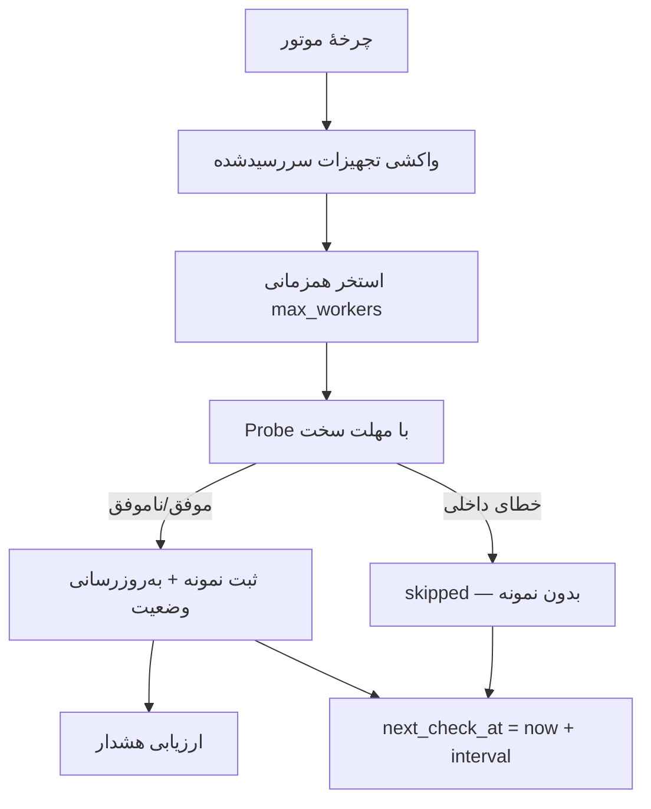
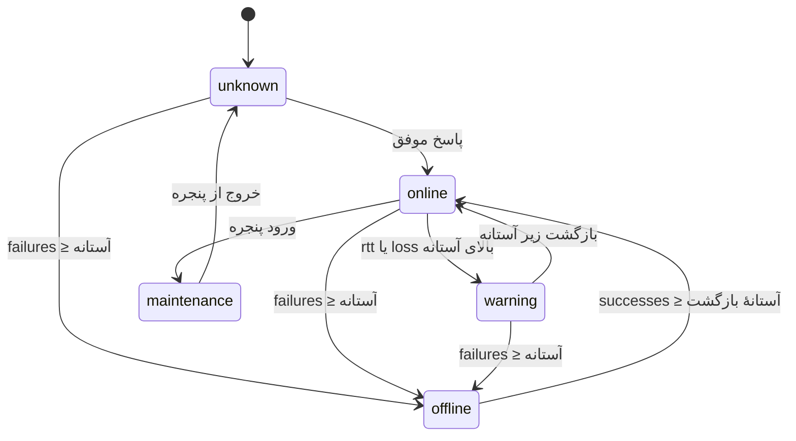
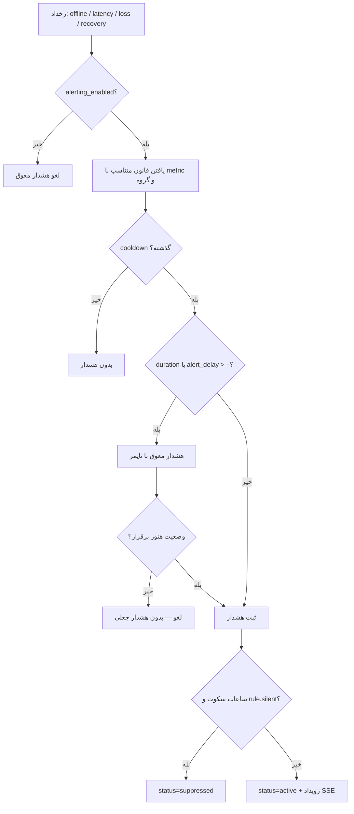
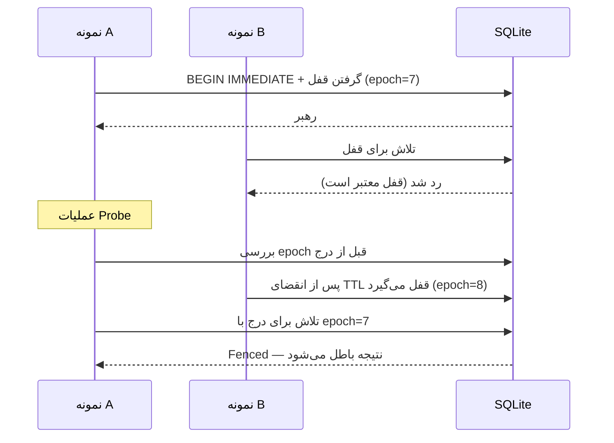

# موتور پایش

این سند قلب NetWatch را توضیح می‌دهد: چگونه بررسی‌ها زمان‌بندی می‌شوند، وضعیت
تجهیز چگونه تغییر می‌کند، هشدارها چگونه ساخته و سرکوب می‌شوند و چند نمونه چگونه
بدون تداخل کار می‌کنند. مخاطب آن توسعه‌دهنده و مدیر سیستم است.

> پیاده‌سازی در `server/engine.js` (کلاس `MonitoringEngine`)، قفل رهبری در
> `server/leader.js` و منطق Probe در `server/ping.js`.

---

## ۱. حالت‌های بررسی

`engine_mode` یکی از چهار مقدار است (`NETWATCH_ENGINE_MODE` یا تنظیمات پایگاه‌داده):

| حالت | رفتار | نکته |
| --- | --- | --- |
| `auto` (پیش‌فرض) | اگر ICMP مجاز باشد `icmp`، وگرنه `tcp` | هرگز به‌طور پنهان شبیه‌سازی نمی‌کند |
| `icmp` | Ping واقعی با فراخوانی سیستم | نیازمند مجوز raw socket یا `CAP_NET_RAW` |
| `tcp` | اتصال TCP به `tcp_port` (پیش‌فرض `80`) | برای محیط‌هایی که ICMP بسته است |
| `simulate` | دادهٔ ساختگی برای دمو/آموزش | نمونه‌ها با `mode='simulate'` برچسب می‌خورند |

```bash
curl -b cookies.txt http://localhost:8787/api/engine/status
```

```json
{
  "running": true,
  "mode": "auto",
  "simulation": false,
  "engineEnabled": true,
  "icmpAvailable": true,
  "interval": 30,
  "maxWorkers": 128,
  "inflight": 4,
  "leader": true,
  "epoch": 7,
  "healthy": true,
  "stalled": false,
  "lastTickAt": 1761000000000,
  "lastRunAt": 1760999998000
}
```

> `simulation: true` باید همیشه در رابط و در تحلیل داده جدی گرفته شود؛ دادهٔ
> شبیه‌سازی‌شده معیار واقعی شبکهٔ شما نیست.

---

## ۲. زمان‌بندی

| مفهوم | پیاده‌سازی |
| --- | --- |
| انتخاب تجهیز | `WHERE enabled=1 AND monitoring_enabled=1 AND next_check_at <= now` |
| ترتیب | اولویت: `critical` → `high` → `normal` → `low` |
| ایندکس | `idx_devices_due` تا هر چرخه کل جدول خوانده نشود |
| همزمانی | `max_workers` (پیش‌فرض `128`) |
| بازه | `ping_interval` (پیش‌فرض `30` ثانیه، هر تجهیز می‌تواند مقدار خود را داشته باشد) |
| پس از هر بررسی | `next_check_at` تجهیز به‌روزرسانی می‌شود |



نکتهٔ مهم: **خطای داخلی Probe** (مهلت سخت یا خطای لایهٔ پروب) با «بی‌پاسخی
تجهیز» یکی نیست. در این حالت هیچ نمونه‌ای ثبت نمی‌شود و شمارندهٔ شکست تجهیز بالا
نمی‌رود؛ در غیر این صورت یک مشکل نرم‌افزاری به‌صورت قطعی جعلی گزارش می‌شد.

---

## ۳. گذار وضعیت

پنج وضعیت وجود دارد (`STATUS` در `server/db.js`):

| وضعیت | معنی |
| --- | --- |
| `online` | پاسخ موفق و زیر آستانه |
| `warning` | پاسخ موفق اما تأخیر یا افت بسته بالای آستانه |
| `offline` | شکست متوالی به آستانهٔ `failures_for_offline` رسیده |
| `maintenance` | داخل پنجرهٔ تعمیرات؛ بررسی متوقف و هشدار سرکوب |
| `unknown` | هنوز بررسی‌ای انجام نشده |



آستانه‌ها (پیش‌فرض از `DEFAULT_SETTINGS`، قابل بازنویسی در هر تجهیز):

| کلید | پیش‌فرض | معنی |
| --- | --- | --- |
| `timeout_ms` | `1200` | مهلت هر بسته |
| `retries` | `1` | تلاش مجدد |
| `packet_count` | `3` | تعداد بسته در هر بررسی |
| `latency_threshold` | `150` ms | آستانهٔ تأخیر برای `warning` |
| `loss_threshold` | `10` ٪ | آستانهٔ افت بسته |
| `failures_for_offline` | `3` | شکست متوالی لازم برای `offline` |
| `successes_for_online` | `2` | موفقیت متوالی لازم برای بازگشت |

منطق «هیسترزیس» عمدی است: بدون آن، یک بستهٔ گم‌شده تجهیز را قطع‌شده و یک بستهٔ
موفق آن را سالم اعلام می‌کرد و سامانه پر از نوسان می‌شد.

---

## ۴. قطعی‌ها

- با نخستین ورود به `offline`، یک ردیف `outages` با `open=1` ساخته می‌شود.
- با بازگشت به `online`، همان ردیف بسته و `duration_sec` محاسبه می‌شود.
- قید یکتایی جزئی پایگاه‌داده تضمین می‌کند هر تجهیز **حداکثر یک** قطعی باز دارد.
- پس از Crash یا ری‌استارت، موتور قطعی باز «یتیم» را به تجهیز خودش وصل می‌کند و
  ارجاع‌های شکسته (`current_outage_id` به قطعی بسته) را پاک می‌کند.

این بازیابی در `orphans`/`adoptOutage`/`clearDanglingOutage` انجام می‌شود و
دلیل وجودش این است که بدون آن، یک قطعی طولانی پس از ری‌استارت «بی‌سند» می‌شد.

---

## ۵. هشدارها

### ترتیب ارزیابی



### فیلدهای قانون که واقعاً اثر دارند

| فیلد | اثر در این نسخه |
| --- | --- |
| `metric` | انتخاب قانون برای `offline`/`latency`/`loss`/`recovery` |
| `scope_group_id` | قانون مخصوص یک گروه بر قانون عمومی مقدم است |
| `cooldown_sec` | حداقل فاصلهٔ دو هشدار هم‌نوع برای یک تجهیز (پیش‌فرض `600`) |
| `duration_sec` | مدت پایداری شرط پیش از ثبت هشدار |
| `silent` | در ساعات سکوت به `suppressed` تبدیل می‌شود |
| `enabled` | قانون غیرفعال در ارزیابی دیده نمی‌شود |
| `threshold` | ذخیره می‌شود، اما آستانهٔ واقعی از `latency_threshold`/`loss_threshold` تجهیز یا تنظیمات خوانده می‌شود |
| `comparator` | ذخیره می‌شود، اما مقایسه در کد ثابت است |
| `severity` | ذخیره می‌شود، اما شدت هشدارهای موتور از کد تعیین می‌شود |

> این تفکیک عمدی مستند شده است تا کسی تصور نکند با تغییر `threshold` در قانون،
> رفتار هشدار عوض می‌شود. بهبود این بخش یک **پیشنهاد آینده** است.

### تأخیر و ساعات سکوت

- `alert_delay` (پیش‌فرض `0`) و `rule.duration_sec` یک معنا دارند: «چند ثانیه صبر
  کن تا وضعیت پایدار بماند». اگر هر دو تنظیم باشند، **بزرگ‌تر** اعمال می‌شود.
- ضدتکرار پیش از هر درج اعمال می‌شود؛ حتی هشدار سرکوب‌شده هم در فاصلهٔ cooldown
  دوباره ساخته نمی‌شود (وگرنه در ساعات سکوت، جدول `alerts` بی‌سقف رشد می‌کرد).
- `suppression_enabled` با `suppression_start`/`suppression_end` (پیش‌فرض
  `23:00`–`06:00`) بازهٔ سکوت را تعیین می‌کند.

---

## ۶. رهبری و Fencing

اگر موتور هم داخل سرور و هم به‌صورت `engine-cli` اجرا شود، هر تجهیز دو بار Ping
می‌خورد و نمونه‌ها دوتایی ثبت می‌شوند. برای جلوگیری از این وضعیت:

| مکانیزم | توضیح |
| --- | --- |
| قفل `engine_lock` | یک ردیف با `owner`، `expires_at` و `epoch` |
| TTL قفل | `NETWATCH_ENGINE_LOCK_TTL_MS` (پیش‌فرض `15000`) |
| تلاش دوباره | `NETWATCH_LOCK_RETRY_MS` (پیش‌فرض `2000`) |
| Fencing Token | `leader_epoch` در `engine_meta`؛ در هر تصاحب یک واحد بالا می‌رود |
| بررسی پیش از ثبت | موتور پیش از نوشتن نتیجه، مالکیت/`epoch`/TTL را دوباره می‌خواند |
| تراکنش | گرفتن قفل و افزایش `epoch` در یک `BEGIN IMMEDIATE` انجام می‌شود |



خطاهای `EngineNotLeaderError` و `EngineFencedError` در کد تعریف شده‌اند و
به‌صورت شمارنده در وضعیت موتور دیده می‌شوند.

---

## ۷. تجمیع روزانه و هرس

| کار | دوره | توضیح |
| --- | --- | --- |
| Rollup روزانه | تقریباً هر ۵ دقیقه (`ROLLUP_EVERY_MS`) | پرکردن `daily_stats` از `samples` و `outages` |
| هرس نمونه‌ها | طبق سیاست Retention | حذف تکه‌ای `5000` رکورد در هر تراکنش |
| هرس لاگ موتور | `engine_log_retention_days` (پیش‌فرض `30`) | حذف دوره‌ای |

`daily_stats` مبناست چون پس از هرس نمونه‌های خام، گزارش‌های بلندمدت باید باقی
بمانند. جزئیات در [Retention](12-retention.md).

---

## ۸. سلامت موتور

| شاخص | معنی |
| --- | --- |
| `running` | موتور روشن است |
| `leader` | این نمونه رهبر است |
| `healthy` | روشن و بدون Stall و بدون کهنگی |
| `stalled` | تأخیر چرخه از `TICK_STALL_MS` (۳۰ ثانیه) گذشته |
| `tickLagMs` | اختلاف زمان واقعی و زمان انتظار چرخه |
| `pendingAlerts` | هشدارهای معوق در انتظار تأخیر |
| `inflight` | بررسی‌های در جریان |
| `lastRunAt` | آخرین چرخهٔ کامل |

«کهنه» وقتی است که `lastRunAt` از سه بازهٔ `ping_interval` به‌علاوهٔ ۵ ثانیه
بیشتر عقب باشد. این شرط در `/api/status` هم بازتاب می‌یابد.

---

## ۹. کنترل دستی

| مسیر | کار |
| --- | --- |
| `POST /api/engine/control/start` | روشن‌کردن موتور |
| `POST /api/engine/control/stop` | خاموش‌کردن (Drain) |
| `POST /api/engine/control/pause` | توقف پذیرش بررسی تازه |
| `POST /api/engine/control/resume` | ادامه |
| `POST /api/engine/check-all` | بررسی فوری همه (مجوز `probe:run`) |

```bash
curl -b cookies.txt -X POST http://localhost:8787/api/engine/control/stop \
  -H "X-CSRF-Token: $CSRF"
```

`stop` صبر می‌کند تا عملیات در جریان تمام شوند (تا سقف `NETWATCH_STOP_DRAIN_MS`)
و سپس قفل رهبری را آزاد می‌کند.

---

## ۱۰. محدودیت‌ها

- **بدون HA افقی روی یک پایگاه‌دادهٔ مشترک:** قفل رهبری از تداخل دو نمونه
  جلوگیری می‌کند، اما SQLite یک فایل محلی است؛ چند نمونه روی دیسک مشترک شبکه‌ای
  پشتیبانی نمی‌شود.
- **بدون پایش SNMP/Syslog/NetFlow:** فقط ICMP/TCP و شبیه‌سازی.
- **بدون Agent روی تجهیزات:** همهٔ بررسی‌ها از سمت سرور انجام می‌شود.
- **`threshold`/`comparator`/`severity` قانون، رفتار اجرایی ندارند** (بالا توضیح
  داده شد).
- **بدون اعلان بیرونی:** هشدار فقط در رابط کاربری و SSE دیده می‌شود؛ ایمیل، SMS
  و Webhook وجود ندارد.

---

## مطالب مرتبط

- [معماری](02-architecture.md)
- [پایگاه‌داده](05-database.md)
- [API](06-api.md)
- [Retention](12-retention.md)
- [عملیات](10-operations.md)
- [عیب‌یابی](13-troubleshooting.md)
