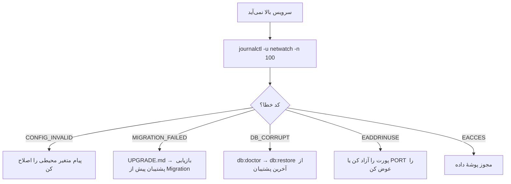

# عملیات و Runbook

این سند راهنمای کار روزمرهٔ مدیر سیستم است: کنترل سرویس، بررسی سلامت، مدیریت
کاربران، پاسخ به حادثه و چک‌لیست‌های دوره‌ای. هدف این است که یک اپراتور در
شرایط فشار، دستور درست را بدون جست‌وجو پیدا کند.

---

## ۱. کنترل سرویس

```bash
# وضعیت
sudo systemctl status netwatch --no-pager

# شروع / توقف / ری‌استارت
sudo systemctl start netwatch
sudo systemctl stop netwatch
sudo systemctl restart netwatch

# لاگ زنده (journald)
sudo journalctl -u netwatch -f

# صد خط آخر
sudo journalctl -u netwatch -n 100 --no-pager
```

| فایل | نقش |
| --- | --- |
| `deploy/netwatch.service` | واحد systemd با سخت‌سازی |
| `/etc/netwatch/netwatch.env` | متغیرهای محیطی (مجوز `600`) |
| `/opt/netwatch` | کد برنامه |
| `/var/lib/netwatch` | پوشهٔ داده (تنها مسیر قابل نوشتن) |

> اگر حالت موتور `icmp` است، سرویس به `CAP_NET_RAW` نیاز دارد. در این حالت در
> واحد systemd باید `CapabilityBoundingSet`/`AmbientCapabilities` را باز کنید و
> `NoNewPrivileges=false` بگذارید — همراه با آگاهی از کاهش سخت‌سازی.

---

## ۲. بررسی سلامت

```bash
# عمومی (بدون احراز هویت) — برای load balancer و cron
curl -fsS http://127.0.0.1:8787/api/health

# جزئیات کامل اجزا
curl -fsS -b cookies.txt http://127.0.0.1:8787/api/system/health | jq .

# وضعیت تجمیعی + موتور
curl -fsS -b cookies.txt http://127.0.0.1:8787/api/status | jq .

# سلامت پایگاه‌داده (کش ۳۰ ثانیه)
curl -fsS -b cookies.txt http://127.0.0.1:8787/api/system/db/health | jq .
```

| شاخص | سالم | هشدار |
| --- | --- | --- |
| `/api/health` | `200` و `ok: true` | هر پاسخ دیگر = incident |
| `engine.stale` | `false` | `true` = چرخه عقب است |
| `engine.stalled` | `false` | `true` = تأخیر > ۳۰ ثانیه |
| `app.disk` | فضای آزاد > `NETWATCH_MIN_FREE_BYTES` (پیش‌فرض ۶۴MiB) | کمتر = نوشتن متوقف می‌شود |
| `backup.lastBackupAt` | کمتر از `backup_interval_hours` | کهنه = پشتیبان شکسته |

### نمونهٔ اسکریپت پایش بیرونی

```bash
#!/usr/bin/env bash
set -euo pipefail
code=$(curl -s -o /dev/null -w '%{http_code}' http://127.0.0.1:8787/api/health)
if [ "$code" != "200" ]; then
  echo "NetWatch DOWN (HTTP $code)" >&2
  exit 1
fi
```

---

## ۳. مدیریت کاربران

```bash
# فهرست
curl -s -b cookies.txt http://localhost:8787/api/auth/users | jq .

# ساخت اپراتور
curl -s -b cookies.txt -X POST http://localhost:8787/api/auth/users \
  -H 'Content-Type: application/json' -H "X-CSRF-Token: $CSRF" \
  -d '{"username":"ops2","password":"<رمز قوی>","role":"operator"}'

# غیرفعال‌کردن (بدنهٔ PUT)
curl -s -b cookies.txt -X PUT http://localhost:8787/api/auth/users/4 \
  -H 'Content-Type: application/json' -H "X-CSRF-Token: $CSRF" \
  -d '{"disabled":true}'

# بازکردن قفل حساب
curl -s -b cookies.txt -X POST http://localhost:8787/api/auth/users/4/unlock \
  -H "X-CSRF-Token: $CSRF"

# باطل‌کردن همهٔ نشست‌های یک کاربر (از سمت همان کاربر)
curl -s -b cookies.txt -X POST http://localhost:8787/api/auth/logout-all \
  -H "X-CSRF-Token: $CSRF"
```

| نقش | برای چه کسی |
| --- | --- |
| `admin` | مدیر سامانه؛ عملیات مخرب و مدیریت کاربران |
| `operator` | اپراتور شیفت؛ تغییر تجهیزات، هشدارها، تعمیرات، Probe |
| `viewer` | نمایشگر اتاق کنترل؛ فقط مشاهده |

قاعدهٔ عملی: **حساب مشترک نسازید.** حسابرسی به `user_id` وابسته است و با حساب
مشترک، مسئولیت‌پذیری از بین می‌رود.

---

## ۴. کارهای روزمره

### افزودن تجهیز

1. `POST /api/devices` یا فرم «تجهیز جدید» در `/devices`.
2. گروه، اولویت و آستانه‌های اختصاصی را تعیین کنید.
3. با `POST /api/devices/:id/ping` یک بررسی فوری بگیرید.
4. در `/devices/:id` نمودار و وضعیت را تأیید کنید.

### ورود گروهی از فایل

```bash
# دریافت قالب
curl -s -b cookies.txt -o devices-template.xlsx \
  http://localhost:8787/api/devices/template

# پیش‌نمایش (بدون نوشتن)
curl -s -b cookies.txt -X POST http://localhost:8787/api/devices/import/preview \
  -H "X-CSRF-Token: $CSRF" -F 'file=@devices.xlsx'

# اعمال
curl -s -b cookies.txt -X POST http://localhost:8787/api/devices/import/commit \
  -H "X-CSRF-Token: $CSRF" -F 'file=@devices.xlsx'
```

همیشه اول `preview` بگیرید؛ `commit` بدون تأیید پیش‌نمایش می‌تواند صدها ردیف
ناخواسته بسازد.

### پاسخ به هشدار

| گام | اقدام |
| --- | --- |
| ۱ | هشدار را در `/alerts` ببینید و تجهیز را در `/devices/:id` باز کنید |
| ۲ | اگر کار برنامه‌ریزی‌شده است، پنجرهٔ تعمیرات بسازید (هشدار سرکوب می‌شود) |
| ۳ | اگر واقعی است، `ack` کنید تا مالکیت مشخص شود |
| ۴ | پس از رفع، `resolve` کنید و سابقهٔ تعمیر ثبت کنید |
| ۵ | اگر هشدار تکراری و بی‌فایده است، `cooldown_sec` قانون را بازبینی کنید |

```bash
curl -s -b cookies.txt -X POST http://localhost:8787/api/alerts/91/ack \
  -H "X-CSRF-Token: $CSRF"
```

### پنجرهٔ تعمیرات

```bash
curl -s -b cookies.txt -X POST http://localhost:8787/api/maintenance-windows \
  -H 'Content-Type: application/json' -H "X-CSRF-Token: $CSRF" \
  -d '{"title":"ارتقای سوئیچ هسته","starts_at":1761100000000,"ends_at":1761107200000,"group_id":1}'
```

در این بازه تجهیزات گروه وارد `maintenance` می‌شوند، Probe متوقف می‌شود و هشدار
ساخته نمی‌شود.

---

## ۵. پاسخ به حادثه

### سناریوی الف — سرویس بالا نمی‌آید



```bash
# بررسی پایگاه‌داده بدون بالا آوردن سرویس
npm run db:doctor

# گزارش ماشین‌خوان برای تیکت
npm run db:doctor -- --json
```

### سناریوی ب — موتور عقب است

1. `GET /api/engine/status` را ببینید: `stalled`، `tickLagMs`، `inflight`.
2. بررسی کنید آیا `engine-cli` هم فعال است و قفل را گرفته (`lock.owner`).
3. تعداد تجهیزات را با `max_workers × ping_interval` مقایسه کنید.
4. اگر `backlog` زیاد است، `ping_interval` را افزایش یا `max_workers` را کم کنید
   (افزایش بی‌رویهٔ `max_workers` فشار روی شبکه و فایل را زیاد می‌کند).

### سناریوی ج — دیسک پر شد

1. `GET /api/system/health` → فضای آزاد و حجم پایگاه‌داده.
2. `npm run db:backup` برای گرفتن نسخهٔ سالم (اگر فضا اجازه دهد).
3. `POST /api/system/retention/run` برای هرس دستی، یا سیاست را کوتاه کنید.
4. پشتیبان‌های قدیمی: `POST /api/system/backups/prune`.
5. `data/*-wal` را **حذف نکنید**؛ با `Checkpoint` یا `db:doctor` پیش بروید.

### سناریوی د — فراموشی رمز مدیر

**مسیر رسمی بازنشانی رمز وجود ندارد** (نه در API و نه در CLI). گزینه‌های موجود:

1. **فایل رمز بوت‌استرپ:** در نخستین راه‌اندازی، اگر `NETWATCH_ADMIN_PASSWORD`
   تنظیم نشده باشد، برنامه یک رمز تصادفی می‌سازد و در
   `data/initial-admin-password.txt` (مجوز `600`) می‌نویسد. این فایل پس از
   نخستین ورود موفق مدیر حذف می‌شود.
2. **بازنشانی از پشتیبان:** اگر پشتیبانی دارید که رمز آن را می‌دانید، با
   `npm run db:restore` بازیابی کنید (بخش [بازیابی](11-backup-restore.md)).
3. **ویرایش دستی پایگاه‌داده (پشتیبانی‌نشده):** با دسترسی به فایل، می‌توان
   `users.password_hash` را با هش Argon2id تازه جایگزین کرد. این کار خارج از
   مسیر پشتیبانی‌شده است؛ پیش از آن پشتیبان بگیرید و سرویس را متوقف کنید.

> ⚠️ `NETWATCH_ADMIN_PASSWORD` فقط وقتی اثر دارد که **هیچ کاربری** در پایگاه‌داده
> نباشد؛ برای بازیابی رمز کاربر موجود استفاده نمی‌شود.

> ⚠️ `npm run seed:reset` تمام دادهٔ تجهیزات، نمونه‌ها، هشدارها و نشانه‌ها را حذف
> و دادهٔ نمونه می‌سازد. این کار «بازنشانی رمز» نیست و نباید برای آن استفاده شود.

---

## ۶. چک‌لیست‌ها

### روزانه

- [ ] `/api/health` سبز است
- [ ] هشدارهای فعال بررسی و `ack` شده‌اند
- [ ] فضای دیسک بیش از حد آستانه است
- [ ] آخرین پشتیبان خودکار موفق بوده

### هفتگی

- [ ] `npm run db:doctor` بدون خطا
- [ ] اندازهٔ پایگاه‌داده و روند رشد بررسی شد
- [ ] تجهیزات `offline` طولانی‌مدت بازبینی شدند
- [ ] قوانین هشدار پرنوسان تنظیم شدند

### ماهانه

- [ ] بازیابی از پشتیبان در محیط آزمایشی تمرین شد
- [ ] کاربران غیرفعال حذف/غیرفعال شدند
- [ ] سیاست Retention با نیاز نگهداری هم‌خوان است
- [ ] گواهی TLS و تاریخ انقضا بررسی شد
- [ ] لاگ حسابرسی برای رخدادهای مشکوک مرور شد

---

## ۷. زمان‌بندی خودکار

| کار | پیش‌فرض | تنظیم |
| --- | --- | --- |
| پشتیبان خودکار | هر `24` ساعت | `backup_interval_hours`, `backup_enabled` |
| Retention | روزانه ساعت `03:00` | `retention_run_time`, `retention_interval_minutes` |
| Checkpoint WAL | هر `15` دقیقه | `checkpoint_interval_minutes` |
| تجمیع روزانه | هر ۵ دقیقه | ثابت در موتور |
| هرس لاگ موتور | طبق `engine_log_retention_days` | تنظیمات |

---

## ۸. محدودیت‌های عملیاتی

- **بدون HA:** یک نمونهٔ فعال؛ قفل رهبری از تداخل جلوگیری می‌کند اما جایگزینی
  خودکار (failover) وجود ندارد.
- **SQLite روی NFS پشتیبانی نمی‌شود:** قفل‌گذاری شبکه‌ای می‌تواند داده را خراب کند.
- **بدون اعلان بیرونی:** اگر کسی رابط را باز نکند، هشدار دیده نمی‌شود.
- **بدون نقش «Read-only admin»:** دسترسی خواندن حسابرسی فقط با نقش admin است.
- **Retention قابل توقف است اما بدون Resume خودکار:** پس از `stop`، اجرای بعدی
  طبق زمان‌بند شروع می‌شود.

---

## مطالب مرتبط

- [پشتیبان‌گیری و بازیابی](11-backup-restore.md)
- [Retention](12-retention.md)
- [عیب‌یابی](13-troubleshooting.md)
- [امنیت](08-security.md)
- [موتور پایش](09-engine.md)
- [ارتقا و انتشار](15-upgrade-release.md)
