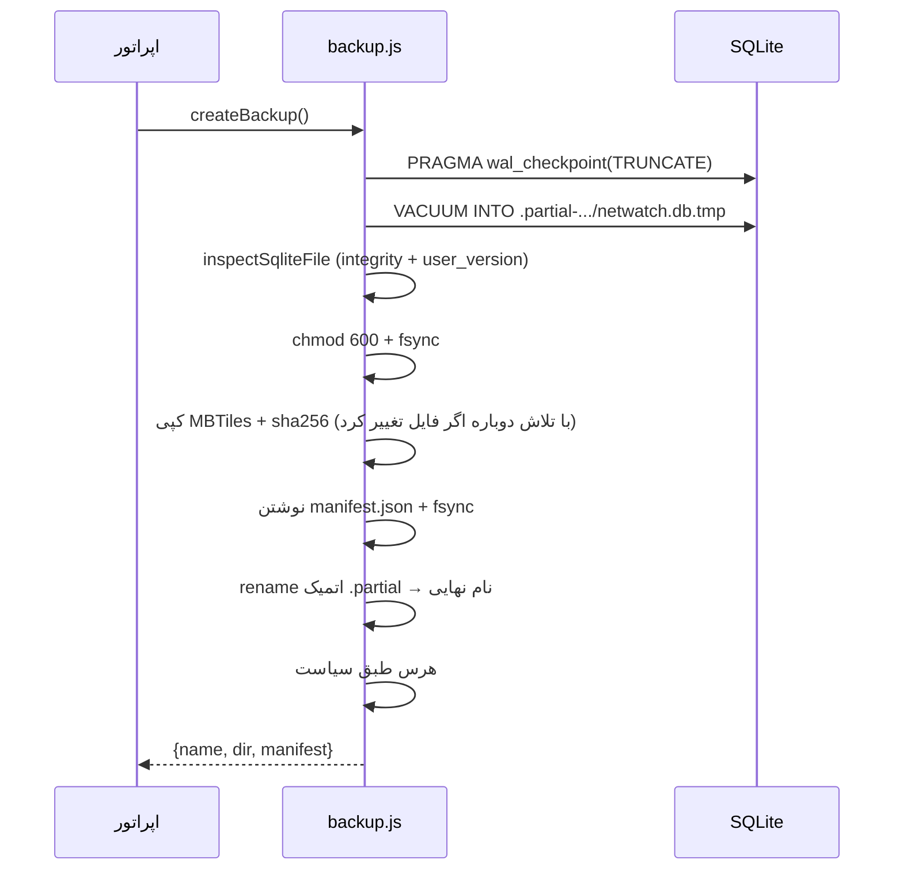
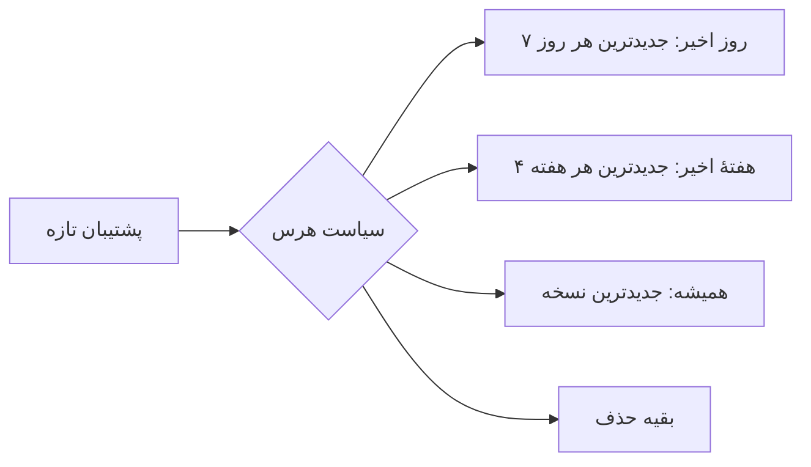

# پشتیبان‌گیری و بازیابی

این سند ساختار پشتیبان NetWatch، نحوهٔ ساخت و اعتبارسنجی آن، رویهٔ بازیابی و
سیاست نگهداری نسخه‌ها را توضیح می‌دهد. هدف این است که مدیر سیستم بداند پشتیبان
«چه چیزی» را برمی‌گرداند و در شرایط خرابی، دقیقاً چه کاری انجام دهد.

> پیاده‌سازی در `server/backup.js` و ابزارهای خط فرمان
> `server/scripts/db-backup.mjs` / `db-restore.mjs`.

---

## ۱. پشتیبان شامل چه چیزی است؟

هر پشتیبان یک **پوشه** است، نه فقط یک فایل:

```
<NETWATCH_BACKUP_DIR>/2026-10-20T03-00-00-1a2b3c/
├── netwatch.db        ← عکس لحظه‌ای پایگاه‌داده (VACUUM INTO)
├── manifest.json      ← مانیفست: نسخه، checksum، شمارش جدول‌ها، وضعیت WAL
└── mbtiles/           ← فایل‌های MBTiles (اگر پشتیبان‌گیری نقشه فعال باشد)
```

مسیر پیش‌فرض: `<NETWATCH_DATA_DIR>/backups`، قابل تغییر با
`NETWATCH_BACKUP_DIR`.

| فیلد مانیفست | معنی |
| --- | --- |
| `format` | نسخهٔ قالب پشتیبان (`BACKUP_FORMAT`) |
| `appVersion` / `schemaVersion` | نسخهٔ برنامه و `user_version` پایگاه‌داده |
| `db.sha256` | checksum فایل پایگاه‌داده |
| `db.counts` | شمارش ردیف جدول‌های کلیدی (برای تأیید پس از بازیابی) |
| `db.integrity` | نتیجهٔ بررسی یکپارچگی هنگام ساخت |
| `mbtiles[]` | نام، اندازه و checksum هر فایل نقشه |
| `settings` | `journal_mode` و `synchronous` هنگام ساخت |
| `durationMs` | مدت ساخت |

> **بدون مانیفست، پشتیبان معتبر نیست.** بازیابی، پوشه‌ای را که `manifest.json`
> ندارد یا checksum آن نمی‌خورد رد می‌کند.

---

## ۲. ساخت پشتیبان

### از رابط یا API

```bash
curl -s -b cookies.txt -X POST http://localhost:8787/api/system/backups \
  -H "X-CSRF-Token: $CSRF" | jq .
```

```json
{
  "ok": true,
  "name": "2026-10-20T03-00-00-1a2b3c",
  "dir": "/var/lib/netwatch/backups/2026-10-20T03-00-00-1a2b3c",
  "manifest": { "db": { "size": 8421376, "integrity": "ok" }, "mbtiles": [] }
}
```

### از خط فرمان

```bash
# پشتیبان کامل با سیاست پیش‌فرض
npm run db:backup

# بدون فایل‌های نقشه (سریع‌تر)
npm run db:backup -- --no-mbtiles

# با سقف کل صریح (رفتار قدیمی، بدون سیاست روزانه/هفتگی)
npm run db:backup -- --keep=14
```

خروجی JSON مصرف‌ماشینی است و کد خروج `0` فقط وقتی برمی‌گردد که پشتیبان **ساخته
و اعتبارسنجی** شده باشد؛ برای Cron ایده‌آل است.

### مراحل داخلی (چرا امن است)



نکته‌های مهم:

- پشتیبان نیمه‌کاره هرگز دیده نمی‌شود؛ ابتدا در `.partial-*` ساخته و بعد
  `rename` می‌شود (اتمیک در همان فایل‌سیستم).
- فایل پایگاه‌داده با مجوز `600` نوشته می‌شود (چون شامل کاربران و حسابرسی است).
- اگر فضای دیسک کافی نباشد، پیش از شروع با تخمین محافظه‌کارانه
  (`db × 2 + mbtiles + 8MiB`) خطا می‌دهد.
- فایل‌های `netwatch.db-wal`/`-shm` را **کپی نکنید**؛ با Checkpoint و
  `VACUUM INTO` محتوای تأییدشده در فایل اصلی است.

---

## ۳. اعتبارسنجی

```bash
curl -s -b cookies.txt -X POST http://localhost:8787/api/system/backups/verify \
  -H 'Content-Type: application/json' -H "X-CSRF-Token: $CSRF" \
  -d '{"name":"2026-10-20T03-00-00-1a2b3c"}'
```

بررسی‌ها:

| بررسی | توضیح |
| --- | --- |
| وجود `manifest.json` | پوشهٔ ناشناخته رد می‌شود |
| `sha256` فایل | دستکاری یا کپی ناقص شناسایی می‌شود |
| `PRAGMA integrity_check` | خرابی صفحه‌ها |
| وجود جدول‌های الزامی | پایگاه‌دادهٔ ناقص رد می‌شود |
| checksum فایل‌های MBTiles | کپی ناقص نقشه |

```bash
# معادل خط فرمان (بخشی از db:backup و db:restore)
npm run db:restore -- <backup-dir> --dry-run
```

`--dry-run` فقط اعتبارسنجی می‌کند و چیزی را تغییر نمی‌دهد.

---

## ۴. بازیابی

### رویهٔ امن (توصیه‌شده)

```bash
# ۱) توقف سرویس تا هیچ نوشتنی رخ ندهد
sudo systemctl stop netwatch

# ۲) تأیید پشتیبان بدون تغییر چیزی
npm run db:restore -- /var/lib/netwatch/backups/2026-10-20T03-00-00-1a2b3c --dry-run

# ۳) بازیابی
npm run db:restore -- /var/lib/netwatch/backups/2026-10-20T03-00-00-1a2b3c

# ۴) بررسی سلامت و شروع
npm run db:doctor
sudo systemctl start netwatch
curl -fsS http://127.0.0.1:8787/api/health
```

```json
{
  "ok": true,
  "restored": true,
  "source": "/var/lib/netwatch/backups/2026-10-20T03-00-00-1a2b3c",
  "safetyFile": "/var/lib/netwatch/netwatch.db.pre-restore-1761000000000",
  "counts": { "devices": 42, "samples": 120960, "alerts": 318 }
}
```

### بازیابی از رابط کاربری

`POST /api/system/backups/restore` ابتدا موتور را متوقف می‌کند، سپس فایل را
جای‌گذاری می‌کند. وضعیت از `GET /api/system/restore/status` قابل پیگیری است.

### چه اتفاقی در طول بازیابی می‌افتد؟

1. پشتیبان **پیش از هر تغییر** اعتبارسنجی می‌شود؛ اگر معتبر نباشد، هیچ کاری
   انجام نمی‌شود (`400`).
2. اگر موتور فعال باشد و `force` نداده باشید، با `409` رد می‌شود.
3. یک **فایل ایمنی** `netwatch.db.pre-restore-<ts>` از وضعیت فعلی ساخته می‌شود.
4. پشتیبان در مسیر موقت کپی و **همان کپی** دوباره اعتبارسنجی می‌شود.
5. جای‌گذاری اتمیک انجام و `-wal`/`-shm` قدیمی پاک می‌شود.
6. وضعیت بازیابی در `restore/status` ثبت می‌شود.

اگر بازیابی وسط کار شکست بخورد، فایل ایمنی مسیر بازگشت است.

```bash
# بازگشت به وضعیت پیش از بازیابی
npm run db:restore -- /var/lib/netwatch/netwatch.db.pre-restore-1761000000000 --force
```

> ⚠️ `--force` بررسی قفل موتور را دور می‌زند. فقط وقتی سرویس واقعاً متوقف است
> از آن استفاده کنید؛ نوشتن هم‌زمان دو فرآیند روی یک فایل SQLite می‌تواند داده
> را خراب کند.

---

## ۵. سیاست نگهداری نسخه‌ها

پیش‌فرض: **GFS** (۷ نسخهٔ روزانه + ۴ نسخهٔ هفتگی).

| تنظیم | پیش‌فرض | معنی |
| --- | --- | --- |
| `backup_enabled` | `true` | پشتیبان خودکار |
| `backup_interval_hours` | `24` | فاصلهٔ پشتیبان خودکار |
| `backup_daily_keep` | `7` | جدیدترین نسخهٔ هر روز از ۷ روز اخیر |
| `backup_weekly_keep` | `4` | جدیدترین نسخهٔ هر هفتهٔ ISO از ۴ هفته |
| `backup_prune_enabled` | `true` | هرس خودکار پس از ساخت |
| `backup_keep` | `7` | سقف کل (سازگاری با نسخه‌های قبلی) |



قاعدهٔ ایمنی: **همیشه حداقل یک نسخه می‌ماند**، حتی اگر همه در یک روز ساخته شده
باشند.

```bash
# هرس دستی طبق سیاست
curl -s -b cookies.txt -X POST http://localhost:8787/api/system/backups/prune \
  -H "X-CSRF-Token: $CSRF"
```

---

## ۶. پشتیبان پیش از Migration

پیش از نخستین Migration روی پایگاه‌دادهٔ موجود، یک نسخهٔ فایلی
`netwatch.db.pre-migration-v<old>-<timestamp>` ساخته می‌شود. اگر این پشتیبان
ساخته نشود، Migration **انجام نمی‌شود** و راه‌اندازی با `MIGRATION_FAILED`
متوقف می‌شود. این رفتار عمدی است: ارتقای بدون مسیر بازگشت، ریسک غیرقابل‌قبول
است.

---

## ۷. RPO و RTO

| مفهوم | مقدار در تنظیمات پیش‌فرض |
| --- | --- |
| **RPO** (حداکثر دادهٔ ازدست‌رفته) | تا ۲۴ ساعت (فاصلهٔ پشتیبان خودکار) |
| **RTO** (زمان بازیابی) | چند دقیقه؛ به اندازهٔ فایل و سرعت دیسک بستگی دارد |
| حداقل فضای لازم | حدود `۲ × حجم پایگاه‌داده + حجم MBTiles + ۸MiB` |

برای RPO کوتاه‌تر، `backup_interval_hours` را کم کنید (مثلاً `6`) و مطمئن شوید
سیاست هرس با فضای دیسک هم‌خوان است.

---

## ۸. تست بازیابی (تمرین دوره‌ای)

پشتیبانِ تست‌نشده، پشتیبان نیست. ماهانه یک بار:

```bash
# روی یک کپی از محیط، نه تولید
export NETWATCH_DATA_DIR=/tmp/netwatch-restore-test
export NETWATCH_BACKUP_DIR=/var/lib/netwatch/backups
npm run db:restore -- <backup-dir> --dry-run
npm run db:doctor
```

معیار موفقیت: `db:doctor` بدون خطا، شمارش جدول‌ها با مانیفست هم‌خوان و
ورود به رابط با دادهٔ درست.

---

## ۹. محدودیت‌ها

- **رمزنگاری پشتیبان وجود ندارد:** پوشهٔ پشتیبان مثل خود پایگاه‌داده حساس است.
  آن را روی رسانهٔ رمزنگاری‌شده یا با مجوز `600` نگه دارید.
- **پشتیبان افزایشی (Incremental) وجود ندارد:** هر پشتیبان کامل است؛ برای
  پایگاه‌داده‌های بزرگ، فضا و زمان بیشتری لازم است.
- **پشتیبان‌گیری به فضای دیسک محلی وابسته است:** پشتیبان روی همان سرور، در
  برابر خرابی دیسک محافظت نمی‌کند. کپی خارج از سرور لازم است.
- **بازیابی آنلاین (Hot Restore) وجود ندارد:** برای اطمینان، سرویس باید متوقف
  باشد.
- **بازگشت به نسخهٔ قدیمی‌تر برنامه** پس از بازیابی، فقط اگر `schemaVersion`
  پشتیبان با کد جدید سازگار باشد ممکن است؛ جزئیات در
  [ارتقا](15-upgrade-release.md).

---

## مطالب مرتبط

- [Retention](12-retention.md)
- [پایگاه‌داده](05-database.md)
- [عملیات](10-operations.md)
- [عیب‌یابی](13-troubleshooting.md)
- [ارتقا و انتشار](15-upgrade-release.md)
