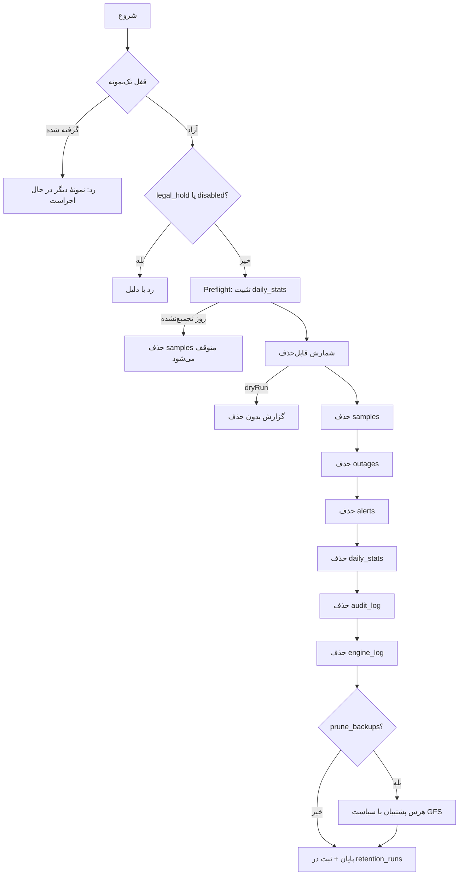
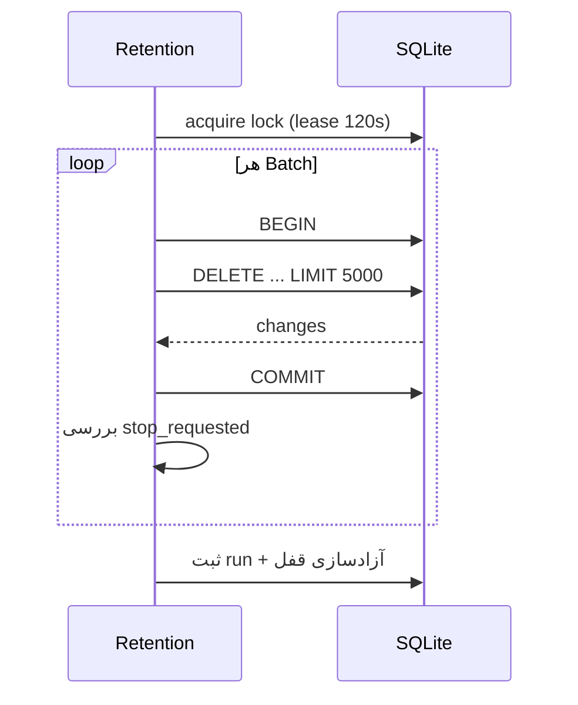

# نگهداری و حذف داده (Retention)

این سند سیاست حذف داده در NetWatch را توضیح می‌دهد: چه چیزی، پس از چند روز، با
چه ترتیبی و تحت چه محافظ‌هایی حذف می‌شود. حذف داده برگشت‌ناپذیر است، بنابراین
هدف این سند شفافیت کامل پیش از فعال‌کردن سیاست است.

> پیاده‌سازی در `server/retention.js` و ابزار خط فرمان
> `server/scripts/db-retention.mjs`.

---

## ۱. چرا Retention لازم است؟

هر بررسی (Probe) یک ردیف در `samples` می‌سازد. با ۱۰۰ تجهیز و بازهٔ ۳۰ ثانیه:

```
۱۰۰ × ۲ × ۶۰ × ۲۴ = ۲۸۸٬۰۰۰ نمونه در روز
```

بدون حذف، فایل پایگاه‌داده در چند هفته به چند گیگابایت می‌رسد و گزارش‌ها کند
می‌شوند. Retention این رشد را کنترل می‌کند، **بدون** از دست دادن گزارش‌های
بلندمدت: پیش از حذف نمونه‌های خام، آمار روزانه در `daily_stats` تثبیت می‌شود.

---

## ۲. سیاست پیش‌فرض

| داده | کلید تنظیم | پیش‌فرض | کف مجاز |
| --- | --- | --- | --- |
| نمونه‌های خام (`samples`) | `samples_retention_days` | `90` روز | ۱ |
| آمار روزانه (`daily_stats`) | `daily_stats_retention_days` | `365` روز | ۳۶۵ |
| قطعی‌ها (`outages`) | `outages_retention_days` | `365` روز | ۳۶۵ |
| هشدارها (`alerts`) | `alerts_retention_days` | `180` روز | ۳۰ |
| گزارش حسابرسی (`audit_log`) | `audit_retention_days` | `365` روز | ۳۶۵ |
| لاگ موتور (`engine_log`) | `engine_log_retention_days` | `30` روز | ۷ |
| پشتیبان‌ها | `retention_prune_backups` | `false` (حذف نمی‌شوند) | — |

کف‌ها (**guardrails**) در کد اعمال می‌شوند: حتی اگر تنظیمات دستکاری یا خراب
شود، مقدار کوچک‌تر از کف پذیرفته نمی‌شود. مثلاً `daily_stats_retention_days`
هرگز کمتر از ۳۶۵ روز نمی‌شود.

| کلید زمان‌بندی | پیش‌فرض | معنی |
| --- | --- | --- |
| `retention_enabled` | `true` | فعال بودن سرویس |
| `retention_run_time` | `03:00` | ساعت اجرای روزانه (به وقت `timezone_offset_minutes`) |
| `retention_interval_minutes` | `1440` | حداقل فاصلهٔ دو اجرای خودکار |
| `retention_batch_size` | `5000` | رکورد در هر تراکنش |
| `retention_max_rows_per_run` | `100000` | سقف کل رکورد در هر اجرا |
| `retention_legal_hold` | `false` | توقف کامل حذف |

---

## ۳. ترتیبی که اجرا می‌شود



### Preflight — مهم‌ترین محافظ

پیش از حذف نمونه‌ها، برنامه بررسی می‌کند که همهٔ روزهای واقع در بازهٔ حذف در
`daily_stats` تجمیع شده باشند. اگر حتی یک روز تجمیع‌نشده باشد:

- حذف `samples` **متوقف** می‌شود؛
- در نتیجهٔ اجرا `blocked.samples = "missing_daily_stats:N"` ثبت می‌شود؛
- بقیهٔ مراحل ادامه می‌یابند.

دلیل: بدون این محافظ، گزارش دسترس‌پذیری ۹۰ روزه پس از هرس، بی‌سروصدا صفر یا
ناقص می‌شد.

---

## ۴. چه چیزی هرگز حذف نمی‌شود؟

| مورد | دلیل |
| --- | --- |
| قطعی **باز** (`outages.open = 1`) | حادثهٔ در جریان باید سند داشته باشد |
| قطعی متصل به سابقهٔ تعمیرات | پیوند سند عملیاتی نباید قطع شود |
| هشدار فعال یا تأییدشده | وضعیت عملیاتی حل‌نشده است |
| هشدار تجهیز دارای قطعی باز | زمینهٔ حادثه حفظ می‌شود |
| حداقل یک نسخهٔ پشتیبان | امکان بازیابی همیشه باقی می‌ماند |

فقط هشدارهای `resolved` و `suppressed` هرس می‌شوند.

---

## ۵. اجرا، Dry-Run و توقف

### از API

```bash
# وضعیت و سیاست مؤثر
curl -s -b cookies.txt http://localhost:8787/api/system/retention | jq .

# اجرای واقعی (Administrator)
curl -s -b cookies.txt -X POST http://localhost:8787/api/system/retention/run \
  -H "X-CSRF-Token: $CSRF" | jq .

# درخواست توقف
curl -s -b cookies.txt -X POST http://localhost:8787/api/system/retention/stop \
  -H "X-CSRF-Token: $CSRF"

# تاریخچهٔ اجراها
curl -s -b cookies.txt 'http://localhost:8787/api/system/retention/runs?pageSize=10' | jq .
```

### از خط فرمان

```bash
# فقط شمارش قابل‌حذف — بدون تغییر
node server/scripts/db-retention.mjs --dry-run

# وضعیت و سیاست مؤثر
node server/scripts/db-retention.mjs --status

# اجرای واقعی
npm run db:retention

# درخواست توقف
node server/scripts/db-retention.mjs --stop
```

> **نکته:** اگر سرویس فعال باشد، قفل پایگاه‌داده جلوی اجرای هم‌زمان را می‌گیرد و
> اسکریپت با کد خروج `2` و پیام روشن پایان می‌یابد. این خطا، خرابی نیست.

### نمونهٔ خروجی Dry-Run

```json
{
  "status": "completed",
  "dryRun": true,
  "runId": 41,
  "counts": {
    "samples": 1843200,
    "outages": 12,
    "alerts": 340,
    "daily_stats": 0,
    "audit_log": 0,
    "engine_log": 5200
  },
  "deletedRows": 1848752,
  "blocked": {},
  "durationMs": 812
}
```

> همیشه پیش از نخستین اجرای واقعی روی یک نصب موجود، `--dry-run` بگیرید و
> عدد `samples` را با انتظار خود مقایسه کنید.

---

## ۶. ایمنی اجرا

| مکانیزم | توضیح |
| --- | --- |
| قفل تک‌نمونه | ردیف `retention_state` با `lock_owner` و lease (۱۲۰ ثانیه) |
| تراکنش هر Batch | Crash فقط همان Batch را برمی‌گرداند |
| `retention_runs` | هر اجرا با `run_id`، پارامترها، آمار و وضعیت ثبت می‌شود |
| Audit Log | `retention.run` و `retention.dry_run` در `audit_log` |
| پرچم `stop_requested` | توقف پس از پایان Batch جاری، نه در میانهٔ آن |
| سقف رکورد در هر اجرا | اجرا کوتاه و قابل توقف می‌ماند |
| `legal_hold` | برای الزام قانونی/قراردادی، همهٔ حذف‌ها متوقف می‌شود |



---

## ۷. هرس پشتیبان

به‌طور پیش‌فرض Retention به پشتیبان‌ها **دست نمی‌زند**؛ سیاست پشتیبان مستقل
است (۷ روزانه + ۴ هفتگی). فقط اگر `retention_prune_backups = true` باشد، پس از
پایان حذف داده، هرس پشتیبان هم اجرا می‌شود.

دلیل جدایی: یک اشتباه در سیاست نگهداری داده نباید هم‌زمان همهٔ نسخه‌های پشتیبان
را از بین ببرد.

---

## ۸. تنظیم سیاست

```bash
curl -s -b cookies.txt -X PUT http://localhost:8787/api/settings \
  -H 'Content-Type: application/json' -H "X-CSRF-Token: $CSRF" \
  -d '{
    "retention_enabled": true,
    "retention_run_time": "02:30",
    "samples_retention_days": 60,
    "alerts_retention_days": 120,
    "retention_legal_hold": false
  }'
```

پس از تغییر، `GET /api/system/retention` را ببینید تا **سیاست مؤثر** (پس از
اعمال کف‌ها) را تأیید کنید.

---

## ۹. محدودیت‌ها و هشدارها

- **حذف برگشت‌ناپذیر است.** تنها راه بازگشت، بازیابی پشتیبان است؛ پس پیش از
  تغییر سیاست، پشتیبان بگیرید.
- **بدون «حذف با تأیید دو مرحله‌ای»:** اجرای واقعی با یک درخواست انجام می‌شود؛
  دسترسی `Administrator` را محدود نگه دارید.
- **بدون زمان‌بند چندبازه‌ای:** فقط یک زمان اجرای روزانه پشتیبانی می‌شود.
- **توقف، Resume خودکار ندارد:** پس از `stop`، اجرای بعدی طبق `retention_run_time`
  شروع می‌شود؛ ادامهٔ دستی با اجرای دوباره است.
- **حذف فیزیکی فایل SQLite کوچک نمی‌شود** مگر با `VACUUM`؛ فضای آزادشده در
  صفحه‌های آزاد باقی می‌ماند و برای استفادهٔ دوباره در دسترس است.

---

## مطالب مرتبط

- [پایگاه‌داده](05-database.md)
- [پشتیبان‌گیری و بازیابی](11-backup-restore.md)
- [عملیات](10-operations.md)
- [پیکربندی](04-configuration.md)
- [موتور پایش](09-engine.md)
