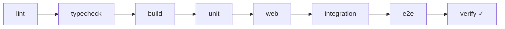

# آزمون و تضمین کیفیت

این سند مجموعه‌آزمون‌های NetWatch، فرمان اجرا و **نتیجهٔ اجرای واقعی** را ثبت
می‌کند. هدف این است که خواننده بداند چه چیزی واقعاً تأیید شده و چه چیزی فقط
زیرساخت آزمون دارد.

> **قاعدهٔ این سند:** فقط آزمونی «PASS» نوشته می‌شود که در همین نسخه اجرا و
> خروجی آن دیده شده باشد. آزمون‌های اجرانشده با برچسب «اجرا نشده» می‌آیند.

---

## ۱. محیط اجرای ثبت‌شده

| مورد | مقدار |
| --- | --- |
| تاریخ اجرا | ۲۰۲۶-۱۰-۲۲ |
| Node.js | `v24.21.0` |
| npm | `11.19.0` |
| نصب وابستگی | `npm ci` موفق |
| سیستم‌عامل | Linux (کانتینر) |

---

## ۲. لایه‌های آزمون

| فرمان | دامنه | ابزار |
| --- | --- | --- |
| `npm run lint` | کل مخزن | ESLint |
| `npm run typecheck` | `web/` | TypeScript (`tsc --noEmit`) |
| `npm run build` | رابط | Vite |
| `npm run test:unit` | `server/tests/unit/*.test.mjs` | `node --test` |
| `npm run test:web` | `web/tests/*.test.ts` | `node --test` + type stripping |
| `npm run test:integration` | `server/tests/integration/*.test.mjs` | `node --test` |
| `npm run test:e2e` | `smoke.mjs` + `server/tests/e2e` | `node --test` |
| `npm run test:db` | زیرمجموعهٔ پایگاه‌داده و Retention | `node --test` |
| `npm run test:engine` | زیرمجموعهٔ موتور و رهبری | `node --test` |
| `npm run test:ui` | مرورگر واقعی | Playwright |
| `npm run test:heavy` | آزمون‌های سنگین | `node --test` |
| `npm run verify` | زنجیرهٔ کامل بالا | — |



---

## ۳. نتیجهٔ اجرای واقعی

| فرمان | نتیجه | جزئیات |
| --- | --- | --- |
| `npm ci` | ✅ موفق | ۲۹۰ بسته |
| `npm run lint` | ✅ PASS (exit 0) | بدون خطا |
| `npm run typecheck` | ✅ PASS (exit 0) | بدون خطای نوع |
| `npm run build` | ✅ PASS | ساخته‌شده در `web/dist`، حدود ۲ ثانیه |
| `npm run test:web` | ✅ ۴۶/۴۶ PASS | `fail 0` |
| `npm run test:unit` | ✅ ۲۴۳/۲۴۳ PASS | `fail 0` |
| `npm run test:integration` | ✅ ۱۵۹/۱۵۹ PASS | ۱۳۷ ثانیه |
| `npm run test:e2e` | ✅ PASS | smoke: ۸۷ موفق / ۰ ناموفق؛ e2e: ۱۱/۱۱ |
| `npm run test:ui` | ⏸ اجرا نشده | نیازمند دانلود مرورگر Playwright |
| `npm run test:heavy` | ⏸ اجرا نشده | آزمون سنگین/طولانی |
| `npm run qa:load` / `qa:soak` | ⏸ اجرا نشده | نیازمند اجرای طولانی و منابع |

آنچه در تست‌های یکپارچه تأیید شد (نمونه):

- RBAC: Viewer فقط می‌خواند؛ Operator عملیات روزمره دارد؛ فقط Administrator
  تنظیمات/کاربران/حسابرسی را تغییر می‌دهد.
- CSRF و Origin غیرمجاز حتی با نشست معتبر، نوشتن را رد می‌کنند.
- آپلود فایل بزرگ پیش از تجزیه رد می‌شود؛ ورودی مخرب رد می‌شود.
- SIGTERM موتور را تخلیه، SSE را می‌بندد و WAL را Checkpoint می‌کند.
- ۱۰۰ کلاینت SSE هم‌زمان و سناریوهای قطع/اتصال دوباره پایدارند.
- نصب تازه بدون دادهٔ دمو، ساخت حساب مدیر، ارتقای پایگاه‌دادهٔ v3 با حفظ داده و
  نقطهٔ بازگشت، شکست Migration بدون ساختار نیمه‌کاره، و توقف راه‌اندازی روی
  پایگاه‌دادهٔ خراب.
- سناریوی انتشار: پشتیبان معتبر → توقف تمیز → بازیابی با دادهٔ سازگار.

آنچه در E2E تأیید شد:

- افزودن تجهیز → شکست بررسی → وضعیت `offline` + هشدار فعال → حذف تجهیز.
- هم‌خوانی شمارنده‌های فهرست با رابط.
- ساخت کاربران با نقش‌های جداگانه.
- جریان Import با پیش‌نمایش و Commit.
- گزارش‌ها و وضعیت پس از قطعی.
- SSE با `hello` و ادامه پس از قطع.
- پشتیبان معتبر + Dry-Run Retention بدون حذف.

---

## ۴. آزمون ناموفق و علت آن

**آزمون:** `server/tests/unit/db-cleanup.test.mjs` →
«samples of today and yesterday survive for the daily rollup»

**نتیجه:** FAIL — `0 !== 1` برای «نمونهٔ دیروز باید برای تجمیع حفظ شود».

**علت ریشه‌ای:** آزمون فرض می‌کند مرز روز UTC است و
`engine.cleanup({ retention_days: 1, timezone_offset_minutes: 0 })` را صدا می‌زند.
اما `engine.cleanup` فقط `retention_days` را می‌خواند و
`timezone_offset_minutes` را نادیده می‌گیرد؛ پس سیاست با مقدار ذخیره‌شده
(`210` دقیقه، Asia/Tehran) اجرا می‌شود. در ساعت `21:24 UTC`، مرز روز محلی جلوتر
از «ظهر دیروز به وقت UTC» است و نمونهٔ آزمون هرس می‌شود.

```text
cutoff (offset=0)      = 2026-10-19T00:00:00Z   → نمونه حفظ می‌شد
cutoff (offset=210)    = 2026-10-19T20:30:00Z   → نمونه حذف می‌شود
نمونهٔ آزمون           = 2026-10-19T12:00:00Z
```

**تأثیر:** رفتار تولیدی **نادرست نیست**؛ Retention دقیقاً طبق مرز روز محلی کار
می‌کند. مشکل، وابستگی آزمون به ساعت اجرا و نادیده‌گرفتن پارامتر
`timezone_offset_minutes` در `engine.cleanup` است.

**وضعیت:** این نقص در نسخهٔ فعلی **برطرف نشده** (این مأموریت فقط مستندسازی است)
و به‌عنوان یافته در [Changelog](17-changelog.md) ثبت شده است. اجرای همین آزمون
در ساعت‌های دیگر روز ممکن است PASS شود؛ بنابراین نتیجهٔ آن را «PASS» گزارش
نکنید.

---

## ۵. آزمون‌هایی که اجرا نشده‌اند

| آزمون | چرا اجرا نشد | چه چیزی را پوشش می‌دهد |
| --- | --- | --- |
| `test:ui` | مرورگر Playwright در این محیط نصب نبود | جریان‌های واقعی مرورگر، RTL و دسترس‌پذیری |
| `test:heavy` | طولانی و منابع‌بر | بار سنگین، سناریوهای حدی |
| `qa:load` | نیازمند اجرای طولانی | ماتریس بار هم‌زمان |
| `qa:soak` / `qa:soak24` / `qa:soak72` | ساعت‌ها تا روزها | نشتی حافظه و پایداری بلندمدت |

نبود این نتایج یعنی **پایداری بلندمدت و رفتار مرورگری واقعی تأیید نشده** است؛
ادعای «تست‌شده» برای این حوزه‌ها مجاز نیست.

---

## ۶. اجرا در محیط خودتان

```bash
npm ci
npm run lint && npm run typecheck && npm run build
npm run test:unit
npm run test:web
npm run test:integration
npm run test:e2e        # نیازمند build موفق
npm run test:ui         # نیازمند: npx playwright install
```

> اگر آزمون واحد `db-cleanup` را در ساعتی اجرا کنید که تهران بعد از نیمه‌شب
> محلی است، احتمال شکست بالا می‌رود — طبق تحلیل بخش ۴.

### آزمون بار

```bash
npm run qa:load -- --help   # بررسی گزینه‌های موجود در همین نسخه
npm run qa:soak             # پیش‌فرض کوتاه
```

پیش از هر ادعای ظرفیت، اعداد واقعی همان سخت‌افزار خودتان را اندازه بگیرید؛
مقادیر این سند مبنای ظرفیت نیست.

---

## ۷. معیار پذیرش انتشار

| معیار | حداقل |
| --- | --- |
| lint / typecheck | بدون خطا |
| build | موفق |
| unit + web | بدون FAIL جدید |
| integration | ۱۰۰٪ PASS |
| e2e | ۱۰۰٪ PASS |
| بازیابی از پشتیبان | یک بار تمرین‌شده روی همان نسخه |

اگر یکی از موارد بالا برقرار نبود، انتشار انجام نشود. جزئیات رویه در
[ارتقا و انتشار](15-upgrade-release.md).

---

## مطالب مرتبط

- [راهنمای توسعه](16-development.md)
- [ارتقا و انتشار](15-upgrade-release.md)
- [عیب‌یابی](13-troubleshooting.md)
- [موتور پایش](09-engine.md)
- [Changelog](17-changelog.md)
