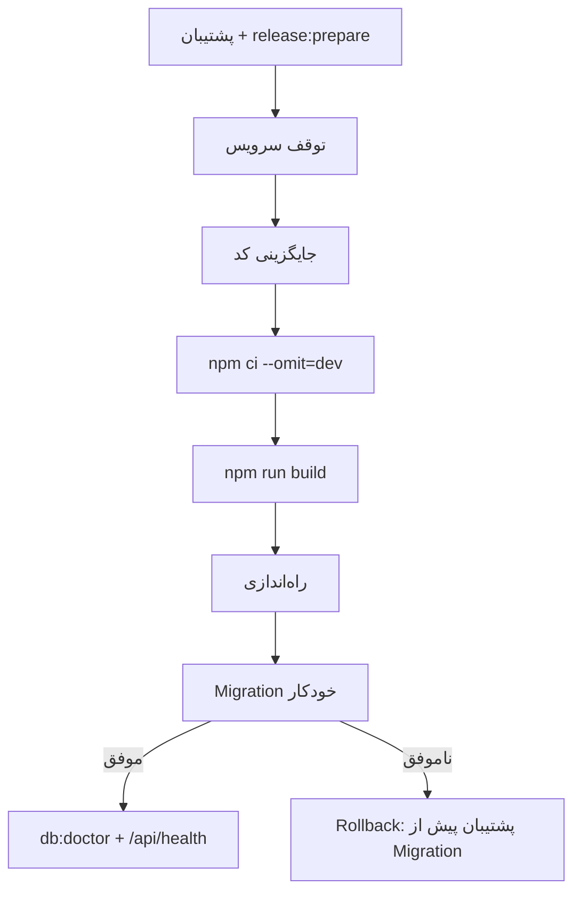

# ارتقا و انتشار

این سند رویهٔ ارتقای نسخه، رفتار Migration و مسیر بازگشت (Rollback) را توضیح
می‌دهد، سپس چگونگی ساخت Artifact انتشار را نشان می‌دهد. مخاطب آن مدیر سیستم و
مسئول انتشار است.

> **هیچ آزمایش ارتقایی روی پایگاه‌دادهٔ تولید اصلی انجام نمی‌شود.** ابتدا روی یک
> کپی تمرین کنید.

---

## ۱. قواعد کلی

| قاعده | توضیح |
| --- | --- |
| پشتیبان پیش از هر تغییر | `npm run db:backup` و خروجی `ok: true` |
| Migration فقط رو به جلو | گام‌های شماره‌دار با `schema_migrations` + `PRAGMA user_version` |
| هر گام یک تراکنش | یا کامل اعمال می‌شود یا هیچ اثری نمی‌گذارد |
| نقطهٔ بازگشت خودکار | `netwatch.db.pre-migration-v<old>-<ts>` با مجوز `600` |
| Downgrade پشتیبانی‌شده | فقط بازگرداندن همان فایل یا پشتیبان پیش از ارتقا |
| زمان توقف | برای پایگاه‌دادهٔ زیر ۱GB معمولاً کمتر از یک دقیقه |



---

## ۲. رویهٔ استاندارد ارتقا

```bash
# ۰) نسخه و سلامت فعلی
cd /opt/netwatch
node -p "require('./package.json').version"
sudo -u netwatch env NETWATCH_DATA_DIR=/var/lib/netwatch npm run db:doctor

# ۱) پشتیبان + نقطهٔ بازگشت کد
sudo -u netwatch env NETWATCH_DATA_DIR=/var/lib/netwatch npm run release:prepare

# ۲) توقف سرویس
sudo systemctl stop netwatch

# ۳) جایگزینی کد
sudo -u netwatch tar -xzf netwatch-<new-version>.tar.gz -C /opt/netwatch --strip-components=1
cd /opt/netwatch
sudo -u netwatch npm ci --omit=dev
sudo -u netwatch npm run build

# ۴) راه‌اندازی (Migration خودکار اجرا می‌شود)
sudo systemctl start netwatch
sudo journalctl -u netwatch -n 100 --no-pager | grep -E "db_migration|db_pre_migration_backup|db_health"

# ۵) تأیید
curl -fsS http://127.0.0.1:8787/api/health
sudo -u netwatch env NETWATCH_DATA_DIR=/var/lib/netwatch npm run db:doctor
```

خروجی مورد انتظار در لاگ (نمونهٔ شکل):

```json
{"event":"db_pre_migration_backup","from":3,"to":5,"file":"netwatch.db.pre-migration-v3-1761000000000"}
{"event":"db_migration_applied","version":4,"name":"auth-security","durationMs":12}
{"event":"db_migration_applied","version":5,"name":"performance-indexes","durationMs":8}
{"event":"db_health","ok":true,"mode":"quick"}
```

---

## ۳. تمرین روی کپی

```bash
# کپی داده در مسیر موقت
sudo install -d -o netwatch -g netwatch /tmp/netwatch-upgrade
sudo -u netwatch cp /var/lib/netwatch/netwatch.db /tmp/netwatch-upgrade/

# اجرای نسخهٔ جدید روی همان کپی (پورت دیگر)
sudo -u netwatch env \
  NETWATCH_DATA_DIR=/tmp/netwatch-upgrade \
  PORT=8090 \
  node server/index.js
```

سپس `db:doctor` و یک ورود آزمایشی روی همان مسیر. اگر همه سالم بود، روی تولید
تکرار کنید.

---

## ۴. Migrationها در نسخهٔ ۱.۲.۰

| نسخه | نام | محتوا |
| --- | --- | --- |
| ۱ | `baseline` | ساختار پایه |
| ۲ | `resilience` | `next_check_at`، `samples.started_at`، `engine_lock.epoch`، `engine_meta`، ایندکس‌های تاب‌آوری |
| ۳ | `retention-policy` | `retention_runs`، `retention_state`، `runtime_state` |
| ۴ | `auth-security` | قفل حساب، `password_changed_at`، ایندکس نشست‌ها |
| ۵ | `performance-indexes` | ایندکس‌های هشدار/قطعی/آمار روزانه |

`SCHEMA_VERSION = 5` است. اگر `PRAGMA user_version` بزرگ‌تر از نسخهٔ برنامه
باشد، برنامه راه‌اندازی نمی‌شود (پایگاه‌داده از کد جدیدتر است).

---

## ۵. Rollback

### الف — بازگشت سریع داده

```bash
sudo systemctl stop netwatch
sudo -u netwatch env NETWATCH_DATA_DIR=/var/lib/netwatch \
  npm run db:restore -- /var/lib/netwatch/netwatch.db.pre-migration-v3-<ts> --force
sudo systemctl start netwatch
```

### ب — بازگشت کامل (کد + داده)

```bash
sudo systemctl stop netwatch
# کد نسخهٔ قبل از آرشیو release:prepare
sudo -u netwatch tar -xzf releases/<old-version>-<ts>/netwatch-<old-version>.tar.gz \
  -C /opt/netwatch --strip-components=1
cd /opt/netwatch && sudo -u netwatch npm ci --omit=dev && sudo -u netwatch npm run build
# دادهٔ همان نسخه
sudo -u netwatch env NETWATCH_DATA_DIR=/var/lib/netwatch npm run db:restore -- <backup-dir>
sudo systemctl start netwatch
```

> ⚠️ کد قدیمی روی پایگاه‌دادهٔ ارتقایافته **پشتیبانی نمی‌شود**. اگر فقط کد را
> برگردانید و داده را نه، ممکن است برنامه به‌دلیل نسخهٔ ساختار بالا نیاید.

---

## ۶. ساخت Artifact انتشار

```bash
npm run build                 # پیش‌نیاز: web/dist
npm run release:artifact
```

| خروجی | محتوا |
| --- | --- |
| `netwatch-<version>.tar.gz` | سورس تحت کنترل نسخه (`git archive`) |
| `netwatch-web-<version>.tar.gz` | خروجی Build رابط (`web/dist`) |
| `SHA256SUMS` | checksum هر دو فایل |
| `release.json` | نسخه، کامیت، زمان و checksumها |

مسیر پیش‌فرض `artifacts/release` و قابل تغییر با `OUTPUT_DIR` است. این اسکریپت
هیچ فایلی را در گیت تغییر نمی‌دهد.

### `release:prepare` چه می‌کند؟

1. پشتیبان WAL-سازگار از پایگاه‌داده و MBTiles می‌سازد و اعتبارسنجی می‌کند.
2. از کد کامیت فعلی یک `tar.gz` می‌سازد (منبع Rollback).
3. `release.json` با نسخه، کامیت، SHA-256 و دستورهای بازگشت می‌نویسد.

خروجی JSON مصرف‌ماشینی است.

---

## ۷. چک‌لیست انتشار

- [ ] `npm run verify` سبز است (به‌جز موارد شناخته‌شده در [آزمون‌ها](14-testing.md))
- [ ] `package.json.version` و `SCHEMA_VERSION` هم‌خوان‌اند
- [ ] [Changelog](17-changelog.md) به‌روز شده است
- [ ] `npm run release:prepare` موفق و `release.json` بررسی شده
- [ ] ارتقا روی کپی تمرین شده است
- [ ] پشتیبان تولید تازه و **اعتبارسنجی‌شده** است
- [ ] مسیر بازگشت (کد + داده) مستند و در دسترس است
- [ ] پس از انتشار: `db:doctor`، `/api/health` و یک ورود آزمایشی

---

## ۸. محدودیت‌ها

- **Migration برگشت‌پذیر نیست:** Rollback یعنی بازگرداندن پشتیبان، نه اجرای
  Migration معکوس.
- **بدون انتشار خودکار (CI/CD):** ساخت Artifact دستی/اسکریپتی است.
- **بدون مهر زمانی امضاشده:** فقط SHA-256 وجود دارد؛ امضای GPG ندارد.
- **بدون ارتقای بدون توقف (Zero-downtime):** سرویس باید متوقف شود.

---

## مطالب مرتبط

- [پشتیبان‌گیری و بازیابی](11-backup-restore.md)
- [پایگاه‌داده](05-database.md)
- [آزمون و تضمین کیفیت](14-testing.md)
- [عیب‌یابی](13-troubleshooting.md)
- [Changelog](17-changelog.md)
