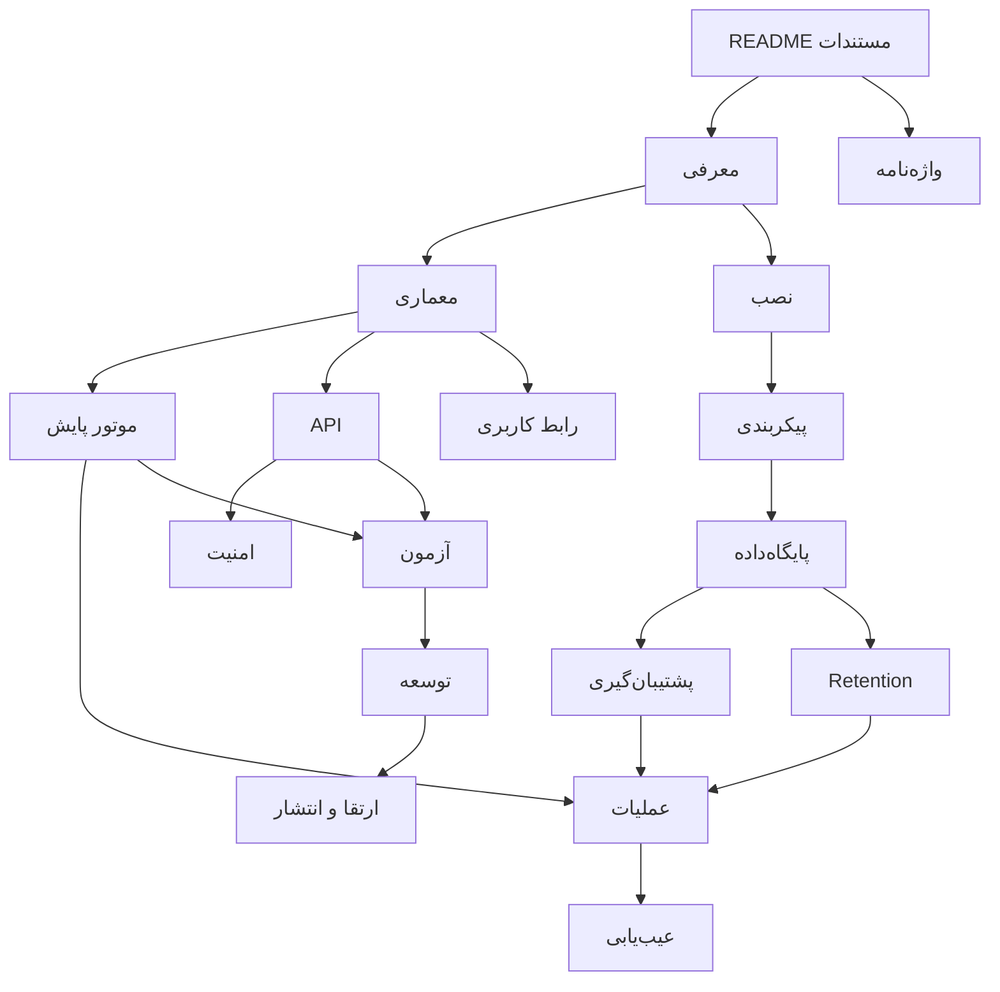

# مستندات فارسی NetWatch

این پوشه، صفحهٔ اصلی مستندات فارسی **NetWatch** است؛ سامانهٔ آفلاین پایش شبکه که در
یک فرآیند Node.js اجرا می‌شود و داده‌ها را در یک فایل SQLite محلی نگه می‌دارد.

| مورد | مقدار |
| --- | --- |
| نسخهٔ برنامه | `1.3.0` |
| نسخهٔ ساختار داده | `SCHEMA_VERSION = 12` |
| آخرین به‌روزرسانی مستندات | ۲۰۲۶-۱۰-۲۲ |
| مخزن کد | `wmp144-ctrl/Freebuff_2` |
| پیش‌نیاز اجرا | Node.js `>= 22.12.0` |

> **مبنای صحت:** هر عدد، پیش‌فرض، مسیر و قرارداد API در این مجموعه از **کد
> همین نسخه** استخراج شده است. اگر بین این مستندات و کد اختلافی دیدید، کد مبنا
> است؛ اختلاف‌های شناسایی‌شده در [Changelog](17-changelog.md) فهرست شده‌اند.

---

## از کجا شروع کنم؟

| اگر شما… | مسیر پیشنهادی |
| --- | --- |
| کاربر مبتدی هستید و فقط می‌خواهید برنامه را بشناسید و اجرا کنید | [معرفی](01-introduction.md) → [نصب](03-installation.md) → [عملیات روزمره](10-operations.md) |
| مدیر سیستم هستید | [نصب](03-installation.md) → [پیکربندی](04-configuration.md) → [پایگاه‌داده](05-database.md) → [امنیت](08-security.md) → [پشتیبان‌گیری](11-backup-restore.md) → [Retention](12-retention.md) → [عیب‌یابی](13-troubleshooting.md) |
| توسعه‌دهنده هستید | [معرفی](01-introduction.md) → [معماری](02-architecture.md) → [پایگاه‌داده](05-database.md) → [API](06-api.md) → [رابط کاربری](07-frontend.md) → [موتور](09-engine.md) → [آزمون‌ها](14-testing.md) → [راهنمای توسعه](16-development.md) |
| می‌خواهید فقط API را صدا بزنید | [API](06-api.md) → [امنیت](08-security.md) |

**ترتیب مطالعهٔ پیشنهادی برای مبتدی:** ۱) معرفی، ۲) نصب، ۳) اولین ورود و
تنظیمات پایه، ۴) عملیات روزمره، ۵) عیب‌یابی. مفاهیم تخصصی در
[واژه‌نامه](00-glossary.md) تعریف شده‌اند.

---

## فهرست کامل مستندات

| # | سند | چه چیزی را توضیح می‌دهد |
| --- | --- | --- |
| ۰۰ | [واژه‌نامه](00-glossary.md) | اصطلاحات تخصصی، واحدها و مفاهیم مشترک |
| ۰۱ | [معرفی و قابلیت‌ها](01-introduction.md) | برنامه چه می‌کند، چه نمی‌کند و برای چه کسانی است |
| ۰۲ | [معماری](02-architecture.md) | اجزای سیستم، جریان داده، مدل اجرا و نمودارها |
| ۰۳ | [نصب و راه‌اندازی](03-installation.md) | اجرای سریع، نصب تولیدی، systemd، TLS و بررسی سلامت |
| ۰۴ | [پیکربندی](04-configuration.md) | متغیرهای محیطی، تنظیمات پایگاه‌داده، پیش‌فرض‌ها و اعتبارسنجی |
| ۰۵ | [پایگاه‌داده](05-database.md) | جدول‌ها، روابط، Migration، WAL، سلامت و کارایی |
| ۰۶ | [API](06-api.md) | احراز هویت، قراردادها، همهٔ گروه‌های Endpoint و نمونه‌ها |
| ۰۷ | [رابط کاربری](07-frontend.md) | ساختار React، صفحات، دریافت داده، SSE و ساخت رابط |
| ۰۸ | [امنیت و کنترل دسترسی](08-security.md) | RBAC، نشست، CSRF، سقف نرخ، سیاست شبکه و Audit |
| ۰۹ | [موتور پایش](09-engine.md) | حالت‌های بررسی، گذار وضعیت، هشدارها، رهبری و سلامت موتور |
| ۱۰ | [عملیات و Runbook](10-operations.md) | کنترل سرویس، پایش، کاربران، حوادث و چک‌لیست‌ها |
| ۱۱ | [پشتیبان‌گیری و بازیابی](11-backup-restore.md) | قالب پشتیبان، ساخت، اعتبارسنجی، Restore و RPO/RTO |
| ۱۲ | [نگهداری داده (Retention)](12-retention.md) | سیاست حذف، ترتیب اجرا، توقف، Dry-Run و ایمنی داده |
| ۱۳ | [عیب‌یابی](13-troubleshooting.md) | نشانه‌ها، علت‌ها، کدهای خطا و سناریوهای بازیابی |
| ۱۴ | [آزمون و تضمین کیفیت](14-testing.md) | مجموعه‌آزمون‌ها، فرمان‌ها، نتایج اجراشده و محدودیت‌ها |
| ۱۵ | [ارتقا و انتشار](15-upgrade-release.md) | Migration، Rollback، Artifact و رویهٔ انتشار |
| ۱۶ | [راهنمای توسعه](16-development.md) | ساختار کد، قواعد کدنویسی و افزودن قابلیت |
| ۱۷ | [Changelog](17-changelog.md) | تغییرات مستندات، نسخهٔ برنامه و اختلاف‌های شناسایی‌شده |

---

## نقشهٔ ارتباط مستندات

---

## وضعیت مستندسازی

برای پرهیز از معرفی قابلیت‌های غیرواقعی، در سراسر این مجموعه از سه برچسب استفاده
می‌شود:

| برچسب | معنی |
| --- | --- |
| **موجود** | در کد همین نسخه پیاده‌سازی شده و مسیر اجرایی دارد |
| **موجود با محدودیت** | پیاده‌سازی شده، اما شرط، سقف یا نقص شناخته‌شده دارد |
| **پیشنهاد آینده** | در این نسخه وجود ندارد و فقط به‌عنوان مسیر توسعه ذکر می‌شود |

مواردی که در این نسخه **وجود ندارند** و نباید به‌عنوان قابلیت موجود معرفی شوند:

- ارسال ایمیل، SMS، Webhook یا اعلان بیرونی؛ اعلان‌ها فقط در رابط کاربری هستند.
- MFA/WebAuthn، ورود با دامنه (LDAP/AD) یا SSO.
- پایش SNMP، Syslog، NetFlow یا Agent نصب‌شده روی تجهیزات.
- اجرای چندنمونه‌ای افقی (HA) روی یک پایگاه‌دادهٔ مشترک.
- رمزنگاری داده در حالت سکون یا رمزنگاری پشتیبان.
- ساخت خودکار سابقهٔ تعمیرات برای هر قطعی.
- اعمال `threshold`/`comparator`/`severity` قوانین هشدار توسط موتور (این فیلدها
  ذخیره می‌شوند، اما رفتار اجرایی فعلی محدود است؛ جزئیات در
  [موتور پایش](09-engine.md)).
- گواهی خودکار TLS از اینترنت (Let’s Encrypt)؛ گواهی محلی با `npm run tls:setup`.

---

## بقیهٔ سند‌های پوشهٔ `docs/`

این مجموعه بخش فارسی و آموزشی مستندات است؛ سندهای عملیاتی و مرجع نیز در همین
پوشه هستند:

- [README اصلی مخزن](../../README.md) — مرور سریع، قابلیت‌ها و نمونه‌های curl
- [install](../install.md) — نصب تولیدی
- [upgrade](../upgrade.md) — ارتقا و Rollback
- [database](../database.md) — پایگاه‌داده و Migration
- [data-retention](../data-retention.md) — سیاست نگهداری داده
- [backup-restore](../backup-restore.md) — پشتیبان و بازیابی
- [operations](../operations.md) — Runbook عملیاتی
- [troubleshooting](../troubleshooting.md) — عیب‌یابی
- [security](../security.md) — مدل تهدید و کنترل‌ها
- [verification-report](../verification-report.md) — نتیجهٔ آزمون‌ها و وضعیت باگ‌ها
- [changelog](../changelog.md) — یادداشت انتشار

> در صورت تناقض، **کد** مبنا است. مثلاً پاسخ عمومی `GET /api/health` در کد فقط
> `{ok, status, ts}` است، حتی اگر در سند قدیمی‌تری فیلدهای بیشتری ذکر شده باشد.

---

## قراردادهای این مستندات

- همهٔ زمان‌ها در API و پایگاه‌داده، **epoch milliseconds** هستند مگر خلاف آن
  ذکر شود.
- مسیرها نسبی به ریشهٔ مخزن نوشته می‌شوند؛ مثلاً `server/config.js`.
- دستورها در Code Block و برای Bash نوشته شده‌اند (در ویندوز از Git Bash یا
  PowerShell معادل استفاده کنید).
- نمونه‌های JSON «نمونهٔ شکل پاسخ» هستند؛ ممکن است فیلدهای بیشتری در پاسخ واقعی
  وجود داشته باشد.
- مقادیر حساس (رمز، توکن، کلید) عمداً با `…` یا `<...>` نمایش داده می‌شوند.

---

## مطالب مرتبط

- [واژه‌نامه](00-glossary.md)
- [معرفی و قابلیت‌ها](01-introduction.md)
- [نصب و راه‌اندازی](03-installation.md)
- [Changelog مستندات](17-changelog.md)
