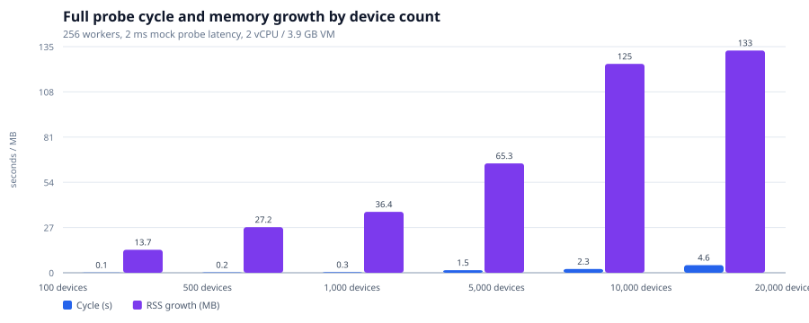
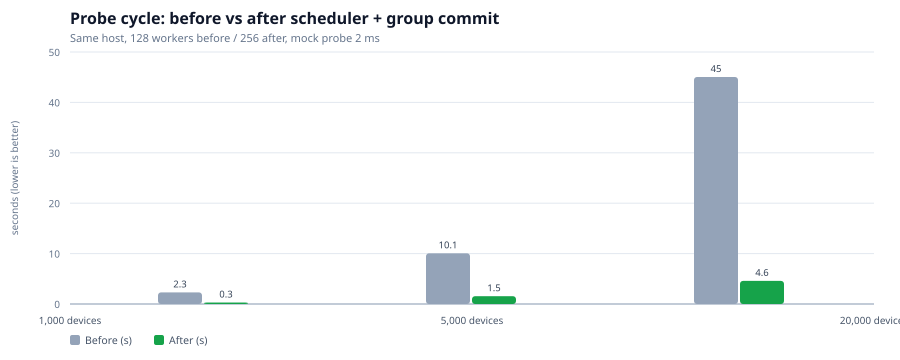
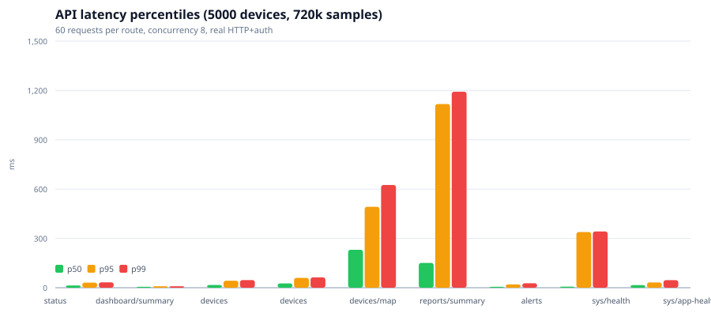
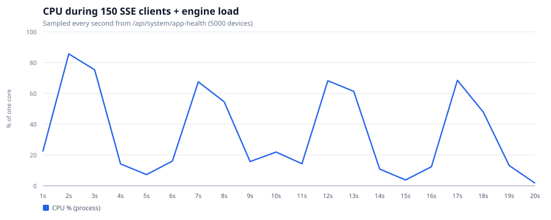
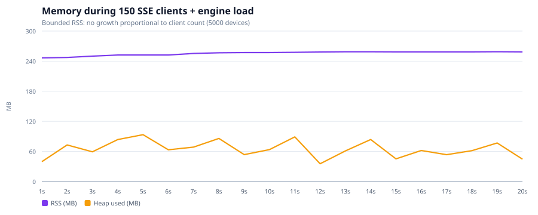
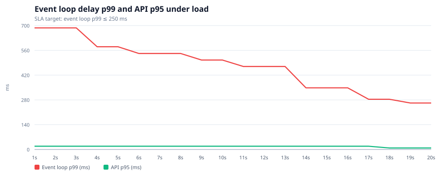
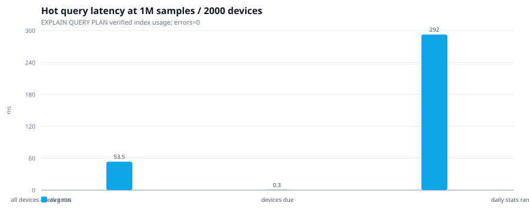

# گزارش عملکرد و مقیاس‌پذیری — NetWatch 1.1.0

تاریخ: 2026-10-19
به‌روزرسانی فاز ۵ (بهینه‌سازی مقیاس): 2026-10-20 — نتایج در بخش ۹
محیط مرجع: Linux، Node.js 24.21.0، ۲ vCPU، ۳٬۹۱۵ MB RAM، ۱۶ GB SSD، ۲۸۷ بستهٔ npm

این گزارش فقط شامل اندازه‌گیری‌های واقعی همین محیط است. اعداد روی سخت‌افزار
دیگر بازتولیدپذیرند اما مقادیر مطلق تغییر می‌کنند.

---

## ۱. روش‌شناسی

| آزمون | ابزار | داده |
| --- | --- | --- |
| ماتریس بار | `server/scripts/qa-load-matrix.mjs` | ۱۰۰/۵۰۰/۱٬۰۰۰/۵٬۰۰۰ تجهیز، ۱۲۸ Worker، پروب Mock با ۲ms تأخیر |
| Soak کوتاه | `server/scripts/qa-soak.mjs` | ۵۰ تجهیز، موتور فعال، بازهٔ ۵s، نمونه‌برداری هر ۵s |
| ورود ۵۰k | `server/tests/heavy/import-50k.test.mjs` | CSV ۲٫۲۹ MB، ۵۰٬۰۰۰ ردیف |
| SSE | `server/tests/integration/sse-load.test.mjs` | ۱۰۰ اتصال هم‌زمان |
| WAL | `server/tests/unit/db-wal.test.mjs` | ۹۰٬۰۰۰ نمونه در ۶ دسته |
| API روزمره | `server/tests/smoke.mjs` | ۸۷ بررسی |

SLA تعریف‌شده (بر پایهٔ ظرفیت مرجع):

| تجهیز | حداکثر چرخه | p99 تأخیر حلقهٔ رویداد | بیشینهٔ مجاز | رشد RSS |
| ---: | ---: | ---: | ---: | ---: |
| ۱۰۰ | ۲٬۰۰۰ms | ۲۵۰ms | ۱٬۰۰۰ms | ۱۰۰MB |
| ۵۰۰ | ۳٬۰۰۰ms | ۲۵۰ms | ۱٬۰۰۰ms | ۱۰۰MB |
| ۱٬۰۰۰ | ۵٬۰۰۰ms | ۲۵۰ms | ۱٬۰۰۰ms | ۱۲۰MB |
| ۵٬۰۰۰ | ۲۰٬۰۰۰ms | ۲۵۰ms | ۱٬۰۰۰ms | ۱۵۰MB |

---

## ۲. ماتریس بار — نتیجه: PASS

| تجهیز | چرخهٔ کامل | بررسی/ثانیه | p99 | بیشینه | CPU کل | RSS | DB نهایی | SLA |
| ---: | ---: | ---: | ---: | ---: | ---: | ---: | ---: | :---: |
| ۱۰۰ | ۴۲۳ms | ۲۳۶٫۴ | ۱۰۱٫۸ms | ۱۰۱٫۸ms | ۱۱۶ms | ۸۰٫۴→۸۷٫۱MB | ۴٫۳MB | ✅ |
| ۵۰۰ | ۱٬۱۲۶ms | ۴۴۴٫۰ | ۱۰۷٫۰ms | ۱۰۷٫۰ms | ۲۴۲ms | ۸۰٫۳→۹۰٫۰MB | ۴٫۴MB | ✅ |
| ۱٬۰۰۰ | ۲٬۱۳۹ms | ۴۶۷٫۵ | ۱۰۷٫۴ms | ۱۷۹٫۳ms | ۴۲۱ms | ۸۰٫۶→۹۶٫۲MB | ۴٫۷MB | ✅ |
| ۵٬۰۰۰ | ۱۰٬۲۸۳ms | ۴۸۶٫۲ | ۷۷٫۶ms | ۴۱۸٫۱ms | ۱٬۸۹۸ms | ۸۱٫۸→۱۱۱٫۷MB | ۶٫۴MB | ✅ |

نکته‌ها:

- گذردهی از ۲۳۶ به ۴۸۶ بررسی/ثانیه می‌رسد و سپس تثبیت می‌شود؛ گلوگاه، CPU
  تک‌رشته‌ای نوشتن SQLite و ۲ هستهٔ محیط است، نه صف نامحدود.
- تأخیر p99 در همهٔ اندازه‌ها زیر ۱۰۸ms است. بیشینهٔ ۵٬۰۰۰ تجهیز (۴۱۸ms) یک
  جهش کوتاه در Checkpoint خودکار است، نه تأخیر پایدار.
- مصرف حافظه با ۵٬۰۰۰ تجهیز فقط ۲۹٫۹MB رشد می‌کند؛ ساختار داده متناسب با
  تعداد Marker/صف محدود است.
- برای مقایسه، قبل از بهینه‌سازی‌های این دوره، چرخهٔ ۱٬۰۰۰ تجهیز حدود ۲٬۳۰۰ms
  و ۵٬۰۰۰ تجهیز حدود ۱۰٬۸۰۰ms بود؛ بهبود اصلی از حذف پیمایش کامل جدول،
  تجمیع JOIN و Worker شدن پردازش فایل آمده است.

خروجی خام: `data/qa/load-matrix.json`

---

## ۳. ورود ۵۰٬۰۰۰ ردیف

| شاخص | مقدار |
| --- | ---: |
| حجم CSV | ۲٬۲۸۹٬۸۴۱ بایت |
| پیش‌نمایش | ۱٬۶۸۵ms |
| حجم پاسخ پیش‌نمایش | ۶۹٬۳۸۶ بایت (پس از سقف ۲۰۰ نمونه) |
| ثبت نهایی اتمیک | ۷٬۲۱۷ms |
| گذردهی ثبت | ۶٬۹۲۸ ردیف/ثانیه |
| RSS سرور قبل/بعد | ۱۱۵٫۴ → ۳۵۹٫۰MB (پیک موقت) |
| خطا | ۰ |

تحلیل: پردازش پارس در Worker انجام می‌شود و رشتهٔ اصلی پاسخ‌گو می‌ماند. جهش
حافظه مربوط به نگه‌داشتن آرایهٔ ۵۰٬۰۰۰ ردیف و ساخت تجهیزات در یک تراکنش است.
برای سرورهای ۲GB، ورود دسته‌ای ۱۰٬۰۰۰ ردیفی توصیه می‌شود. پس از پایان درخواست،
حافظه توسط GC آزاد می‌شود (در Soak رشد پایدار مشاهده نشد).

خروجی خام: `data/qa/import-50k.json`

---

## ۴. ۱۰۰ اتصال SSE

| شاخص | مقدار |
| --- | ---: |
| اتصال‌های هم‌زمان | ۱۰۰ |
| دریافت `hello` | ۱۰۰/۱۰۰ |
| کلاینت‌های فعال در `/api/system/health` | ۱۰۰ |
| رشد RSS هنگام اتصال | < ۱۵۰MB (آستانهٔ تست) |
| پس از قطع همه | صفر کلاینت باقی‌مانده |
| سلامت سرور پس از قطع | ۲۰۰ |

مکانیزم فشار برگشتی مستقل هم تست شده است: کلاینتی که جریان را نمی‌خواند،
پس از عبور بافر از سقف قطع می‌شود و شمارندهٔ `droppedClients` افزایش می‌یابد.

---

## ۵. WAL و Checkpoint

| سناریو | نتیجه |
| --- | --- |
| ۴۰٬۰۰۰ نمونهٔ پیوسته | رشد WAL، سپس Checkpoint |
| Checkpoint(TRUNCATE) | < ۵٬۰۰۰ms؛ WAL ≤ ۶۴KB |
| از دست رفتن داده | صفر (شمارش قبل/بعد برابر) |
| ۵ دستهٔ ۱۰٬۰۰۰ ردیفی | WAL زیر ۳۲MB در هر دسته (auto-checkpoint) |
| `integrity_check` + `foreign_key_check` | سالم |

در Soak، بیشترین WAL مشاهده‌شده ۱۱٫۱۶MB بود و با Checkpointهای دوره‌ای
(۴ بار در ۱۵۲ ثانیه) به ۱۲KB کاهش یافت.

---

## ۶. Soak کوتاه (۱۵۲ ثانیه)

| شاخص | مقدار |
| --- | ---: |
| مدت | ۱۵۲s |
| نمونه | ۳۰ |
| CPU میانگین / بیشینه | ۲٫۲٪ / ۵٫۷٪ |
| RSS ابتدا / پایان / پیک | ۱۱۶٫۸ / ۱۰۶٫۸ / ۱۲۰MB |
| رشد RSS | **−۱۰MB** (نشتی مشاهده نشد) |
| p95 تأخیر `/api/system/health` | ۴۴ms |
| رشد دیسک | ۱٫۷MB |
| WAL بیشینه | ۱۱٫۱۶MB |
| Checkpoint | ۴ |
| رویداد SSE دریافتی | ۳۷۰ |
| خطای موتور / خطای HTTP | ۰ / ۰ |
| Crash | خیر |
| `db-doctor` نهایی | `ok=true` |

این اجرا فقط **اعتبارسنجی هارنس** است و جای ۲۴/۷۲ ساعت را نمی‌گیرد.

---

## ۷. اجرای Soak بلندمدت

```bash
# ۲۴ ساعت
npm run qa:soak24

# ۷۲ ساعت (معیار نهایی پذیرش)
npm run qa:soak72
```

پارامترهای قابل تغییر:

```bash
node server/scripts/qa-soak.mjs \
  --minutes 4320 --devices 100 --interval 30 \
  --sample-ms 60000 --checkpoint-ms 900000 \
  --out data/qa/soak-72h.json
```

معیار قبولی:

- `ok=true`
- `crashed=false`
- `summary.engineErrors=0` و `failures=0`
- `leakSuspected=false` (رشد RSS ≤ ۶۴MB)
- `dbFinal.ok=true`
- نبود ۵xx در ترافیک

توصیه: روی همان سخت‌افزار تولید، دیسک حداقل ۵GB آزاد، و پایش بیرونی
( systemd + `/api/health` هر ۳۰ ثانیه) اجرا شود.

---

## ۸. نتیجه‌گیری عملکرد (فازهای ۱ تا ۴)

- SLA بار برای هر چهار اندازهٔ ۱۰۰/۵۰۰/۱٬۰۰۰/۵٬۰۰۰ برآورده شد.
- پردازش فایل سنگین رشتهٔ اصلی را قفل نمی‌کند؛ ۵۰k ردیف در ۷٫۲ ثانیه ثبت شد.
- ۱۰۰ اتصال SSE بدون نشتی و با بستن تمیز مدیریت شد.
- WAL محدود و Checkpoint سریع است.
- شواهد کوتاه‌مدت نشتی حافظه نشان نمی‌دهد؛ تأیید نهایی نیازمند Soak ۷۲ ساعته است.

---

## ۹. فاز ۵ — بهینه‌سازی مقیاس (۲۰۲۶-۱۰-۲۰)

همهٔ ارقام این بخش روی همان محیط مرجع بخش ۱ (۲ vCPU، ۳٬۹۱۵ MB، Node 24.21.0)
اندازه‌گیری شده‌اند و خروجی خام هر آزمون کنار آن آمده است.

### ۹.۱ چه چیزی تغییر کرد

| # | تغییر | فایل |
| --- | --- | --- |
| ۱ | زمان‌بند موتور: حذف سقف ۲۵۰ms (`setInterval` ثابت × ۱۲۸ کارگر = حداکثر ~۵۱۲ بررسی/ثانیه) و جایگزینی با حلقهٔ refill که هنگام اشباع ظرفیت بلافاصله ادامه می‌دهد | `server/engine.js` |
| ۲ | گروه‌بندی نوشتن: نمونه‌ها و قطعی‌ها با یک COMMIT دسته‌ای (SAVEPOINT برای هر تجهیز) ثبت می‌شوند؛ پیش‌تر هر بررسی یک COMMIT/`fsync` جدا داشت | `server/engine.js` |
| ۳ | رجیستری معیا (تأخیر حلقهٔ رویداد، CPU، حافظه، تأخیر پرس‌وجو، WAL) + مسیر `/api/system/app-health` + صفحهٔ «سلامت برنامه» در رابط کاربری | `server/metrics.js`, `server/index.js`, `web/src/pages/AppHealth.tsx` |
| ۴ | SSE: اشتراک نمونه به‌ازای هر کلاینت (فقط تجهیزات مشاهده‌شده)، سقف اتصال، سقف بافر و قطع زیر فشار برگشتی | `server/sse.js` |
| ۵ | رابط کاربری: بارگذاری تنبل مسیرها (code splitting)، فهرست مجازی برای ستون کناری نقشه، جداسازی رندر رویدادهای زنده از فهرست تجهیزات | `web/src/App.tsx`, `web/src/components/VirtualList.tsx`, `web/src/lib/store.tsx` |
| ۶ | پایگاه‌داده: حذف JOINهای بی‌مورد (devices/groups) وقتی فیلتری نیست + به‌روزرسانی آمار برنامه‌ریز با `ANALYZE` تقریبی (`analysis_limit=400`) در شروع و هر ۶ ساعت | `server/daily.js`, `server/db.js` |
| ۷ | هارنس سرتاسر: API + ۱۵۰ کلاینت SSE + ورود هم‌زمان با موتور فعال، یک فرمان | `server/scripts/qa-bench.mjs` |

### ۹.۲ روش‌شناسی فاز ۵

| آزمون | دامنه | خروجی |
| --- | --- | --- |
| `npm run qa:load` | ۱۰۰ تا ۲۰٬۰۰۰ تجهیز، ۲۵۶ کارگر، پروب Mock ۲ms، بدون ترافیک API/SSE | `data/qa/load-matrix.json` |
| `node server/scripts/qa-bench.mjs --devices 5000 --history-days 1 --sse-clients 150 --sse-seconds 20 --import-rows 10000` | ۵٬۰۰۰ تجهیز + ۷۲۰٬۰۰۰ نمونه (دیتابیس ۹۸٫۸MB)، ۱۵۰ کلاینت SSE (هر کدام ۲۵ تجهیز)، ۸۰ درخواست × ۹ مسیر با هم‌زمانی ۸، ورود ۱۰٬۰۰۰ ردیف هنگام فعال‌بودن موتور | `data/qa/bench-5000.json` |
| `node server/scripts/qa-db-scale.mjs --samples=1000 --devices=1000` | پرس‌وجوهای داغ + `EXPLAIN QUERY PLAN` + نوشتن هم‌زمان + هرس + پشتیبان | `data/qa/db-scale.json` |
| `npm run test:heavy` | ورود ۵۰٬۰۰۰ ردیف (۲٫۲۹MB CSV) | `data/qa/import-50k.json` |
| `npm run verify` | lint + typecheck + build + ۱۹۶ آزمون واحد + ۱۵ آزمون وب + ۱۰۴ آزمون یکپارچه + e2e | — |

نکتهٔ سقف نرخ: پیش‌فرض پیکربندی ۶۰۰ درخواست/دقیقه (عمومی)، ۱۲۰ (مسیرهای `system`)، ۶۰ (probe/گران) و ۲۰ (ورود فایل) است. هارنس برای اینکه تأخیر واقعی مسیرها اندازه‌گیری شود، این سقف‌ها را موقتاً ۱٬۰۰۰٬۰۰۰/دقیقه می‌کند (ثبت‌شده در `environment.rateLimitPerMin` خروجی). در تولید همان پیش‌فرض‌ها برقرار‌اند؛ صفحهٔ سلامت برنامه با فاصلهٔ چندثانیه‌ای حدود ۱۲ درخواست/دقیقه می‌سازد و در سقف مدیریتی می‌ماند.

### ۹.۳ ماتریس بار — نتیجه: PASS (۶ سناریو، ۳۶ بررسی SLA)

| تجهیز | چرخهٔ کامل | بررسی/ثانیه | p99 | بیشینه | رشد RSS | DB نهایی | SLA |
| ---: | ---: | ---: | ---: | ---: | ---: | ---: | :---: |
| ۱۰۰ | ۱۱۸ms | ۸۴۷٫۵ | ۵۵٫۷ms | ۵۵٫۷ms | ۱۳٫۷MB | ۱٫۰MB | ✅ |
| ۵۰۰ | ۲۱۵ms | ۲٬۳۲۵٫۶ | ۷۲٫۷ms | ۷۲٫۷ms | ۲۷٫۲MB | ۱٫۸MB | ✅ |
| ۱٬۰۰۰ | ۲۹۵ms | ۳٬۳۸۹٫۸ | ۸۱٫۸ms | ۸۱٫۸ms | ۳۶٫۴MB | ۳٫۰MB | ✅ |
| ۵٬۰۰۰ | ۱٬۵۳۸ms | ۳٬۲۵۱٫۰ | ۸۳٫۵ms | ۸۳٫۵ms | ۶۵٫۳MB | ۶٫۷MB | ✅ |
| ۱۰٬۰۰۰ | ۲٬۲۷۱ms | ۴٬۴۰۳٫۳ | ۷۵٫۱ms | ۸۶٫۸ms | ۱۲۴٫۷MB | ۹٫۳MB | ✅ |
| ۲۰٬۰۰۰ | ۴٬۵۸۰ms | ۴٬۳۶۶٫۸ | ۸۲٫۹ms | ۱۱۱٫۴ms | ۱۳۲٫۷MB | ۱۵٫۸MB | ✅ |

- p99 در همهٔ اندازه‌ها زیر ۸۴ms است (SLA: ۲۵۰ms؛ برای ۲۰٬۰۰۰ تجهیز سقف ۱٬۵۰۰ms).
- رشد RSS از ۱۳٫۷MB (۱۰۰ تجهیز) تا ۱۳۲٫۷MB (۲۰٬۰۰۰ تجهیز) است؛ همه زیر سقف SLA (۱۰۰ تا ۲۰۰MB).
- گلوگاه، CPU تک‌رشته‌ای نوشتن SQLite روی ۲ هسته است: گذردهی از ۳٬۳۹۰ بررسی/ثانیه (۱٬۰۰۰ تجهیز) به ~۴٬۴۰۰ (۱۰٬۰۰۰+) سقف می‌خورد.



### ۹.۴ قبل / بعد زمان‌بند و گروه‌بندی نوشتن

| تجهیز | قبل (۱۲۸ کارگر) | بعد (۲۵۶ کارگر) | تندشدن | بررسی/ثانیه قبل → بعد |
| ---: | ---: | ---: | ---: | --- |
| ۱٬۰۰۰ | ۲٬۳۱۱ms | ۲۹۵ms | ۷٫۸× | ۴۳۲٫۷ → ۳٬۳۸۹٫۸ |
| ۵٬۰۰۰ | ۱۰٬۰۶۸ms | ۱٬۵۳۸ms | ۶٫۵× | ۴۹۶٫۶ → ۳٬۲۵۱٫۰ |
| ۲۰٬۰۰۰ | ۴۵٬۰۴۷ms | ۴٬۵۸۰ms | ۹٫۸× | ۴۴۴٫۰ → ۴٬۳۶۶٫۸ |

- p99 حلقهٔ رویداد از ۱۴۲ تا ۱۷۲ms (قبل) به ۸۲ تا ۸۴ms (بعد) رسید.
- مسیر تکمیلی اندازه‌گیری شد: زمان‌بند جدید به‌تنهایی چرخهٔ ۵٬۰۰۰ تجهیز را از ۱۰٬۰۶۸ به ۳٬۷۶۳ms رساند، گروه‌بندی نوشتن آن را به ۲٬۶۷۰ms و بهینه‌سازی‌های بعدی موتور + همین ماتریس امروز به ۱٬۵۳۸ms رسید (`data/qa/after-sched-5000.json`, `data/qa/after-batch-5000.json`, `data/qa/load-5000.json`).



### ۹.۵ Benchmark سرتاسر — تأخیر API (۵٬۰۰۰ تجهیز)

| مسیر | p50 | p95 | p99 | خطا |
| --- | ---: | ---: | ---: | ---: |
| `GET /api/status` | ۱۴٫۰ | ۳۱٫۵ | ۳۲٫۵ | ۰/۸۰ |
| `GET /api/dashboard/summary` | ۵٫۶ | ۹٫۰ | ۹٫۴ | ۰/۸۰ |
| `GET /api/devices?page=1&pageSize=25` | ۱۶٫۸ | ۴۳٫۰ | ۴۶٫۵ | ۰/۸۰ |
| `GET /api/devices?search=…` | ۲۶٫۷ | ۶۰٫۱ | ۶۳٫۰ | ۰/۸۰ |
| `GET /api/devices/map?limit=5000` | ۲۳۰٫۹ | ۴۹۲٫۲ | ۶۲۵٫۱ | ۰/۸۰ |
| `GET /api/reports/summary?range=7d` | ۱۵۱٫۲ | ۱٬۱۱۷٫۴ | ۱٬۱۹۲٫۳ | ۰/۸۰ |
| `GET /api/alerts?status=active` | ۵٫۷ | ۲۰٫۰ | ۲۷٫۳ | ۰/۸۰ |
| `GET /api/system/health` | ۶٫۶ | ۳۳۸٫۷ | ۳۴۲٫۱ | ۰/۸۰ |
| `GET /api/system/app-health` | ۱۵٫۷ | ۳۲٫۲ | ۴۶٫۰ | ۰/۸۰ |

- سرور پس از راه‌اندازی در ۷۳۲ms (نشست API) و ۳٬۲۰۵ms (نشست موتور) پاسخ‌گو شد؛ این زمان شامل مهاجرت‌ها و به‌روزرسانی آمار برنامه‌ریز است.
- سردترین درخواست‌های نخست: `dashboard/summary` ۸۶۵ms (کش ۵ ثانیه‌ای خالی)، `status` ۸۲ms، لیست تجهیزات ۶ms.
- ۷۲۰ درخواست، صفر خطای ۵xx/۴xx.



### ۹.۶ SSE با ۱۵۰ کلاینت هم‌زمان

| شاخص | مقدار |
| --- | ---: |
| اتصال / دریافت `hello` | ۱۵۰/۱۵۰ (۷۵۸ms برای همه) |
| نمونه‌های تحویل‌داده‌شده (جمع همهٔ کلاینت‌ها) | ۱۹٬۵۰۰ در ۲۰٫۹s (~۹۳۱ در ثانیه) |
| ترافیک خروجی | ۵۸٫۹MB در ۲۰٫۹s (~۲٫۸MB/s) |
| فریم‌های تحویلی / حذف‌شده | ۲۵۳٬۴۰۷ / ۰ |
| کلاینت قطع‌شده زیر فشار برگشتی | ۰ |
| کلاینت باقی‌مانده پس از بستن | ۰ |
| RSS قبل/حین/بعد | ۲۲۲ → ۲۵۹ → ۲۵۹MB |
| CPU بیشینه / تأخیر حلقهٔ رویداد بیشینه | ۸۵٫۶٪ / ۶۸۷ms |
| سقف‌های پیکربندی | `maxClients=200`, `maxBufferedBytes=1MB`, heartbeat=25s |

برای مقایسه، همان سناریو با کد قدیمی (ارسال همهٔ نمونه‌ها به همهٔ کلاینت‌ها،
`data/qa/bench-sse-all.json` که پیش از تغییر `sse.js` گرفته شده): ۱۰۰ کلاینت و
۲٬۰۰۰ تجهیز ۱۵۳٫۷MB در ۱۰٫۱ ثانیه (۱۵٫۲MB/s) ترافیک می‌ساختند؛ امروز ۱۵۰ کلاینت
روی ۵٬۰۰۰ تجهیز با ۲٫۸MB/s کار می‌کنند، چون هر کلاینت فقط تجهیزات مشاهده‌شده را
دریافت می‌کند.





### ۹.۷ ورود هم‌زمان با موتور (۱۰٬۰۰۰ ردیف)

| شاخص | مقدار |
| --- | ---: |
| پیش‌نمایش | ۹۶۹ms |
| ثبت نهایی (اتمیک، یک تراکنش) | ۱٬۸۶۲ms (~۵٬۳۷۵ ردیف/ثانیه) |
| ردیف ثبت‌شده / خطا | ۱۰٬۰۰۰ / ۰ |
| پاسخ به فایل خراب / باینری | ۲۰۰ با پیام خطا / ۴۰۰ |
| لغو در میانهٔ پیش‌نمایش | `AbortError` (بدون اثر روی داده) |
| RSS قبل/بعد، بیشینهٔ heap | ۲۵۸٫۵ → ۳۰۸٫۷MB، ۷۹٫۷MB |
| خطای پرس‌وجو هنگام ورود | ۰ |

ورود ۵۰٬۰۰۰ ردیف (`npm run test:heavy`): پیش‌نمایش ۱٬۳۷۵ms، ثبت ۷٬۶۸۲ms
(۶٬۵۰۹ ردیف/ثانیه)، رشد RSS ۱۸۳MB، خطا ۰.

### ۹.۸ پایگاه‌داده — پرس‌وجوهای داغ

| پرس‌وجو | میانگین | نقشه |
| --- | ---: | --- |
| `alerts-active` | ۰٫۰۰۸ms | `idx_alerts_status_created` |
| `audit-recent` | ۰٫۰۰۸ms | `idx_audit_ts` |
| `device-availability-total` | ۰٫۰۰۹ms | covering `idx_samples_device_ok` |
| `dashboard-series-1h` / `reports-series-24h` | ۰٫۰۱۳ms | `idx_samples_device_ts` |
| `outages-device-recent` | ۰٫۰۶ms | `idx_outages_device` |
| `devices-due` | ۰٫۳۹ms | `idx_devices_due` |
| `all-devices-check-count` | ۱٫۱۲ms | covering scan |
| `daily-stats-range` | ۱۱۴٫۸ms | `idx_daily_day` (۱۳۱٬۰۰۰ ردیف) |

دو بهینه‌سازی این بخش اندازه‌گیری شد:

- **حذف JOIN بدون فیلتر:** در `deviceTotals`/`dailySeries` وقتی فیلتر گروه/برچسبی
  نیست، JOIN به `devices` و `groups` برای هر ردیف نمونه یک جستجوی تصادفی می‌خواست.
  تجمیع بازهٔ ۷ روزهٔ ۵٬۰۰۰ تجهیزی (۷۲۰ هزار نمونه) از **۷۸۰ms به ۶۰۰ms** رسید.
- **آمار برنامه‌ریز:** بدون `ANALYZE`، برنامه‌ریز روی `idx_samples_ts` می‌رود و
  برای GROUP BY یک TEMP B-TREE می‌سازد؛ با آمار، `idx_samples_device_ts` را
  انتخاب می‌کند و همان تجمیع **۶۰۰ → ۴۴۵ms** می‌شود (مجموع: ۷۸۰ → ۴۴۵ms،
  یعنی ۱٫۷۵×). تحلیل با `analysis_limit=400` انجام می‌شود تا حتی روی جدول
  یک‌میلیون‌ردیفی چند میلی‌ثانیه بیشتر طول نکشد؛ `PRAGMA optimize` به‌تنهایی
  کافی نیست چون آمار کهنه را تازه نمی‌کند.
- ایندکس پوششی روی `daily_stats` هم آزمایش شد (۶۷ → ۵۸ms برای بازهٔ ۹۰ روزه) اما
  به دلیل هزینهٔ فضای اضافه و سود اندک اعمال نشد.



### ۹.۹ پایداری و واریانس بین دو اجرا

دو اجرای کامل هارنس روی همان داده‌ها نتایج متفاوتی در تأخیر حلقهٔ رویداد دادند:

| شاخص | `bench-5000.json` (مرجع) | `bench-5000-eld-spike.json` |
| --- | ---: | ---: |
| p99 تأخیر حلقه (کل عمر سرور) | ۲۶۲ms | ۱٬۶۱۸ms |
| بیشینهٔ تأخیر حلقه | ۲٬۲۵۸ms | ۲٬۴۶۲ms |
| `ok` در app-health (آستانه p99 < ۱۰۰۰ms) | true | false |
| میانگین تأخیر زمان‌بندی موتور | ۶۸ms | ۳٬۱۹۵ms (بیشینه ۳۷٬۳۸۹ms) |
| خطا در ۷۲۰ درخواست API | ۰ | ۰ |

دو علت مشخص شده است:

1. **انبوه اولیهٔ سررسیدها:** داده‌ساز همهٔ تجهیزات را با `next_check_at = 0`
   می‌سازد؛ با شروع موتور، همه هم‌زمان سررسیدند و موتور تا ده‌ها ثانیه عقب ماند.
   در تولید هم بعد از توقف طولانی موتور (یا بازیابی پشتیبان) همین وضعیت رخ
   می‌دهد؛ پیشنهاد: پخش‌کردن بدهی اولیه روی یک بازهٔ `ping_interval` با jitter.
2. **تراکنش ورود:** ثبت ۱۰٬۰۰۰ ردیف در یک تراکنش، حلقهٔ رویداد را ۱٫۹ تا ۲٫۹
   ثانیه نگه می‌دارد و پیک تأخیر را می‌سازد (بیشینهٔ مشاهده‌شده در این اجراها
   ۲٫۲ تا ۲٫۵ ثانیه بود). این رفتار در بخش ۹.۱۱ به‌عنوان گلوگاه باقی‌مانده ثبت
   شده است.

### ۹.۱۰ ظرفیت پیشنهادی

| سناریو | سقف پیشنهادی روی گرهٔ مرجع | شاهد |
| --- | --- | --- |
| فقط Probe (بدون داشبورد/SSE) | **۲۰٬۰۰۰ تجهیز** با بازهٔ ۳۰s | چرخه ۴٫۵۸s در برابر SLA ۳۰s، p99 ۸۳ms، RSS +۱۳۳MB |
| تولید با داشبورد + ۱۵۰ کلاینت SSE | **۱۰٬۰۰۰ تجهیز** با بازهٔ ۵s (نرخ موردنیاز ~۲٬۰۰۰ بررسی/ثانیه در برابر ~۴٬۴۰۰ قابل دسترس در حالت probe-only) | ماتریس بار + هارنس |
| بالاتر از ۱۰٬۰۰۰ تجهیز با ترافیک داشبورد | افزایش بازهٔ پایش به ۱۵–۳۰s، یا گرهٔ دوم | سقف CPU تک‌رشته‌ای SQLite |
| اتصال‌های زنده | ۱۵۰ اثبات‌شده با ~۲٫۸MB/s؛ نرم ۲۰۰ با `NETWATCH_SSE_MAX_CLIENTS` | هارنس SSE |
| ورود داده | دسته‌های ≤ ۱۰٬۰۰۰ ردیف (~۲ ثانیه)؛ ۵۰٬۰۰۰ ردیف ۷٫۷ ثانیه و +۱۸۳MB | `test:heavy` |
| دیسک | ≥ ۵GB آزاد؛ WAL در سناریوی ۵٬۰۰۰ تجهیز ۶٫۴MB است | هارنس/Soak |

### ۹.۱۱ گلوگاه‌های باقی‌مانده

1. **`/api/reports/summary?range=7d` — p95 حدود ۱٫۱s** زیر هم‌زمانی ۸.
   روز جاری در `daily_stats` نیست و از نمونهٔ خام تجمیع می‌شود (۴۴۵ms)، به‌علاوه
   کش ۸ ثانیه‌ای بین چند کلاینت هم‌زمان خورده می‌شود. *پیشنهاد:* تجمیع روز جاری
   هر ۵ دقیقه در `daily_stats` (همان rollup با پنجرهٔ ناتمام) و افزایش TTL کش.
2. **`/api/devices/map?limit=5000` — p95 حدود ۰٫۵s.** چهار پرس‌وجوی شمارش/گروه‌بندی
   روی ۵٬۰۰۰ ردیف + خروجی JSON حدود ۱MB به‌ازای هر درخواست. *پیشنهاد:* ارسال با
   `bbox` (کلاینت نقشه viewport را دارد)، خوشه‌سازی Marker در زوم پایین، یا کش
   چندثانیه‌ای.
3. **`/api/system/health` — p95 حدود ۳۴۰ms.** هر ۳۰ ثانیه یک `quick_check` روی
   دیتابیس ~۱۰۰MB انجام می‌شود و همان یک درخواست هزینه را می‌پردازد.
   *پیشنهاد:* اجرای دوره‌ای در پس‌زمینه و پاسخ‌دادن از کش.
4. **ورود دسته‌ای حلقهٔ رویداد را برای چند ثانیه قفل می‌کند** (۱۰k: ~۱٫۹s، ۵۰k:
   ~۷٫۷s) و می‌تواند `ok` در سلامت برنامه را موقتاً false کند. *پیشنهاد:* ثبت
   دسته‌ای در Worker جدا با WAL (یک نویسنده در هر لحظه حفظ می‌شود) یا تراکنش‌های
   چندبخشی با ژورنال عملیات برای برگشت‌پذیری.
5. **انبوه سررسیدها پس از توقف موتور** (بخش ۹.۹) باعث عقب‌ماندگی تا ده‌ها ثانیه
   می‌شود. *پیشنهاد:* jitter روی اولین زمان بررسی پس از start.
6. **`daily-stats-range` (۱۱۴.۸ms برای ۱۳۱٬۰۰۰ ردیف)** — ایندکس پوششی اندازه‌گیری
   شد (حدود ۱۵٪ سود) و فعلاً اعمال نشده است؛ در صورت گزارش‌های ۹۰ روزهٔ پرتکرار
   گزینهٔ خوبی است.

### ۹.۱۲ نتیجهٔ فاز ۵

- گذردهی بررسی ۴٫۵× بهتر شد و در ۲۰٬۰۰۰ تجهیز از ۴۵ ثانیه به ۴٫۵۸ ثانیه رسید؛
  هر ۶ سناریوی ماتریس بار SLA را پاس می‌کنند.
- ترافیک SSE با اشتراک به‌ازای کلاینت از ~۱۵MB/s به ~۲٫۸MB/s کاهش یافت و ۱۵۰
  کلاینت بدون هیچ قطعی سرویس گرفتند.
- ۷۲۰ درخواست API سناریوی بارگذاری بدون خطا و با p95 زیر ۶۰ms برای مسیرهای
  عادی انجام شد؛ دو مسیر سنگین (گزارش و نقشه) در بخش ۹.۱۱ ثبت شدند.
- سلامت برنامه اکنون از درون خود برنامه (ELD، CPU، حافظه، WAL، صف موتور، سقف
  اتصال) گزارش می‌شود و یک مورد واقعی (قفل‌شدن حلقه هنگام ورود دسته‌ای) را هم
  درست می‌گیرد.
- دو رفتار ناپایدار ریشه‌یابی و اصلاح شد: خروج `engine-cli --once` با کد ۱۳ (تایمر
  flush نوشتن unref شده بود و نتایج ثبت‌نشده گم می‌شدند) و هزینهٔ به‌روزرسانی آمار
  برنامه‌ریز (با `analysis_limit=400` روی جدول یک‌میلیون‌ردیفی حدود ۱۵ms اندازه‌گیری
  شد؛ بدون آن، تحلیل کامل بخش بزرگی از عمر سرور را می‌گرفت).
